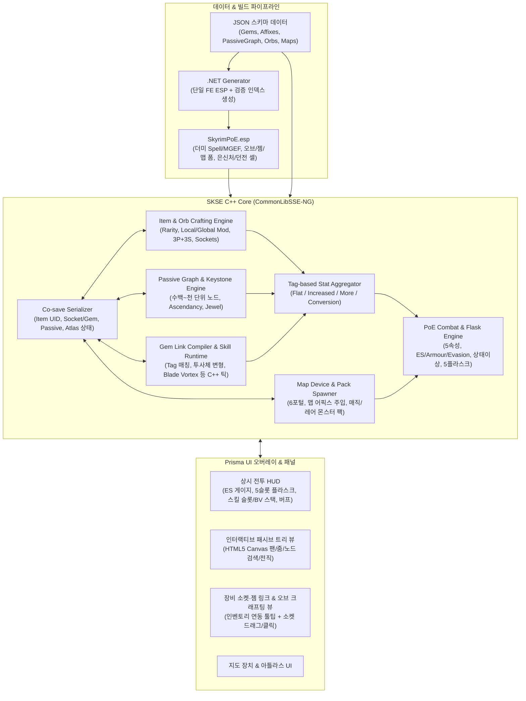
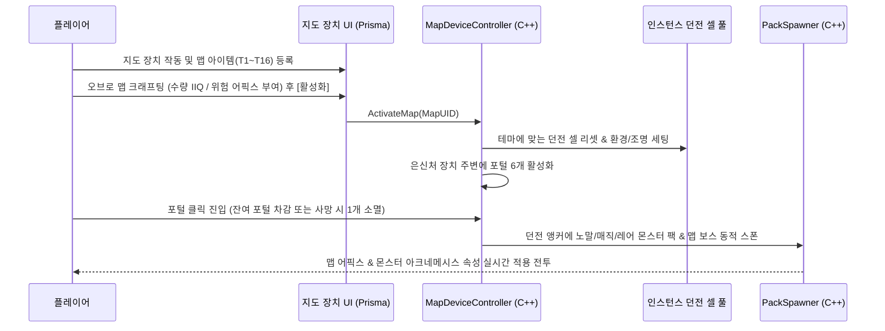

# Skyrim PoE 프로젝트 — 전체 시스템 통합 설계서 (Draft v0.1)

스카이림 SE/AE의 **1인칭·3인칭 액션 전투 감각**은 유지하면서, Path of Exile(PoE 1)의 핵심 빌드·파밍·엔드게임 루프 전체를 네이티브 C++(`CommonLibSSE-NG`)와 `Prisma UI` 기반으로 구현하기 위한 마스터 아키텍처 초안입니다.

> [!IMPORTANT]
> **기존 프로젝트 자산과의 기술적 연속성**
> 현재 개발 환경에 구축된 [Calamity - Reactive Loot & Affixes](file:///Z:/home/USERNAME/Calamity%20-%20Reactive%20Loot%20&%20Affixes/README.md) (`ExtraUniqueID` 인스턴스 추적, 64-bit FNV-1a 코세이브, [`Hooks.h`](file:///Z:/home/USERNAME/Calamity%20-%20Reactive%20Loot%20&%20Affixes/skse/CalamityAffixes/include/CalamityAffixes/Hooks.h)의 `HandleHealthDamage` / `MagicTarget` 훅, [`CombatContext.h`](file:///Z:/home/USERNAME/Calamity%20-%20Reactive%20Loot%20&%20Affixes/skse/CalamityAffixes/include/CalamityAffixes/CombatContext.h) 소환체 소유권 판정, Prisma UI 파이프라인, `.NET` ESP 생성기) 및 [CustomSkillsToolkit](file:///G:/skyrim%20project/%EC%8A%A4%EC%B9%B4%EC%9D%B4%EB%A6%BC%20%EC%BB%A4%EC%8A%A4%ED%85%80%EC%8A%A4%ED%82%AC%ED%8A%B8%EB%A6%AC%20%EA%B0%9C%EC%84%A0/README.md)에서 검증된 한계점(CSF의 트리당 127노드 상한 등)을 설계 출발점으로 삼았습니다.

---

## 1. 전체 시스템 아키텍처 개요

파피루스(Papyrus)는 MCM 바인딩과 최소한의 퀘스트/문 이벤트 브리지로만 제한하고, **모든 아이템 데이터·스킬 링크 컴파일·전투 공식·스킬 틱(블레이드 볼텍스 등)·맵 스포너는 단일 SKSE C++ DLL 내부에서 처리**합니다.

---

## 2. 핵심 서브시스템 상세 설계

### 2.1 전투 공식 & 방어/상태이상/플라스크 엔진 (`CombatEngine`)

스카이림 기본 `ActorValue` 연산은 단순 합연산 위주이고 속성 구분이 빈약하므로, `Actor::HandleHealthDamage` 및 투사체/마법 적중 시점에 **PoE 데미지 파이프라인**이 최종 피해량을 직접 산출합니다.

1. **태그 기반 스탯 집계 (`TagBitmask` 64-bit)**
   - 모든 스킬과 타격은 태그 집합을 가짐: `Attack`, `Spell`, `Melee`, `Projectile`, `AoE`, `Duration`, `Channelling`, `Physical`, `Fire`, `Cold`, `Lightning`, `Chaos`, `Minion`, `Totem`, `Trap` 등.
   - 스탯 풀은 4단계 버킷으로 분리 집계:
     - `Base / Added Flat` (타격 기본 피해 + 플랫 추가 피해, `Damage Effectiveness %` 반영)
     - `Conversion & Gain as Extra` (`Physical → Lightning → Cold → Fire → Chaos` 단방향 그래프를 따라 전환해 무한 루프 원천 차단)
     - `Increased / Reduced` (조건이 일치하는 모든 증가/감소 합연산)
     - `More / Less` (보조 젬·키스톤·스택 보너스 각각 독립 곱연산)

$$
\text{SkillHitDamage}_{e} = \left( \text{Base}_{e} + \text{Added}_{e} \times \eta_{\text{eff}} \right) \times \left( 1 + \sum_{i} \text{Inc}_{i} \right) \times \prod_{j} \left( 1 + \text{More}_{j} \right)
$$

2. **3대 방어 기제 + 5속성 저항**
   - **에너지 실드 (Energy Shield, ES)**: 체력보다 먼저 소모되는 보호막(카오스 피해는 기본 ES 관통, 단 `Chaos Inoculation` 활성화 시 체력 `1` 고정 및 카오스 피해 완전 면역). 마지막 피격 후 기본 `2.0초` 경과 시 초당 `33.3%` 자동 재충전(`ES Recharge`), `Ghost Reaver` / `Zealot's Oath` 키스톤으로 흡수/재생 전환 지원.
   - **방어도 (Armour)**: 큰 물리 단타일수록 감쇄율이 낮아지는 PoE 비선형 공식 적용:
     $$
     \text{DR}_{\text{phys}} = \min\left(0.90,\; \frac{\text{Armour}}{\text{Armour} + 5 \times \text{RawPhysHit}}\right)
     $$
   - **회피 (Evasion) & 정확도 (Accuracy)**: 순수 난수가 아니라 액터별 엔트로피(`0~99`) 누적치를 사용해 연속 억까 피격을 막는 PoE 엔트로피 회피 구현(1인칭/3인칭 근접·원거리 타격 시 회피 판정 성공하면 `Evaded` 처리 및 경직 무효화).
   - **5속성 저항**: `Fire`, `Cold`, `Lightning` (기본 캡 `75%`, 최대 캡 `90%`), `Chaos` (기본 `0%`, 액트/맵 티어 상승 시 저항 패널티 부여 가능). 저항 관통(`Penetration`)과 노출(`Exposure`) 분리 계산.

3. **PoE 상태이상 (`AilmentRuntime`)**
   - **비-중첩 타격 비례형**: `Ignite`(화염 DoT, 가장 강한 1개 적용), `Chill`(피해 비례 감속 `5%~30%`), `Freeze`(최소 지속시간 임계치 통과 시 행동 불능), `Shock`(피해 비례 받는 피해 증가 `5%~50%`).
   - **중첩/특수형**: `Poison`(물리+카오스 기반 무한 중첩 카오스 DoT), `Bleed`(물리 기반 DoT, 대상이 이동 중일 때 추가 피해), `Impale`(물리 타격 시 저장 후 후속 타격마다 반사 피해).

4. **5슬롯 충전식 플라스크 (`FlaskBelt`)**
   - 인벤토리를 열지 않고 단축키(예: `1~5`)로 즉시 마시는 장착형 플라스크 5칸.
   - 생명력 / 마나 / 하이브리드 / 유틸리티(수은=이속, 화강암=방어도, 비취=회피, 다이아몬드=치명타 확률, 루비/사파이어/토파즈=속성 저항+최대 저항 등).
   - 적 처치 시 몬스터 등급(일반 `1`, 매직 `2.5`, 레어 `6`, 유니크/보스 `12` 등)에 따라 충전량 자동 수급 + 플라스크 자체 매직 어픽스(출혈/빙결 해제 등) 지원.

---

### 2.2 스킬 젬 & 보조 젬 링크 + 네이티브 PoE 스킬 (`GemLinkEngine`)

1인칭/3인칭 스카이림 액션에서 PoE 스킬이 이질감 없이, 그러나 PoE다운 폭발적 메커니즘으로 작동하도록 **네이티브 C++ 스킬 행동 컨트롤러(`ISkillBehavior`)** 구조를 채택합니다.

1. **소켓 & 링크 데이터 구조**
   - 장비 부위별 최대 소켓: 양손 무기 / 갑옷 `6소켓`, 투구 / 장갑 / 신발 `4소켓`, 한손 무기 / 방패 `3소켓`.
   - 소켓 색상: `Red (STR)`, `Green (DEX)`, `Blue (INT)`, `White (Any)`.
   - 소켓 간 연결(`LinkMask`: 인접 소켓 사이 `5-bit` 비트마스크)로 연결 그룹(`SocketGroup`) 형성.
   - 각 장착 젬도 고유 인스턴스(`GemUID`, `GemID`, `Level 1~20`, `Quality 0~20%`, `TotalXP`, `IsCorrupted/Vaal`)로 추적하여 전투 시 플레이어와 함께 경험치를 획득하고 레벨업.

2. **런타임 스킬 컴파일 (`CompiledSkillSpec`)**
   - 소켓/장비가 변경될 때 링크 그룹 내 **액티브 젬 1개 ↔ 호환되는 모든 보조 젬**을 태그 매칭하여 `CompiledSkillSpec`으로 사전 컴파일:
     - 수치 변형: 마나 소모 배율(`CostMult`), 시전/공격 속도, 범위(`AoE Radius`), 지속시간(`Duration`), 치명타 확률, 데미지 `More`/`Less` 및 플랫 추가 피해.
     - 메커니즘 변형 플래그: 투사체 개수(`+2 GMP/LMP`), 발사 패턴(`Nova`, `Barrage` 순차 발사), 충돌 후 행동(`Pierce Count` → `Fork` → `Chain Count` → `Return` 우선순위 체인!), 다중 시전(`Spell Echo`, `Multistrike`, `Unleash`), 트리거(`Cast on Crit`, `Cast when Damage Taken`, `Cast while Channelling`).

3. **1인칭/3인칭 조작 바인딩 & 오라 점유**
   - **액티브 바 (6~8슬롯)**: 좌/우손 스펠 장착 슬롯과 연동하거나, 스카이림 무기를 든 채로도 즉시 나가는 **전용 핫키 슬롯(`Q`, `E`, `R`, `F`, `V` 등)** 제공(1인칭/3인칭 캐스팅·공격 모션 OAR 연동 또는 즉시 시전 스킬 분리).
   - **마나 점유 (`Reservation`)**: 오라(`Hatred`, `Wrath`, `Determination`, `Grace`, `Discipline`) 및 전령(`Herald of Ice`, `Herald of Ash`, `Herald of Thunder`)은 별도 토글 슬롯에서 최대 마나(또는 `Blood Magic` / `Arrogance` 시 생명력)의 일정 비율(`50%`, `25%` + `Reservation Efficiency` 반영)을 잠그고 상시 유지.

4. **PoE 시그니처 스킬의 C++ 네이티브 구현 방식 (예시)**
   - **블레이드 볼텍스 (Blade Vortex)**:
     - 파피루스나 바닐라 망토(Cloak) 마법 대신 C++ 프레임 업데이터 내 `OrbitingBladeBehavior`가 직접 구동.
     - 시전 1회당 칼날 `1스택` 생성(최대 `10스택`, `Unleash` 보조 젬 연결 시 인장 수만큼 한 번에 다중 스택 생성!).
     - 각 칼날은 독립 타이머를 가지며, 플레이어 루트 노드 주변에 회전 검기 메쉬(`NiAVObject` / NIF)를 실시간 공전시킴.
     - 스택 수에 비례해 회전 속도·타격 주기(Hit Interval 감소)·범위(`AoE` 스탯 비례)·스택당 증폭 피해(`More Damage per Blade` + 치명타 확률)가 실시간 증가하며, C++ 구체 범위 판정으로 주변 적에게 물리 주문 타격을 가함(여기에 물리→냉기 전환 + `Herald of Ice` 연쇄 폭사 빌드 그대로 구현 가능!).
   - **투사체 스킬군 (Fireball, Ice Spear, Spark, Lightning Arrow, Tornado Shot)**:
     - 스카이림 `Projectile` 훅을 통해 `CompiledSkillSpec` 포인터를 투사체 런타임 맵에 바인딩. 발사 시 부채꼴/노바 각도로 복제 생성하고, 적중 시 `Pierce → Fork(2갈래 분기) → Chain(주변 적 자동 탐색 유도) → Return(시전자 귀환)` 상태머신을 C++에서 직접 수행.
   - **정의의 불길 (Righteous Fire) / 사이클론 (Cyclone) / 시체 폭발 (Detonate Dead)**:
     - RF는 초당 자해 화염 DoT(화염 최대 저항 + 체력 재생으로 버티는 빌드 성립!)와 비타격 주변 연소 영역 생성; 사이클론은 채널링 이동 회전 베기 + `Cast while Channelling` / `CoC` 트리거와 직결.

---

### 2.3 아이템 인스턴스, 3접두+3접미 & 오브 크래프팅 (`Itemization`)

`Calamity 2`에서 검증된 `(owner FormID, ExtraUniqueID)` 방식을 계승하되, PoE 정통 아이템 구조를 수용하도록 데이터 레이아웃을 확장합니다.

| 항목 | 설계 사양 |
| --- | --- |
| **아이템 등급** | `Normal` (0 어픽스) / `Magic` (최대 1접두+1접미) / `Rare` (최대 3접두+3접미) / `Unique` (고유 고정 어픽스 + 빌드 규칙 변형) |
| **아이템 레벨 (`iLvl`)** | 드랍한 몬스터/맵 레벨에 의해 결정되며, 굴러갈 수 있는 어픽스 티어(`T1~T7`)와 최대 소켓 수(예: `iLvl 50+` 6소켓 해금)를 제한 |
| **옵션 계층** | `Implicit`(베이스 고정 1~2줄) + `Explicit`(접두 최대 3 + 접미 최대 3) + `Crafted`(크래프팅 벤치 1줄) + `Corrupted Implicit`(바알 타락 변이) |
| **로컬 vs 글로벌** | 무기의 물리 피해·공속·치명타, 방어구의 방어도·회피·ES 어픽스는 **해당 장비 베이스 수치를 먼저 변형(Local)** 한 뒤 글로벌 풀에 반영 |
| **오브 라인업** | 감정 주문서, 진화, 변화, 확장, 제왕, 연금술, 카오스, 엑잘티드, 소멸, 정제, 신성, 후회, 쥬얼러, 색채, 연결, 대장장이 숫돌/방어구 장인 고철, **바알 오브(타락)** |

> [!TIP]
> **바닐라 및 타 모드 무기·방어구 100% 호환**
> 새로운 무기/방어구 메쉬를 강제하지 않고, 스카이림 바닐라 및 유저가 설치한 의상/무기 모드 아이템을 아키타입(한손검, 단검, 활, 지팡이, 중갑=Armour 베이스, 경갑=Evasion 베이스, 의복/로브=Energy Shield 베이스, 혼합 베이스 등)으로 자동 분류해 그 위에 소켓과 어픽스가 붙도록 설계하면 스카이림 모딩 생태계 장점을 그대로 살릴 수 있습니다.

---

### 2.4 패시브 스킬 트리 & 키스톤 / 전직 (`PassiveGraph`)

`CustomSkillsFramework`는 트리당 127노드 제한과 고정 별자리 연출 제약이 있으므로, **Prisma UI 기반 전용 캔버스 뷰**로 구현합니다.

- **그래프 스키마**: 드라이브에 보유하신 PoB(`POE1 한글 POB`) 데이터 구조와 유사한 무방향 그래프 JSON(`nodes`, `groups/orbits`, `out/in edges`, `classStartNodes`).
- **노드 유형**:
  1. `Attribute / Minor`: 힘(`+10 STR`: 생명력/근접물리), 민첩(`+10 DEX`: 정확도/회피), 지능(`+10 INT`: 마나/ES%) 및 소형 스탯(소켓 장비 및 스킬 젬 장착 요구치와 연동!).
  2. `Notable`: 중형 핵심 스탯 + 특수 유틸리티.
  3. `Keystone`: 빌드 정체성을 바꾸는 규칙 변형 노드 (예: `Chaos Inoculation`, `Blood Magic`, `Resolute Technique`, `Mind Over Matter`, `Elemental Overload`, `Acrobatics`, `Avatar of Fire`, `Point Blank`, `Pain Attunement`).
  4. `Jewel Socket`: 패시브 트리에 드랍/크래프팅한 주얼(일반 주얼 / 심연 주얼 / 고유 주얼)을 실제로 끼워 넣는 슬롯.
  5. `Ascendancy (전직)`: 특수 시련(미궁 Labyrinth 축소판 던전 또는 보스 챌린지) 클리어 시 포인트(최대 `8pt`) 획득, 클래스별 전직 서브트리 개방(예: 어쌔신, 엘리멘탈리스트, 네크로맨서, 저거넛, 데드아이, 슬레이어 등 핵심 전직부터 구축).

---

### 2.5 은신처, 지도 장치(Map Device) & 엔드게임 맵핑 (`AtlasMapping`)

스카이림 오픈월드 퀘스트도 플레이 가능하면서, 본격적인 파밍과 고점 테스트는 **은신처(Hideout)의 지도 장치**에서 돌아가도록 투트랙으로 구성합니다.

- **6포털 규칙**: 맵 활성화 시 은신처 지도 장치 둘레에 실제 작동하는 포털 오브젝트 6개 생성. 플레이어가 맵 내부에서 사망할 때 바닐라 세이브 강제 로드 대신 **사망 인터셉트(Death Intercept)** 로 은신처로 부활시키며 포털을 1개 닫음(6개 모두 소진 시 해당 맵 인스턴스 종료!).
- **몬스터 팩 & 희귀 몬스터 어픽스**: 스카이림 기본 스폰처럼 산발적으로 1~2마리씩 나오는 대신, 앵커당 `6~12마리` 단위의 **몬스터 팩(Normal / Magic Blue Pack / Rare Yellow Leader)** 을 구성하고 레어 몬스터에게 가시적인 오라/접두사(가속, 원소 저항, 여분 투사체, 생명력 재생 등)와 높은 IIQ/IIR 드랍 보상을 부여합니다.
- **전리품 필터 & 바닥 라벨 (`LootFilter`)**: 드랍 아이템 중요도에 따라 이름표 색상·배경 테두리·드랍 사운드(고가치 오브/유니크 드랍 시 PoE 특유의 강조음!)·빛기둥 VFX를 차등 출력합니다.

---

## 3. 세이브 직렬화 (`SKSE Co-save`) 규약 초안

장기 플레이 세이브 오염과 비대화(Save Bloat)를 막기 위해 `Calamity 2`의 64-bit FNV-1a 토큰 철학을 전체 레코드로 확장합니다.

- `POEI` (Item Table): `(OwnerFormID, UID)` → `Rarity`, `iLvl`, `Quality`, `Flags(Identified/Corrupted)`, `SocketCount`, `SocketColors[6]`, `LinkMask`, `SocketedGemUIDs[6]`, `AffixEntries`
- `POEG` (Gem Table): `GemUID` → `GemHash64`, `Level`, `XP`, `Quality`, `Flags`
- `POEP` (Passive & Ascendancy): 할당된 `NodeID` 배열, 선택된 `AscendancyID`, 주얼 소켓별 장착 `ItemUID`
- `POEF` (Flask & Skill Bar): 플라스크 슬롯 `5칸` 장착 `ItemUID` 및 현재 충전량, 액티브 스킬 바 슬롯 바인딩, 활성 오라 목록
- `POEA` (Atlas & Map State): 해금된 아틀라스 보너스 비트셋, 현재 열려 있는 맵 인스턴스 스냅샷 및 잔여 포털 수

---

## 4. 권장 구현 로드맵 (마일스톤 단계)

설계서를 완전히 확정한 뒤 착수할 때 의존성이 꼬이지 않는 정석 빌드업 순서입니다:

1. **Phase 1 — 코어 프레임워크 & 전투 수학/방어 엔진**: `CommonLibSSE-NG` 스켈레톤, Co-save 직렬화기, `TagBitmask` 스탯 집계기, 5속성 저항 + ES/방어도/회피 + 사망 인터셉트 + 기본 HUD(ES/플라스크 5칸).
2. **Phase 2 — 아이템 어픽스(3P+3S) · 소켓 · 오브 크래프팅**: 장비 인스턴스 추적, 로컬/글로벌 스탯 분리, 오브 크래프팅 전체, Prisma UI 인벤토리 툴팁 & 소켓/크래프팅 뷰.
3. **Phase 3 — 스킬 젬 & 보조 젬 컴파일러 + 시그니처 스킬 1차 팩**: 링크 태그 매칭기, 마나 점유(오라), **블레이드 볼텍스**·투사체(GMP/Chain/Fork)·이동기를 포함한 대표 액티브 젬 10~15종 + 핵심 보조 젬 15~20종.
4. **Phase 4 — 패시브 스킬 트리 & 키스톤 / 전직**: Prisma UI 캔버스 패시브 트리, STR/DEX/INT 요구치 연동, 핵심 키스톤 10종+, 주얼 소켓, 전직 시스템.
5. **Phase 5 — 은신처 & 지도 장치(6포털) 엔드게임 맵핑**: 은신처 셀, 맵 아이템 크래프팅, 인스턴스 던전 풀 + 몬스터 팩 스포너, 전리품 필터 & 드랍 사운드/빛기둥.
