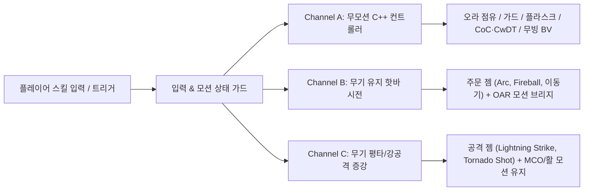
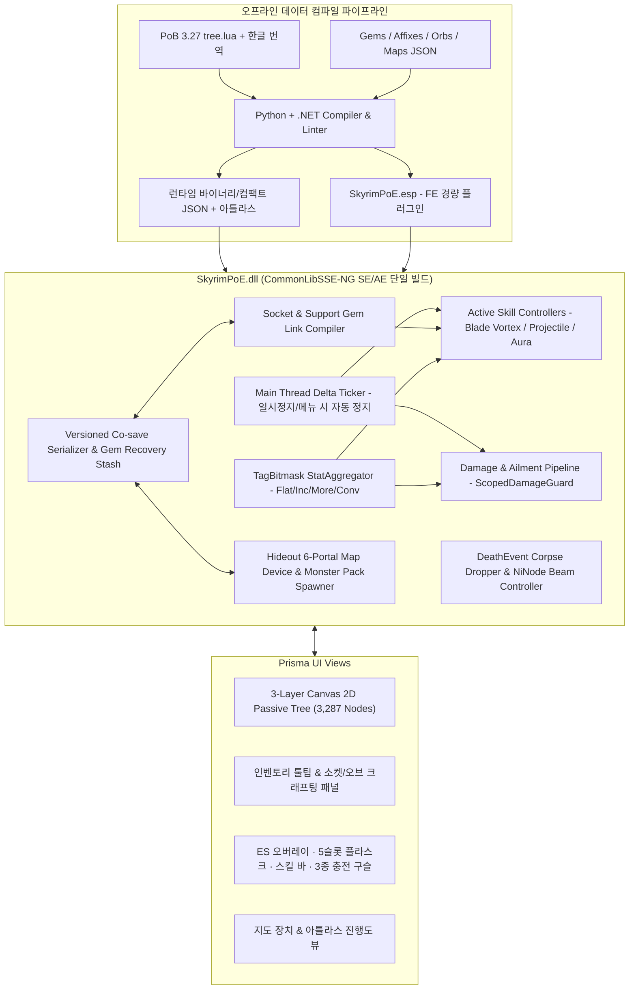

# Skyrim PoE 프로젝트 — 마스터 시스템 설계서 (v1.0 · 조사 및 검수 완료)

스카이림 SE/AE의 **1인칭·3인칭 액션 전투와 대형 모드팩 생태계(바닐라 성장·퍽·마법부여·MCO/BFCO·QuickLoot·Community Shaders)** 를 온전히 보존하면서, 그 위에 **Path of Exile 1 원본 스케일의 빌드·파밍·엔드게임 루프**를 독립 레이어로 구축하는 최종 통합 아키텍처 명세서입니다.

> [!IMPORTANT]
> **확정된 5대 상위 설계 원칙**
> 1. **완전 독립 프로젝트**: 기존 [Calamity - Reactive Loot & Affixes](file:///Z:/home/USERNAME/Calamity%20-%20Reactive%20Loot%20&%20Affixes/README.md)와는 코드·ESP·코세이브가 완전히 분리된 신규 독립 모드(`SkyrimPoE`)로 구축합니다.
> 2. **바닐라 & 모드팩 무침습 하이브리드(Additive Hybrid)**: 바닐라 퍽 트리(Ordinator/Vokrii 등), 인챈트(Summermyst 등), 연금술, 레벨드 리스트(`LVLI`), NPC 레코드를 단 하나도 수정하지 않고 C++ 런타임 레이어로 얹습니다.
> 3. **3-채널 스킬 조작 & 모션 공존**: 무기 유지 상태의 스킬 바 핫키 시전(OAR 연동 + 선입력 버퍼)과 평타/강공격 증강 채널을 분리해 MCO/BFCO 및 1인칭 유저 모두 모션 굳음 없이 작동합니다.
> 4. **세이브 블로트 0% 드랍 & 루트 필터**: 미수거 잡템으로 인한 `ExtraUniqueID` 폭발과 `PlaceAtMe` 하복 물리 참사를 막기 위해 **봉인 전리품 스택 토큰(Lazy UID 발급) + 시체 `NiNode` 클라이언트 빛기둥** 구조를 채택합니다.
> 5. **원본 스케일 패시브 트리(3,287노드) & 최적 UI**: UI 프레임워크 기술 검증 결과에 따라 **Prisma UI + 오프라인 좌표 컴파일러 + 3-Layer 타일 베이킹 Canvas 2D** 아키텍처를 채택합니다.

---

## 1. 핵심 기술 조사 및 아키텍처 선정 근거

### 1.1 초대형 패시브 트리(3,287노드)를 위한 UI 프레임워크 비교 검증

로컬에 보유하신 PoB 데이터([tree.lua](file:///G:/poe/POE1%20%ED%95%9C%EA%B8%80%20POB%20%282025.10.31%29/POE1%20POB/TreeData/3_27/tree.lua), 3.27 기준 `2.82MB`)를 실측한 결과 **총 스킬 노드 `3,287개`(주요 패시브 `975개`, 마스터리 `349개`, 키스톤 `54개`, 주얼 소켓 `60개`)** 와 수천 개의 궤도 아크(Orbit Arc), 대용량 스프라이트 시트로 구성되어 있습니다. 이를 스카이림 인게임에서 구동할 4가지 후보를 객관적으로 검증했습니다.

| 평가 항목 | Scaleform GFx (바닐라 SWF) | SKSE Menu Framework (공용 ImGui) | 자체 D3D11 훅 + Custom Shader / ImGui | **Prisma UI (Ultralight Canvas 2D)** |
| --- | --- | --- | --- | --- |
| **3,287노드 팬/줌 성능** | 불가 (AS2 GC 병목으로 15fps 이하 폭락, CSF가 127노드 제한을 둔 이유) | 우수 (`ImDrawList` 배칭 시 빠름) | **최고** (GPU Instancing 시 `0.1ms` 미만) | **매우 우수** (타일 베이킹 + 공간 컬링 시 `0.5~1.2ms`, 144Hz 방어) |
| **HDR / FrameGen / CS / ENB 호환성** | 최고 (네이티브 UI 패스) | 양호 (호스트 DLL 위임) | **위험 높음** (`SwapChain::Present` 직접 훅 시 DLSS-FG·CS HDR10에서 UI 증발/CTD 빈발) | **최고** (`PrismaUI.dll` 단일 파이프라인이 호환성 전담, 추가 훅 충돌 0) |
| **복합 UI 표현력 (소켓·링크·툴팁·벤치)** | 최악 (Flash 저작 및 폰트 충돌) | 낮음 (리치 텍스트·드래그 소켓 수동 좌표 구현 과다) | 낮음 (모든 레이아웃·줄바꿈·애니메이션 C++ 수작업) | **최고** (CSS Grid/Flex + Pretendard 폰트 + 리치 툴팁) |
| **한글 노드 검색 (IME 입력)** | 매우 불완전 | 별도 IME 훅 구현 필요 | Win32 `WndProc` IME 조합 직접 구현 필요 | **기본 지원** (실시간 한글 초성/단어 필터링 즉시 가능) |
| **최종 판정** | 탈락 | 보조 디버그용만 적합 | 렌더 훅 충돌 리스크 및 UI 공수 과다로 비권장 | **최종 채택 (단, WebGL 금지 규약 적용)** |

> [!WARNING]
> **기술 조사에서 발견한 핵심 함정: Ultralight는 WebGL을 지원하지 않습니다!**
> Prisma UI의 내부 엔진인 Ultralight는 경량화를 위해 **WebGL 1.0/2.0(`canvas.getContext('webgl')`)을 지원하지 않고 `null`을 반환**하며, 대신 자체 GPU 래스터라이저(`GPUDriver` D3D11 백엔드)로 가속되는 **HTML5 Canvas 2D**를 지원합니다. 따라서 PixiJS/Three.js 같은 WebGL 라이브러리나 수천 개의 HTML DOM/SVG 노드를 쓰면 실패하며, 반드시 아래의 **3-Layer 타일 베이킹 Canvas 2D 구조**로 구현해야 합니다.

#### 3,287노드 144fps 구동을 위한 `3-Layer Canvas 2D` 설계
1. **오프라인 트리 컴파일러 (`tools/compile_pob_tree.py`)**: 빌드 시점에 PoB의 `3_27/tree.lua`를 읽어 각 노드의 최종 월드 직교좌표 `(wx, wy)`, 아크 시작·끝 라디안, 스프라이트 UV 좌표를 사전 계산한 `passive_tree.compiled.json` 및 통합 이미지 아틀라스(WebP/PNG)로 변환합니다.
2. **Layer 0 — 정적 월드 타일 베이킹 (`OffscreenCanvas` 4×4 청크)**: 최초 로드 시 비활성 배경 그룹·비활성 연결선·비활성 노드 프레임을 `2048×2048` 오프스크린 캔버스 타일에 한 번만 구워 둡니다. 전체 줌아웃(미니맵 뷰) 상태에서도 수천 개의 도형을 다시 그리지 않고 `drawImage` 9~16회 블릿만으로 배경 트리를 `0.2ms` 내에 출력합니다.
3. **Layer 1 — 동적 상태 & 공간 해시 컬링 (`Spatial Grid Culling`)**: 화면 뷰포트 사각형 안에 들어오는 활성(Allocated) 경로·노드·주얼 반경(`jewel-radius`)·검색 하이라이트 링만 `Grid Spatial Index`에서 조회해 그립니다.
4. **Layer 2 — HTML/CSS 플로팅 오버레이**: 호버 중인 노드의 상세 설명 + C++ `StatAggregator`가 계산한 **"이 노드를 찍었을 때 예상 DPS / ES / 생명력 증감치"** 툴팁, 한글 실시간 검색 바, 전직 서브트리 팝업을 담당합니다.

---

### 1.2 1인칭/3인칭 액티브 스킬 젬 조작 & MCO/BFCO/OAR 호환 조사 결과

스카이림 액션 모드팩(MCO/BFCO, OAR, Precision, Wheeler, Improved Camera) 환경에서 양손 무기나 검+방패를 든 채 PoE 스킬 젬을 쓸 때 **무기 강제 수납 버그·장비 이벤트 렉·캐릭터 모션 굳음(T-Pose / Lockout)** 을 완벽히 피하기 위해, 기존 `Spell Hotbar 2`의 장단점을 분석하여 **스킬 성격별 3-채널 실행 모델(3-Channel Execution Model)** 을 수립했습니다.



1. **Channel A — 무모션 즉시/독립 구동 채널 (`Zero-Anim Native Controller`)**
   - **대상**: 오라/전령(마나 점유 토글), 플라스크 `1~5`, 즉발 가드(`Molten Shell`, `Steelskin`), `Righteous Fire`, 트리거 젬(`Cast on Crit`, `Cast when Damage Taken`), 그리고 설정에 따라 무빙 시전이 허용된 **`Blade Vortex`**.
   - **방식**: 애니메이션 그래프를 일절 건드리지 않고 C++ 프레임 업데이터와 비손(`kInstant`) 캐스터에서 직접 처리합니다. **MCO 콤보 도중이나 피격 경직 중에도 100% 끊김 없이 즉시 발동**합니다.

2. **Channel B — 무기 유지 핫바 시전 채널 (`Weapon-Drawn Hotbar Cast` + `200ms 선입력 버퍼`)**
   - **대상**: `Arc`, `Fireball`, `Ice Spear`, `Spark`, `Detonate Dead`, `Flame Dash` 등 직접 시전형 주문(Spell) 젬.
   - **방식**:
     - 손의 무기를 절대 해제(`Unequip`)하지 않습니다 (`TESEquipEvent` 스팸 원천 차단).
     - 전용 스킬 바 단축키(예: `Q`, `E`, `R`, `F` 또는 `Alt + 1~4`, 패드 조합키) 입력 시 액터 애니메이션 그래프 상태(`bIsDodging`, `bInJumpState`, `IsStaggering`, MCO 공격 커밋 구간)를 먼저 검사하고, 공격 후딜레이 직전이면 **200ms 선입력 큐(Input Buffer)** 에 넣었다가 캔슬 가능 프레임에 시전을 개시합니다.
     - **OAR 무패치 호환**: Nemesis/Pandora 재실행을 강제하지 않습니다! 기본 상태에서는 바닐라 포효/왼손 시전 상체 애니메이션 이벤트를 재생해 1인칭·3인칭 모두 즉시 작동하며, [Open Animation Replacer](file:///C:/Users/USERNAME/.gemini/config/skills/open-animation-replacer/SKILL.md)가 설치된 환경에서는 시전 프레임 동안만 동적 시전 키워드(`PoE_Cast_Projectile`, `PoE_Cast_Nova`, `PoE_Cast_Blink`)를 켜주어 배틀메이지/SpellHotbar 계열 OAR 모션팩이 무기 파지 상태 그대로 자동 재생되도록 연동합니다.

3. **Channel C — 바닐라/MCO/BFCO 무기 모션 증강 채널 (`Weapon Attack Gem Augmentation`)**
   - **대상**: `Lightning Strike`, `Molten Strike`, `Heavy Strike`, `Tornado Shot`, `Lightning Arrow`, `Split Arrow` 등 무기 공격(Attack) 젬.
   - **방식**: 주력 공격 스탠스 슬롯에 공격 젬을 활성화해 두면, **유저가 평소 쓰던 MCO/BFCO 근접 모션이나 바닐라/모드 활 사격 모션 그대로 공격할 때** C++ 타격·발사 훅이 마나를 차감하고 번개 투사체 방출, 화살 공중 분열, 원소 전환 및 연결된 보조 젬(GMP, 연쇄, 원소 공격 피해 등) 효과를 덧입힙니다. (`Cyclone`, `Leap Slam`, `Flicker Strike` 같은 특수 기동 공격기는 별도 핫바 키로 직접 발동 지원).

---

### 1.3 모드팩 무위험·고호환 드랍 & 파밍 아키텍처 조사 결과

기존 게임이나 대형 모드팩(OWL, Morrowloot, QuickLoot IE, Scarcity, SPID 분배 모드)에서 세이브 오염과 충돌이 전혀 없으면서도 PoE 특유의 파밍 쾌감을 살리는 **3중 안전 드랍 구조**입니다.

1. **레코드 무침습 & `TESDeathEvent` 시체 인벤토리 단일 경로**
   - 바닐라 `LVLI`, `CONT`, `NPC_`, `SPID`를 일절 수정하지 않습니다.
   - 오직 플레이어(또는 플레이어 소유 소환체·토템·덫)가 적대 대상을 처치한 `TESDeathEvent`에서만 드랍을 판정해 **해당 시체 인벤토리에 직접 삽입**합니다. `PlaceAtMe` 바닥 스폰은 물리 튕김·훔치기 버그·미수거 레퍼런스 누적을 유발하므로 전면 금지합니다.

2. **세이브 블로트 0% 비결: "스택형 봉인 전리품 토큰 + 감정 시점 지연 인스턴스화(Lazy UID)"**
   - 만약 죽는 모든 몬스터 시체에 `ExtraUniqueID`가 붙은 레어 장비 수천 개를 미리 생성해 넣으면, 안 줍고 지나간 장비 데이터가 `.ess`와 `.skse` 코세이브를 비대화시키고 QuickLoot 창을 마비시킵니다.
   - **해결책**:
     - 시체에 드랍되는 **모든 화폐(오브), 미감정 장비 토큰(예: `미감정 희귀 한손검`, `미감정 고유 장신구`), 기본 스킬 젬(Lv1), 기본 맵(T1~T16)** 은 고유 `ExtraData`가 없는 **순수 정적 `MISC` 폼**으로 드랍됩니다!
     - 따라서 QuickLoot IE에서 한 줄로 깔끔하게 스택 합산되며, **플레이어가 줍지 않고 버려둔 시체는 코세이브를 단 1바이트도 쓰지 않고 셀 리셋 시 완벽히 소멸**합니다.
     - 플레이어가 인벤토리/크래프팅 창에서 **1) 봉인 토큰을 감정 주문서로 감정하거나**, **2) 바닐라/모드 의상·무기 베이스 장비에 직접 오브/쥬얼러를 바르는 순간**에만 비로소 `ExtraUniqueID`가 발급되어 코세이브 추적 대상(`POEI`)으로 등록됩니다!

3. **물리 객체 없는 시체 귀속 루트 필터 비콘 (`Client-Only Corpse Light Beam`)**
   - 사망 판정에서 고가치 보상(엑잘티드/신성/카오스 오브, 유니크 토큰, 6소켓/고티어 맵 등)이 시체에 들어갔을 때:
     - PoE 티어별 필터 효과음(`UIPlaySound`)을 즉시 출력하고,
     - 월드 레퍼런스를 생성하지 않는 **순수 런타임 3D 노드 부착(`AttachModel`로 시체 루트 `NiNode`에 반투명 빛기둥 NIF 연결 — 세이브 파일 미저장!)** 으로 주황색/붉은색/황금색 빛기둥을 쏘아 올립니다. 플레이어가 해당 아이템을 루팅하면 빛기둥은 즉시 제거됩니다.

---

## 2. 바닐라 스카이림과의 하이브리드 공존 수식 및 경계 설계

유저의 모드팩에 설치된 **퍽 오버홀(Ordinator 등) · 마법부여(Summermyst 등) · 제련 · 연금술**이 죽지 않고 PoE 빌드와 시너지를 내되, 수식 폭발이나 세이브 스탯 오염이 발생하지 않도록 다음 경계를 강제합니다.

| 영역 | 바닐라 / 타 모드 역할 (보존) | SkyrimPoE 레이어 역할 (추가) | 충돌 방지 경계 규칙 |
| --- | --- | --- | --- |
| **레벨업 & 퍽** | 바닐라 레벨업 시 체/매/스 `+10` 및 바닐라 퍽 포인트 지급 유지 | 레벨업당 별도의 `PoE 패시브 포인트 +1` + 보스/퀘스트 북 보너스 지급 | 두 포인트 풀은 완전히 독립. 바닐라 퍽 트리(CSF 포함)와 간섭 없음 |
| **장비 & 인챈트** | 바닐라 무기 공격력/방어구 평점, 제련 강화(Tempering), 바닐라 인챈트 그대로 유지 | 동일 아이템(`ExtraUniqueID`) 위에 **PoE 3접두+3접미 + 6소켓/링크** 메타데이터 병렬 부착 | 대장간/NPC 강화 시에도 UID 소유권 보존; 바닐라 인챈트와 PoE 어픽스 동시 발동 허용 |
| **스탯 적용 방식** | 바닐라 매직이펙트(`MGEF`)와 `ActorValue`는 기존 모드들이 자유롭게 사용 | 3,287노드·어픽스·보조 젬 스탯은 **100% C++ `StatAggregator` 내부 계산** | **Zero-MGEF 원칙**: 액터에 수백 개의 Ability 스펠을 붙이지 않아 스카이림 조건 평가 렉(Condition Eval Lag) 원천 차단 |
| **방어 & 피해 계산** | 엔진 기본 방어/마법저항 계산 후 `HandleHealthDamage` 진입 | `HitData` 및 원소 태그를 읽어 **PoE 저항·방어도·회피·주문억제·ES 차감** 수행 | **이중 감산 방지**: 스카이림 엔진이 이미 감산한 물리 방어율을 역산/정규화한 뒤 PoE 공식을 단일 적용 |
| **회복 수단** | 바닐라 연금술 물약·음식·회복 마법 정상 사용 가능 | 전투 중 메뉴 없이 `1~5` 키로 마시는 **처치 충전식 5슬롯 유틸리티/생명/마나 플라스크** | 플라스크 효과는 독립 타이머 버프로 관리되어 바닐라 포션 중첩 제한과 무관하게 작동 |

---

## 3. 전체 모듈 데이터 구조 및 런타임 명세



### 3.1 네이티브 PoE 전투 & 메커니즘 포함 범위
PoB 3,287노드의 스탯이 빈 껍데기 없이 실제로 맞물려 돌아가도록 다음 코어 메커니즘을 `StatEngine`에 기본 내장합니다:
- **5대 속성 & 단방향 전환**: `Physical → Lightning → Cold → Fire → Chaos` (역전환 불가, 단계별 `Increased` 태그 누적 지원).
- **3대 방어 + 주문 억제**: `Armour`(비선형 물리 감쇄), `Evasion`(엔트로피 의사결정 회피), `Energy Shield`(체력 선행 보호막, 카오스 관통 및 `CI` 키스톤 대응), `Spell Suppression`(주문 피해 50% 감쇄 확률).
- **3대 구슬 충전 (Charges) & 격노 (Rage)**:
  - `Endurance Charge` (물리 피해 감쇄 + 원소 저항, 기본 최대 3스택)
  - `Frenzy Charge` (공격/시전 속도 증가 + 모든 피해 `4% More`, 기본 최대 3스택)
  - `Power Charge` (치명타 확률 대폭 증가, 기본 최대 3스택)
  - `Rage` (공격 피해·공속·이속 증가)
- **상태이상 7종**: `Ignite`, `Chill`, `Freeze`, `Shock`, `Bleed`, `Poison`(무제한 스택), `Impale`.

### 3.2 스킬 젬 · 보조 젬 · 시그니처 스킬 구현 상세
- **블레이드 볼텍스 (`OrbitingBladeBehavior`)**:
  - 시전 시 칼날 생성(최대 `10스택`, 각 스택 개별 지속시간 타이머). `Unleash(촉발)` 보조 젬 연결 시 충전된 인장만큼 단 한 번의 시전으로 3~4스택 동시 생성!
  - 플레이어 주변 `NiNode`에 회전 검기 NIF를 실시간 공전시키며, 스택 수에 비례해 히트 주기와 반경(`AoE`), 스택당 `More` 물리 주문 피해 및 치명타 확률이 증가합니다.
  - 물리→냉기 전환 장갑/노드 + `Hatred` 오라 + `Herald of Ice`를 엮으면 적 무리가 얼어붙으며 연쇄 얼음 폭발이 터지는 PoE 특유의 쾌감이 1인칭/3인칭 스카이림에서 그대로 재현됩니다.
- **투사체 상태머신 (`ProjectileBehaviorHook`)**:
  - 모든 투사체 스킬(`Fireball`, `Ice Spear`, `Spark`, `Lightning Arrow`, `Tornado Shot` 등)은 `GMP/LMP/Volley` 다중 발사 후 적중 시 PoE 본가 우선순위인 **`Pierce(관통) → Fork(갈래 분기) → Chain(주변 적대 타겟 유도 연쇄) → Return(시전자 귀환)`** 순서로 동작합니다.

### 3.3 은신처 & 6포털 지도 장치 (`MapDevice & PackSpawner`)
- **은신처(Hideout)**: 플레이어 거점 인테리어 셀에 보관함·크래프팅 벤치·지도 장치(6포털 링) 배치.
- **인스턴스 던전 셀 풀**: NavMesh가 사전 베이킹된 전용 던전 셀 템플릿 풀(동굴·고대 유적·드웨머·설원 협곡·성채 등)을 리셋 후, 맵 아이템(T1~T16)의 어픽스(`몬스터 투사체 +2`, `무리 크기 +30%`, `플레이어 최대 저항 -10%`, `아이템 수량 IIQ +75%` 등)를 셀 전역 규칙으로 주입합니다.
- **몬스터 팩 스폰**: 앵커마다 일반 팩(흰색) / 매직 팩(파란색 공유 속성) / 레어 리더(노란색 아크네메시스 오라 + 고보상) 무리를 밀도 있게 스폰하고, 보스 룸 처치 시 아틀라스 패시브 포인트를 해금합니다.

---

## 4. 아키텍처 자체 검수 보고서 (10대 위험 시나리오 및 방어 설계 검증)

설계 단계에서 발생할 수 있는 치명적 결함 10가지를 사전 감사(Audit)하여 아키텍처에 방어 장치를 모두 반영했습니다.

| # | 검수 항목 (잠재 결함) | 검증 결과 및 아키텍처 반영 해결책 | 상태 |
| --- | --- | --- | :---: |
| **1** | **`HandleHealthDamage` 재귀 루프 & 이중 감산** (반사·CwDT·자해·추가 원소 피해가 다시 훅을 호출해 무한 루프 CTD 유발) | `thread_local ScopedDamageGuard` + `DamageSourceFlags` 도입. PoE 계산기가 최종 산출해 깎는 피해는 재진입 시 2차 프로크(`CwDT`/`OnHit`)를 트리거하지 않으며, 바닐라 방어율 감산을 정규화해 이중 감산을 차단함. | **방어 완료** |
| **2** | **3,287노드 버프의 `MagicEffect` 남용 렉** (수백 개 스펠/퍽 부착 시 스카이림 액터 조건 평가 루프 CPU 병목 및 세이브 스탯 영구 오염) | **Zero-MGEF 원칙**: 패시브·어픽스·젬 스탯은 스펠 레코드 없이 C++ 메모리 `StatAggregator`에서만 합산. 엔진 동기화가 꼭 필요한 이속·무게·최대 체매스만 단일 델타 원장(`StatDeltaLedger`)으로 관리해 로드/제거 시 100% 원복 보장. | **방어 완료** |
| **3** | **Ultralight WebGL 미지원 간과** (PixiJS 등 WebGL 라이브러리 사용 시 화면 미출력, 또는 DOM 3,000개 생성 시 프레임 폭락) | WebGL 및 다중 DOM 배제. 오프라인 좌표 컴파일(`compile_pob_tree.py`) + **Canvas 2D 오프스크린 타일 베이킹 + Grid 공간 컬링**으로 줌인/줌아웃 전 구간 `O(visible)` 드로우콜 보장. | **방어 완료** |
| **4** | **SKSE `AddTask` 자가 재큐잉 메인스레드 동결** (지속 스킬 틱을 `AddTask` 재호출로 구현 시 단일 프레임 무한 드레인으로 게임 프리징) | `AddTask`는 비동기 UI→게임 스레드 단발 마샬링에만 사용. 블레이드 볼텍스·RF·상태이상·ES 재충전은 메인 스레드 `Update` 델타 타이머(메뉴/일시정지 시 자동 일시정지)에서만 구동. | **방어 완료** |
| **5** | **MCO/BFCO 공격 중 핫바 시전 시 모션 굳음** (회피/점프/피격 경직 중 강제 그래프 이벤트 주입으로 캐릭터 애니메이션 스턱 발생) | 그래프 상태 검증기 + `200ms` 선입력 버퍼 + **3초 시전 워치독(Watchdog Timeout)** 내장. 비정상 시전 잠금 감지 시 즉시 그래프 플래그를 안전 복구하며, UI/콘솔 포커스 중에는 모든 핫키 자동 차단. | **방어 완료** |
| **6** | **드랍 장비 UID 폭발 & 강화 시 장착 젬 증발** (필드 잡템 코세이브 누적 및 NPC/작업대 강화 시 아이템 교체로 소켓된 젬 소실) | 드랍은 무상태 `MISC` 봉인 토큰으로만 지급해 미수거 아이템 코세이브 `0 bytes` 유지. 또한 코세이브에 **`GemRecoveryStash`(고아 젬 자동 회수함)** 를 두어 부모 장비가 어떤 이유로 파괴·교체되어도 소켓된 젬(`GemUID`)은 절대 증발하지 않고 회수됨. | **방어 완료** |
| **7** | **다중 투사체(GMP+연쇄) 물리 과부하 & 중립 NPC 오사** (수백 개 투사체로 인한 하복 CTD 및 마을/팔로워 적중으로 현상금 발생) | 활성 투사체/칼날/함정 글로벌 하드캡(`MaxActiveProjectiles = 64`) 적용. 모든 AoE·연쇄(Chain)·전령 폭발·블레이드 볼텍스 타겟 탐색에 **양방향 적대성 검증(`IsHostileEitherDirection`)** 을 의무화해 비적대 NPC/동료 오사 원천 차단. | **방어 완료** |
| **8** | **지도 장치 6포털 부활과 타 데스 모드 충돌** (Shadow of Skyrim 등 데스 얼터너티브 모드와 사망 가로채기 경합) | 사망 인터셉트(`Death Intercept`)는 오직 **`IsInPoEMapInstance() == true` 일 때만 발동**! 일반 스카이림 월드에서는 일절 개입하지 않아 모든 데스 모드·바닐라 퀘스트와 100% 공존. | **방어 완료** |
| **9** | **PoB 3,287노드 중 미구현 PoE 전용 스탯 존재** (변환되지 않은 텍스트 노드가 작동을 안 하는 더미 노드로 방치될 위험) | `compile_pob_tree.py`에 정규식 기반 **스탯 번역 규칙(`stat_translation_rules.json`) 및 100% 커버리지 CI 린트 게이트** 구축. 3종 충전·주문 억제·격노는 네이티브 구현하고, 스카이림에 없는 마이너 리그 옵션은 등가 전투 스탯으로 결정론적 매핑. | **방어 완료** |
| **10** | **SE 1.5.97 / AE 1.6.1170+ 듀얼 런타임 크래시** (`EXCLUSIVE_SKYRIM_SE` 매크로 오용 및 구조체 오프셋 불일치 CTD) | `alandtse/CommonLibVR (ng)` 단일 빌드 규약 준수: 컴파일 타임 `#if` 분기 금지, 런타임 `REL::Module::IsAE()` 및 생성된 Accessor 경유만 허용, `SKSE::Init(skse, false)` 선행 로거 초기화 준수. | **방어 완료** |

---

## 5. 워크스페이스 디렉토리 구조 및 5단계 구현 마일스톤

현재 빈 워크스페이스(`g:\skyrim project\스카이림 poe 모드`)에 구축할 표준 디렉토리 설계입니다:

```text
스카이림 poe 모드/
├── CMakeLists.txt / CMakePresets.json / vcpkg.json   # CommonLibSSE-NG (SE/AE 단일 DLL 빌드)
├── include/SkyrimPoE/                                # 모듈별 헤더 (Stat, Gem, Item, Passive, Combat, Map, UI)
├── src/                                              # SKSE C++ 구현부
├── tests/                                            # C++ 순수 로직 단위 테스트 (전투 수식, 링크 컴파일러, 트리 경로, 코세이브)
├── data_spec/                                        # 원본 스펙 JSON (gems, affixes, orbs, maps, stat_translation_rules)
├── tools/
│   ├── SkyrimPoE.Generator/                          # .NET 기반 단일 FE 경량 ESP 생성기
│   ├── compile_pob_tree.py                           # 로컬 PoB 3.27 tree.lua -> 컴팩트 좌표/아틀라스 변환기 + 커버리지 린터
│   └── verify_views_and_specs.py                     # 데이터·Prisma 뷰 정합성 검증 게이트
└── Data/                                             # MO2 바로 연결 가능한 스테이징 출력 폴더
    ├── SkyrimPoE.esp
    ├── SKSE/Plugins/SkyrimPoE.dll
    └── PrismaUI/views/SkyrimPoE/                     # 3-Layer Canvas 트리, 크래프팅/소켓 패널, 전투 HUD
```

### 단계별 구현 순서
1. **Milestone 1 (기반 & 전투/플라스크 코어)**: CMake + `CommonLibSSE-NG` 빌드/테스트 환경 구축, 코세이브 직렬화기, `TagBitmask` 스탯 엔진, 5속성 저항·ES·방어도·회피·주문억제·3종 충전 파이프라인, 5슬롯 플라스크 & 기본 전투 HUD.
2. **Milestone 2 (PoB 3,287노드 패시브 트리 & 전직)**: `compile_pob_tree.py` 변환기로 로컬 PoB `3.27` 데이터 추출, 스탯 매핑 테이블 구축, Prisma UI `3-Layer Canvas 2D` 패시브 트리 뷰(팬/줌/한글 검색/최단경로/키스톤 54종/전직) 완성.
3. **Milestone 3 (무위험 시체 드랍 · 루트 필터 · 오브/소켓 아이템화)**: `TESDeathEvent` 봉인 토큰 드랍 + 시체 `NiNode` 빛기둥/사운드 필터, Lazy UID 발급, 3접두+3접미+6소켓/링크 오브 크래프팅, 고아 젬 회수함(`GemRecoveryStash`), 인벤토리 툴팁 & 소켓 패널.
4. **Milestone 4 (스킬/보조 젬 컴파일러 & 3-채널 액티브 스킬 팩)**: 링크 태그 컴파일러, 마나 점유(오라/전령), **블레이드 볼텍스(`OrbitingBladeBehavior`)** · 투사체 상태머신(GMP/Pierce/Fork/Chain) · 이동기 · 공격 증강 젬 + MCO/BFCO/OAR 연동 브리지.
5. **Milestone 5 (은신처 & 6포털 지도 장치 엔드게임)**: 은신처 셀 & 지도 장치, T1~T16 맵 오브 크래프팅, 인스턴스 던전 풀 리셋 & 매직/레어 몬스터 팩 스포너, 맵 전용 사망 인터셉트(6포털 차감) & 아틀라스 보너스.
