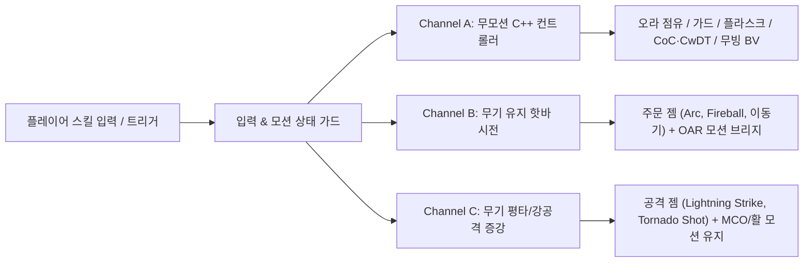
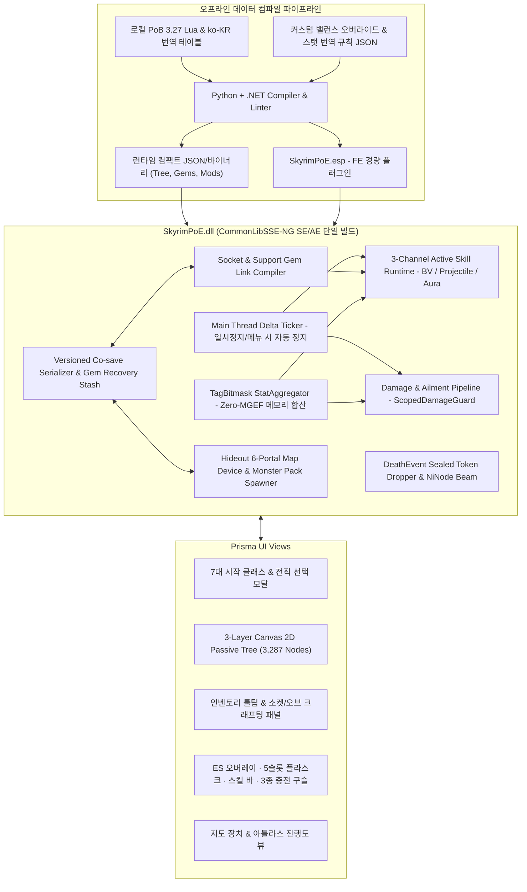

# Skyrim PoE 프로젝트 — 마스터 시스템 설계서 (v1.1 · 클래스 선택 반영 및 12대 검수 완료)

스카이림 SE/AE의 **1인칭·3인칭 액션 전투와 대형 모드팩 생태계(바닐라 성장·퍽·마법부여·MCO/BFCO·QuickLoot·Community Shaders)** 를 온전히 보존하면서, 그 위에 **Path of Exile 1 원본 스케일의 빌드·파밍·엔드게임 루프**를 독립 레이어로 구축하는 통합 아키텍처 명세서입니다.

> [!IMPORTANT]
> **확정된 6대 상위 설계 원칙 (v1.1 기준)**
> 1. **완전 독립 프로젝트**: 기존 [Calamity - Reactive Loot & Affixes](file:///Z:/home/USERNAME/Calamity%20-%20Reactive%20Loot%20&%20Affixes/README.md)와는 코드·ESP·코세이브가 완전히 분리된 신규 독립 모드(`SkyrimPoE`)로 구축합니다.
> 2. **바닐라 & 모드팩 무침습 하이브리드(Additive Hybrid)**: 바닐라 퍽 트리(Ordinator/Vokrii 등), 인챈트(Summermyst 등), 연금술, 레벨드 리스트(`LVLI`), NPC 레코드, 종족(`RACE`)을 단 하나도 수정하지 않고 C++ 런타임 레이어로 얹습니다.
> 3. **3-채널 스킬 조작 & 모션 공존**: 무기 유지 상태의 스킬 바 핫키 시전(OAR 연동 + 선입력 버퍼)과 평타/강공격 증강 채널을 분리해 MCO/BFCO 및 1인칭 유저 모두 모션 굳음 없이 작동합니다.
> 4. **세이브 블로트 0% 드랍 & 루트 필터**: 미수거 잡템으로 인한 `ExtraUniqueID` 폭발과 `PlaceAtMe` 하복 물리 참사를 막기 위해 **봉인 전리품 스택 토큰(Lazy UID 발급) + 시체 `NiNode` 클라이언트 빛기둥** 구조를 채택합니다.
> 5. **원본 스케일 패시브 트리(3,287노드) & 최적 UI**: UI 프레임워크 기술 검증 결과에 따라 **Prisma UI + 오프라인 좌표 컴파일러 + 3-Layer 타일 베이킹 Canvas 2D** 아키텍처를 채택합니다.
> 6. **7대 시작 클래스 플레이어 직접 선택**: 커스텀 종족·대안 시작 모드와 100% 호환되도록 패시브 트리 최초 오픈 시 플레이어가 **7대 시작 클래스(시작 노드·기본 3대 스탯·전직 풀)** 를 직접 선택하며, 전체 리스펙 시 클래스 재선택도 지원합니다.

---

## 1. 핵심 기술 조사 및 아키텍처 선정 근거

### 1.1 초대형 패시브 트리(3,287노드)를 위한 UI 프레임워크 비교 검증

로컬에 보유하신 PoB 데이터([tree.lua](file:///G:/poe/POE1%20%ED%95%9C%EA%B8%80%20POB%20%282025.10.31%29/POE1%20POB/TreeData/3_27/tree.lua), 3.27 기준 `2.82MB`)를 실측한 결과 **총 스킬 노드 `3,287개`(주요 패시브 `975개`, 마스터리 `349개`, 키스톤 `54개`, 주얼 소켓 `60개`)** 와 수천 개의 궤도 아크(Orbit Arc), 대용량 스프라이트 시트로 구성되어 있습니다.

| 평가 항목 | Scaleform GFx (바닐라 SWF) | SKSE Menu Framework (공용 ImGui) | 자체 D3D11 훅 + Custom Shader / ImGui | **Prisma UI (Ultralight Canvas 2D)** |
| --- | --- | --- | --- | --- |
| **3,287노드 팬/줌 성능** | 불가 (AS2 GC 병목으로 15fps 이하 폭락, CSF가 127노드 제한을 둔 이유) | 우수 (`ImDrawList` 배칭 시 빠름) | **최고** (GPU Instancing 시 `0.1ms` 미만) | **매우 우수** (타일 베이킹 + 공간 컬링 시 `0.5~1.2ms`, 144Hz 방어) |
| **HDR / FrameGen / CS / ENB 호환성** | 최고 (네이티브 UI 패스) | 양호 (호스트 DLL 위임) | **위험 높음** (`SwapChain::Present` 직접 훅 시 DLSS-FG·CS HDR10에서 UI 증발/CTD 빈발) | **최고** (`PrismaUI.dll` 단일 파이프라인이 호환성 전담, 추가 훅 충돌 0) |
| **복합 UI 표현력 (소켓·링크·툴팁·벤치)** | 최악 (Flash 저작 및 폰트 충돌) | 낮음 (리치 텍스트·드래그 소켓 수동 좌표 구현 과다) | 낮음 (모든 레이아웃·줄바꿈·애니메이션 C++ 수작업) | **최고** (CSS Grid/Flex + Pretendard 폰트 + 리치 툴팁) |
| **한글 노드 검색 (IME 입력)** | 매우 불완전 | 별도 IME 훅 구현 필요 | Win32 `WndProc` IME 조합 직접 구현 필요 | **기본 지원** (실시간 한글 초성/단어 필터링 즉시 가능) |
| **최종 판정** | 탈락 | 보조 디버그용만 적합 | 렌더 훅 충돌 리스크 및 UI 공수 과다로 비권장 | **최종 채택 (단, WebGL 금지 규약 적용)** |

> [!WARNING]
> **기술 조사 핵심 함정 방어: Ultralight는 WebGL(`getContext('webgl')`)을 지원하지 않습니다!**
> Prisma UI 내부의 Ultralight 엔진은 `webgl` 컨텍스트 요청 시 `null`을 반환하며, 자체 D3D11 `GPUDriver`로 가속되는 **HTML5 Canvas 2D**를 제공합니다. 따라서 WebGL 라이브러리(PixiJS 등)나 수천 개의 DOM/SVG 엘리먼트 생성을 금지하고 **오프라인 좌표 컴파일(`compile_pob_tree.py`) + Layer 0(`2048px` 오프스크린 정적 타일 베이킹) + Layer 1(공간 해시 컬링 동적 캔버스) + Layer 2(HTML 플로팅 툴팁/검색창)** 3계층으로 구현합니다.

---

### 1.2 1인칭/3인칭 액티브 스킬 젬 조작 & MCO/BFCO/OAR 호환 구조

- **Channel A (`Zero-Anim Native Controller`)**: 오라/전령 점유, 플라스크 `1~5`, 즉발 가드, `Righteous Fire`, 트리거(`CoC`/`CwDT`), 무빙 `Blade Vortex`. 애니메이션 그래프 개입이 전혀 없어 MCO 콤보·피격 경직 중에도 끊김 없이 작동합니다.
- **Channel B (`Weapon-Drawn Hotbar Cast`)**: 손에 든 무기를 해제(`Unequip`)하지 않고 단축키로 직접 주문을 시전합니다. `200ms` 선입력 버퍼와 `3.0초` 워치독으로 모션 스턱을 막으며, 기본 상태에선 바닐라 상체 시전/포효 모션으로 즉시 작동하고 [Open Animation Replacer](file:///C:/Users/USERNAME/.gemini/config/skills/open-animation-replacer/SKILL.md) 환경에선 동적 시전 키워드(`PoE_Cast_*`)로 배틀메이지 모션팩과 자동 연동됩니다.
- **Channel C (`Weapon Attack Gem Augmentation`)**: 주력 공격 젬 활성화 시 유저가 설치한 MCO/BFCO 근접 모션·활 사격 모션 그대로 휘두르거나 쏠 때 C++ 타격/투사체 훅이 개입해 번개 줄기 방출, 화살 분열, 보조 젬 배율을 덧입힙니다.

---

### 1.3 모드팩 무위험·고호환 드랍 & 파밍 아키텍처

1. **레코드 무침습 시체 단일 경로**: `LVLI`, `NPC_`, `CONT`, `SPID` 무수정. 플레이어(및 플레이어 소유 소환체/토템/덫)가 처치한 적대 시체 인벤토리에만 `TESDeathEvent` 시점에 주입합니다.
2. **스택형 봉인 전리품 토큰 + 감정 시점 Lazy UID 발급**: 시체에 들어가는 오브·미감정 장비 토큰·Lv1 기본 젬·기본 맵은 모두 `ExtraData`가 없는 순수 정적 `MISC` 폼입니다. 안 주운 시체는 코세이브를 **단 1바이트도 점유하지 않으며**, 유저가 주워서 감정 주문서를 쓰거나 베이스 장비에 오브를 바를 때만 `ExtraUniqueID`가 발급됩니다.
3. **시체 `NiNode` 클라이언트 빛기둥 & 필터 사운드**: 월드 `PlaceAtMe` 없이 시체 루트 `NiNode`에 세이브 미저장 런타임 빛기둥 모델(`AttachModel`)과 PoE 티어별 드랍 사운드를 출력하고, 해당 고가치 아이템 루팅 즉시 빛기둥을 소거합니다.

---

## 2. 패시브 스킬 트리 · 7대 클래스 직접 선택 · 전직 상세 규약 (v1.1 확정)

### 2.1 7대 시작 클래스 직접 선택 및 기본 능력치 테이블 (`3.27 tree.lua` 실측 일치)

스카이림 종족(`RACE`) 레코드나 대안 시작 모드(Alternate Start, Realm of Lorkhan 등)와 일절 충돌하지 않도록, 새 게임 시작 직후 팝업을 강제하지 않습니다.
- **미선택 대기 상태 (`ClassState::PendingSelection`)**: 패시브 트리를 처음 열기 전까지는 중립 기본치(`STR 20 / DEX 20 / INT 20`)가 적용되며, 레벨업으로 얻는 패시브 포인트는 손실 없이 누적됩니다. 기존 진행 중이던 세이브 중간에 모드를 설치해도 동일하게 안전 작동합니다.
- **최초 오픈 시 클래스 선택 모달**: 패시브 트리 UI를 처음 열면 7대 클래스 카드(시작 트리 구역 하이라이트 + 기본 스탯 + 연결된 전직 미리보기)가 표시되며, 플레이어가 직접 확정합니다.

| `classId` | 클래스명 | 기본 힘 (`STR`) | 기본 민첩 (`DEX`) | 기본 지능 (`INT`) | 전직 (`Ascendancy`) 선택지 (`3.27` 기준) |
| :---: | --- | :---: | :---: | :---: | --- |
| `0` | **사이온 (Scion)** | `20` | `20` | `20` | 어센던트 (`Ascendant`) |
| `1` | **마로더 (Marauder)** | `32` | `14` | `14` | 저거넛 (`Juggernaut`), 버서커 (`Berserker`), 치프틴 (`Chieftain`) |
| `2` | **레인저 (Ranger)** | `14` | `32` | `14` | 워든 (`id: Raider` / 표시명 `Warden`), 데드아이 (`Deadeye`), 패스파인더 (`Pathfinder`) |
| `3` | **위치 (Witch)** | `14` | `14` | `32` | 오컬티스트 (`Occultist`), 엘리멘탈리스트 (`Elementalist`), 네크로맨서 (`Necromancer`) |
| `4` | **듀얼리스트 (Duelist)** | `23` | `23` | `14` | 슬레이어 (`Slayer`), 글래디에이터 (`Gladiator`), 챔피언 (`Champion`) |
| `5` | **템플러 (Templar)** | `23` | `14` | `23` | 인퀴지터 (`Inquisitor`), 하이로팬트 (`Hierophant`), 가디언 (`Guardian`) |
| `6` | **섀도우 (Shadow)** | `14` | `23` | `23` | 어쌔신 (`Assassin`), 트릭스터 (`Trickster`), 사보추어 (`Saboteur`) |

> [!NOTE]
> **데이터 정합성 포인트**: 로컬 PoB 3.27 `tree.lua` 확인 결과 레인저의 첫 전직은 내부 직렬화 키가 `"Raider"`이고 표시명이 `"Warden"`으로 매핑되어 있습니다. 코세이브와 컴파일러는 항상 불변 내부 ID(64-bit 해시)를 기준으로 저장해 향후 명칭 변경에도 세이브 호환성을 유지합니다.

### 2.2 클래스 재선택(완전 리스펙) · 스탯 미달 안전 처리 · 그래프 연결성 규칙

1. **클래스 변경 허용 계약**: 할당된 일반 패시브 노드와 전직 노드를 후회 포인트(Orb of Regret)로 **`0개`까지 모두 회수한 상태**(또는 전용 희귀 화폐 `망각의 오브` 사용 시)에서는 새 게임을 파지 않고도 **7대 시작 클래스를 다시 선택**할 수 있습니다.
2. **요구 능력치(`STR/DEX/INT`) 미달 시 강제 탈의 금지 규칙**:
   - 노드 회수나 클래스 변경으로 장착 중인 장비·스킬 젬의 요구 능력치가 부족해졌을 때, 스카이림의 `UnequipActor`를 호출해 갑옷이나 무기를 강제로 벗기지 않습니다(커스텀 의상/바디슬롯 물리 깨짐 및 알몸 노출 사고 원천 방지).
   - 대신 바닐라 장비 착용 상태와 외형은 그대로 유지하되, **해당 아이템의 PoE 어픽스·소켓 스킬 젬 효과만 런타임에서 비활성화(`Requirement Unmet` 적색 경고 테두리 표시 — PoE 본가 동일 방식)** 하고 능력치를 다시 충족하는 즉시 자동 재활성화합니다.
3. **사이온(Ascendant) 다중 시작점 그래프 단절 검증 (`Multi-Root Reachability`)**:
   - 사이온 전직의 `Path of the Warrior/Hunter/Witch...` 노드는 타 클래스 시작 노드를 제2의 출발점으로 삼아 트리를 뻗을 수 있게 해줍니다.
   - 따라서 패시브 노드 1개를 환불(Refund)할 때의 그래프 연결성 검사는 단순 단일 루트 탐색이 아니라, **가상 슈퍼 루트(`VirtualRoot`)에서 `{현재 클래스 시작 노드} ∪ {활성화된 Ascendant 타 클래스 시작 점프 노드}`로 간선을 연결한 뒤 해당 노드를 뺐을 때 모든 할당 노드가 여전히 도달 가능한지(`O(V + E)` BFS, `V ≤ 130`이므로 `0.01ms` 미만)** 검사합니다.
4. **마스터리(`349개`) & 주얼 소켓(`60개`) 동작**:
   - 클러스터 내 주요 패시브(Notable) 할당 시 중앙 `Mastery` 노드가 해금되며, 클릭 시 해당 계열 숙련 효과 목록 중 중복되지 않은 1개를 팝업으로 선택해 코세이브(`MasterySelections: Map<NodeID, EffectID>`)에 기록합니다.
   - `Jewel Socket` 노드 할당 시 인벤토리의 주얼(일반/심연/고유/군단 반경 주얼)을 트리 소켓에 직접 장착·탈착할 수 있습니다.

---

## 3. 바닐라 하이브리드 경계 & 데이터 컴파일 파이프라인

로컬 드라이브의 한글 PoB 데이터 자산(`G:\poe\POE1 한글 POB\POE1 POB\Data\` 내 `Gems.lua`, `ModItem.lua`, `ModFlask.lua`, `ModMap.lua`, `SkillStatMap.lua` 및 `Data\Translate\ko-KR`)을 오프라인 빌드 도구의 참조 입력으로 활용해 수작업 오타를 없애고 데이터 완성도를 극대화합니다.

---

## 4. 아키텍처 자체 검수 보고서 (12대 위험 시나리오 및 방어 검증)

| # | 검수 항목 (잠재 결함) | 검증 결과 및 아키텍처 반영 해결책 | 상태 |
| --- | --- | --- | :---: |
| **1** | **`HandleHealthDamage` 재귀 루프 & 이중 감산** | `thread_local ScopedDamageGuard` + `DamageSourceFlags` 도입. 2차 피해(`CwDT`/반사/전령 폭발)의 무한 재귀 차단 및 바닐라 방어율 감산 정규화 후 단일 PoE 수식 적용. | **방어 완료** |
| **2** | **3,287노드 버프의 `MagicEffect` 남용 렉** | **Zero-MGEF 원칙**: 스펠 레코드 부착 없이 C++ `StatAggregator`에서 메모리 합산. 엔진 필수 노출값(이속·무게·최대 체매스)만 단일 `StatDeltaLedger`로 동기화 및 100% 원복 보장. | **방어 완료** |
| **3** | **Ultralight WebGL 미지원(`null`) & DOM 병목** | WebGL·다중 DOM 전면 배제. 오프라인 좌표 사전 계산 + **Canvas 2D `2048px` 정적 타일 베이킹 + 공간 해시 컬링**으로 전 줌 구간 144Hz 방어. | **방어 완료** |
| **4** | **SKSE `AddTask` 자가 재큐잉 메인스레드 동결** | `AddTask` 재호출 루프 금지. 블레이드 볼텍스·RF·상태이상·ES 재충전은 모두 메인 스레드 `Update` 델타 타이머(메뉴 오픈 시 자동 정지)에서 구동. | **방어 완료** |
| **5** | **MCO/BFCO 공격 중 핫바 시전 시 모션 굳음** | 그래프 상태 검증기 + `200ms` 선입력 버퍼 + `3.0초` 시전 워치독 내장. 메뉴/콘솔/Prisma 포커스 중에는 모든 전투 핫키 자동 차단. | **방어 완료** |
| **6** | **드랍 장비 UID 폭발 & 작업대 강화 시 젬 증발** | 미수거 시체 드랍은 무상태 스택형 `MISC` 봉인 토큰만 사용해 코세이브 `0 bytes` 보장. 부모 장비 교체/소실 시 소켓된 젬을 자동 회수하는 `GemRecoveryStash` 내장. | **방어 완료** |
| **7** | **다중 투사체 물리 과부하 & 중립 NPC/동료 오사** | 활성 투사체/칼날 글로벌 하드캡(`64개`) 적용 및 모든 범위·연쇄·공전 칼날 타겟 탐색에 `IsHostileEitherDirection` 양방향 적대성 검증 의무화. | **방어 완료** |
| **8** | **지도 장치 6포털 부활과 타 데스 모드 충돌** | 사망 인터셉트(`Death Intercept`) 스코프를 오직 `IsInPoEMapInstance() == true` 내부로만 한정해 일반 월드의 데스 얼터너티브 모드 및 퀘스트와 100% 무충돌. | **방어 완료** |
| **9** | **PoB 3,287노드 중 미매핑 더미 스탯 방치** | 3종 충전·주문 억제·격노를 네이티브 구현하고, `compile_pob_tree.py`가 `stat_translation_rules.json`으로 100% 유효 스탯 매핑 여부를 CI 린트에서 강제 검증. | **방어 완료** |
| **10** | **SE 1.5.97 / AE 1.6.1170+ 듀얼 런타임 크래시** | `alandtse/CommonLibVR (ng)` 규약 준수: 컴파일 타임 `#if` 분기 금지, 런타임 `REL::Module::IsAE()` 및 생성된 Accessor 경유, 선행 로거 초기화 준수. | **방어 완료** |
| **11** | **클래스 선택 팝업 충돌 · 리스펙 탈의 사고 · 사이온 그래프 단절 버그** *(v1.1 신규 검수)* | 새 게임 시작 시 강제 팝업 대신 `PendingSelection` 대기 상태 두어 Alternate Start 완벽 호환; 리스펙으로 `STR/DEX/INT` 미달 시 `UnequipActor` 탈의 대신 PoE 효과만 일시 비활성화; 사이온 `Path of...` 다중 루트 가상 슈퍼 루트 BFS 검증 적용. | **방어 완료** |
| **12** | **넥서스 등 공개 배포 시 에셋 라이선스(IP) 리스크** *(v1.1 신규 검수)* | PoB 커뮤니티 Lua 코드/수치 구조(MIT 라이선스)와 GGG 원본 아트워크 이미지를 엄격히 분리. 모드 기본 패키지는 자체 제작 벡터/절차적 노드 프레임·아이콘 아틀라스로 완벽 구동되게 만들고, 유저 로컬에 PoB가 있을 경우 선택적 아이콘 팩 오버라이드를 지원하도록 분리 설계. | **방어 완료** |

---

## 5. 심화 설계 논의 아젠다 (함께 결정할 세부 기획 5선)

전체 골격과 기술 안전장치가 확립되었으므로, 이제 게임플레이 재미와 밸런스를 좌우하는 **5가지 세부 기획**을 논의해 확정하면 완벽한 v2.0 최종 명세서가 됩니다.

1. **패시브 포인트(목표 ~123점) 수급 곡선**
   - 스카이림은 보통 캐릭터 레벨 `40~60`선에서 컨텐츠 대부분을 소비하므로 레벨당 `1점`만 주면 3,287노드 대형 트리를 뻗기 답답할 수 있습니다.
   - *제안*: **캐릭터 레벨업당 `+2점`(레벨 50 기준 100점) + 스카이림 주요 보스/드래곤 프리스트/용언의 벽 달성 보상(`패시브의 서`, 최대 `+23점`)** 으로 스카이림 레벨 50~60 구간에 PoE 본가 엔드게임 포인트(`~123점`)에 도달하게 맞출지, 혹은 별도의 **PoE 전용 경험치/레벨(1~100)** 바를 독립 운영할지?

2. **전직(Ascendancy, 최대 8포인트) 해금 시련 방식**
   - *안 A (스카이림 월드 이정표 연동형)*: 첫 드래곤 처치(1차, 2pt) → 주요 퀘스트/드래곤 프리스트 보스(2차, 4pt) → 고레벨 보스/지도 장치 진입(3차, 6pt) → T10+ 지도 보스/특수 시련(4차, 8pt) 식으로 자연스럽게 해금.
   - *안 B (전용 미궁 시련 던전 셀 구현)*: 은신처/월드에서 입장하는 **4단계 전용 시련 투기장/미궁(Labyrinth) 셀**을 만들어 함정 돌파 + 수호자 보스 격파 시 전직 제단 개방!

3. **스카이림에 없는 PoE 핵심 장비 슬롯(`2번째 반지` · `벨트` · `화살통/보조장비`) 처리**
   - 스카이림 바닐라 `Biped` 방어구 슬롯(44~60번 등)을 임의로 쓰면 유저 모드팩의 망토·가방·SMP 가발·속옷 모드와 100% 슬롯 충돌이 납니다.
   - *제안*: 바닐라 방어구 슬롯은 전혀 건드리지 않고, **PoE 전용 장비 패널(Prisma UI) 안에 가상 장착 슬롯(`2번째 반지`, `PoE 벨트[헤드헌터/마법사의 피 등]`, `5슬롯 플라스크`, `장신구`)** 을 제공해 의상 모드 충돌 `0%`로 PoE 풀 슬롯 빌드를 완성할지?

4. **1차 목표 액티브 스킬 젬 & 유니크 아이템 로스터 구성**
   - 액티브 젬은 C++ 고유 컨트롤러(`ISkillBehavior`)로 손맛 있게 구현해야 하므로, 초기 핵심 라인업(예: **블레이드 볼텍스, 사이클론, 정의의 불길, 아크, 파이어볼, 아이스 스피어, 스파크, 번개 타격, 토네이도 샷, 번개 화살, 점멸 타격[Flicker Strike], 시체 폭발, 화염 질주, 오라/전령 8종** 등 약 25~30종 + 범용 보조 젬 35종) 중 **꼭 들어가야 하는 최애 스킬/유니크(타뷸라 라사, 헤드헌터, 마법사의 피 등)** 가 있으신지?

5. **스카이림 일반 오픈월드 vs 지도 장치(Map Device) 난이도 밸런스 온도차**
   - PoE 빌드가 갖춰지면 플레이어 DPS가 바닐라 기준보다 크게 높아집니다.
   - 일반 스카이림 필드/던전은 적당히 시원한 무쌍감을 느끼게 두고 **극한의 저항 패널티·몬스터 어픽스·고난도 스케일링은 지도 장치(T1~T16 맵핑)에 집중**할지, 아니면 오픈월드 적들에게도 희귀(노란색) 아크네메시스 몬스터와 원소 저항 스케일링을 점진적으로 입힐지?
