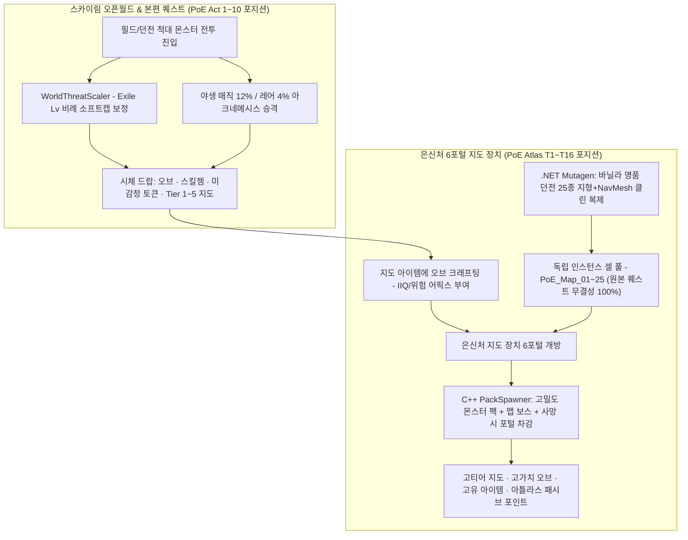
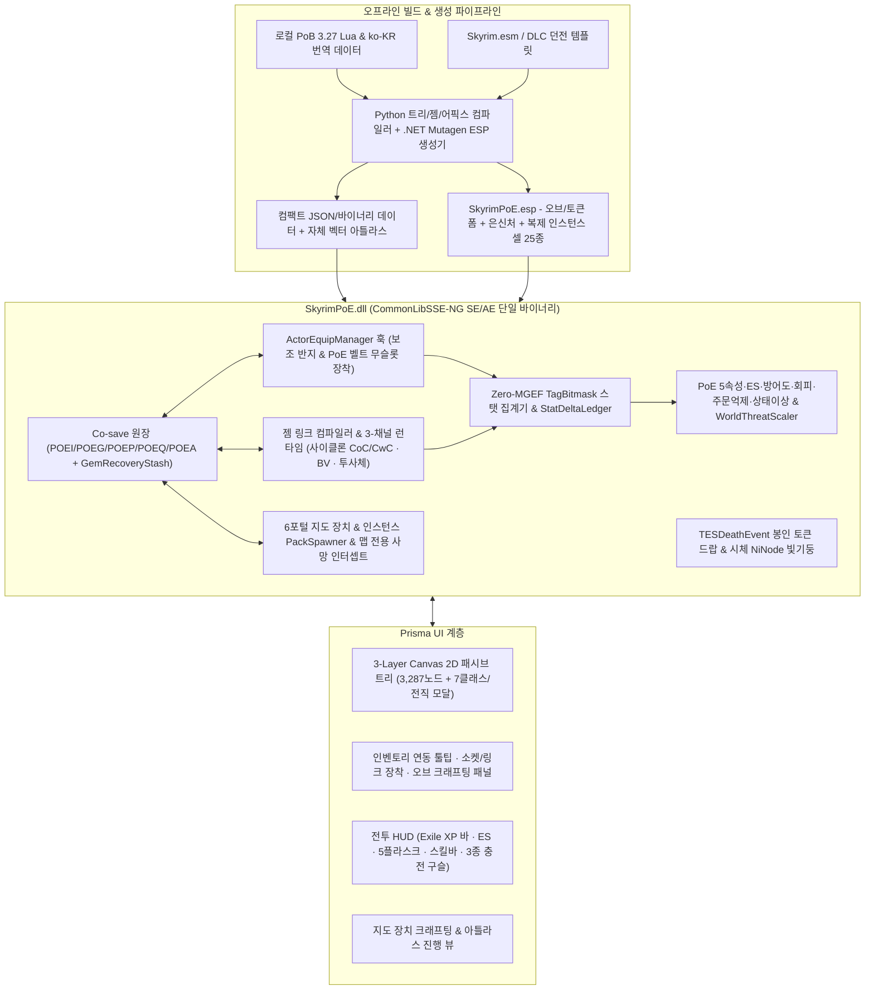

# Skyrim PoE 프로젝트 — 마스터 시스템 설계서 (v2.0 · 전 영역 확정 및 16대 검수 완결판)

스카이림 SE/AE의 **1인칭·3인칭 액션 전투와 대형 모드팩 생태계**를 온전히 보존하면서, 그 위에 **Path of Exile 1 원본 스케일의 빌드·파밍·캠페인 스케일링·엔드게임 맵핑 루프**를 독립 레이어로 구축하는 최종 마스터 설계 명세서입니다.

> [!IMPORTANT]
> **확정된 8대 핵심 설계 헌장 (v2.0 기준)**
> 1. **완전 독립 프로젝트 (`SkyrimPoE`)**: [Calamity - Reactive Loot & Affixes](file:///Z:/home/USERNAME/Calamity%20-%20Reactive%20Loot%20&%20Affixes/README.md)와는 코드·ESP·코세이브가 완전히 분리된 독립 모드로 구축합니다.
> 2. **바닐라 & 모드팩 무침습 하이브리드**: 바닐라 퍽·인챈트·연금술·레벨드 리스트(`LVLI`)·원본 던전 셀·종족(`RACE`) 레코드를 단 하나도 수정하지 않습니다.
> 3. **독립 유배자 레벨 (`Exile Level 1~100`) 성장축**: 타 레벨링/언캡퍼 모드와의 끝없는 밸런스 예외를 원천 차단하기 위해, **전투 처치 경험치로만 오르는 독립 `Exile Level (99pt)` + 보스 토벌 업적(`24pt`) = PoE 정통 `123pt` 하드캡** 구조를 채택합니다.
> 4. **바디슬롯 충돌 0% 인벤토리 직접 장착**: `30~61번` 바디슬롯을 건드리지 않고 `ActorEquipManager` C++ 훅으로 **SkyUI 인벤토리 안에서 그대로 2번째 반지와 PoE 벨트(헤드헌터 등)를 클릭 장착**합니다.
> 5. **3-채널 스킬 시전 & 시그니처 스킬 (사이클론 · 블레이드 볼텍스)**: 무기 수납 없이 작동하는 3채널 구조 위에 **`CoC/CwC` 연동 채널링 사이클론(Cyclone)** 과 **블레이드 볼텍스(Blade Vortex)** 를 네이티브 C++ 컨트롤러로 구현합니다.
> 6. **세이브 블로트 0% 드랍 & 루트 필터**: 미수거 시체 코세이브 `0 bytes`를 보장하는 **봉인 스택 토큰(감정 시 Lazy UID 발급)** + **시체 `NiNode` 클라이언트 빛기둥/사운드**를 사용합니다.
> 7. **원본 스케일 패시브 트리(`3,287노드`) + 7대 클래스 직접 선택**: `Prisma UI`의 **3-Layer 타일 베이킹 Canvas 2D**(WebGL 배제)로 144Hz 팬/줌을 구현하며, 최초 오픈 시 7대 클래스를 직접 선택합니다.
> 8. **투트랙 월드 난이도 & 바닐라 복제 인스턴스 맵핑**: **오픈월드(동적 몬스터 스케일링 + 야생 매직/레어 몬스터 = PoE 액트 1~10 역할)** 와 **은신처 지도 장치(`.NET Mutagen`으로 클린 복제된 바닐라 명품 던전 인스턴스 풀 = PoE 아틀라스 엔드게임 역할)** 로 완벽한 반복 파밍 루프를 완성합니다.

---

## 1. 성장 · 전직 · 장비 슬롯 상세 설계 (신규 확정 사항)

### 1.1 왜 패시브 포인트는 "독립 유배자 레벨 (`Exile Level 1~100`)"이 정답인가?

스카이림 캐릭터 레벨에 패시브 포인트를 묶으면 유저마다 설치한 레벨링 모드(`Experience`, `Community Uncapper` Lv 300, `Static Skill Leveling`, 제련/소매치기 비전투 레벨업, 스킬 전설화 여부)에 따라 포인트가 40점에서 멈추거나 300점까지 폭주해 밸런스 예외 케이스가 끝없이 발생합니다.

- **단일 폐쇄형 수식 (`Closed-Form Progression`)**:
  - 오직 적대 몬스터 처치(`TESDeathEvent`)로만 **`Exile XP`** 와 **장착 중인 모든 스킬 젬의 `Gem XP`** 가 동시에 상승합니다.
  - `Exile Level 1 → 100` 달성 시 확정 **`99 포인트`** + 스카이림 월드 주요 보스/용언 수호자 토벌 업적(`Book of Skill` 해금, 최대 **`24 포인트`**) = 어떤 모드팩 환경에서도 정확히 PoE 본가와 동일한 **최대 `123 포인트`** 로 수렴합니다.
  - 고레벨 구간(예: `Exile Lv 70+`)에서 사망 시 현재 레벨 내 경험치 `5~10%` 차감(레벨 다운은 절대 없음, MCM에서 비율 조정 가능)까지 PoE 본가 그대로 재현됩니다.
  - 기존 고레벨 세이브 중간 설치 유저를 위해 최초 1회 `"현재 스카이림 레벨에 비례해 초기 유배자 레벨 보정"` 선택 옵션만 MCM에 제공하면 모든 예외가 사라집니다.

### 1.2 전직(`Ascendancy`, 최대 8점) 해금 — 대규모 미궁 제작 공수 없는 스카이림식 해법

거대한 함정 미궁 4개를 새로 디자인하는 과도한 공수를 피하면서도, 비선형 플레이 호환성과 우버 라비린스의 결투 긴장감을 모두 챙기는 **3+1 하이브리드 시련 구조**입니다.

| 차수 | 보상 | 해금 조건 (비선형 투트랙 조건으로 퀘스트 강제 없음) |
| :---: | :---: | --- |
| **1차 시련 (Normal)** | `2 pt` (누적 2) | 첫 드래곤(`ActorTypeDragon`) 처치 **또는** 던전 보스(`LocRefTypeBoss`) 누적 `5회` 처치 |
| **2차 시련 (Cruel)** | `+2 pt` (누적 4) | 네임드 드래곤 프리스트 / 주요 DLC 중간보스 1기 처치 **또는** 던전 보스 누적 `15회` 처치 |
| **3차 시련 (Merciless)** | `+2 pt` (누적 6) | 고위 보스(알두인/하르콘/미락/카스타그) 처치 **또는** 지도 장치 `Tier 1~5` 보스 첫 토벌 |
| **4차 시련 (Eternal)** | `+2 pt` (누적 8) | 은신처 지도 장치에 드랍 재화 `여신에게 바치는 공물` 투입 → **복제된 원형 결투장 셀 1칸**에서 포털 부활 없이 **3페이즈 연속 수호자 보스전(이자로 오마주)** 단판 승리 시 눈앞에 전직 제단 생성 |

### 1.3 의상 모드 충돌 0% + 몰입감 100% — SkyUI 인벤토리 직접 장착 아키텍처

별도의 동떨어진 가상 창에 아이템을 넣는 대신, **유저가 평소 쓰는 SkyUI 인벤토리/즐겨찾기에서 그대로 장착(`[E]`)** 하면서도 바디슬롯(`30~61번`) 충돌을 원천 제거한 구조입니다.

1. **기본 8부위 (투구 · 갑옷 · 장갑 · 신발 · 무기 · 방패 · 화살[화살통 겸용] · 목걸이 1 · 반지 1)**:
   - 바닐라 및 유저가 설치한 모든 모드 장비가 그대로 베이스 아이템이 됩니다. (경갑=회피 베이스, 중갑=방어도 베이스, 의복/로브=에너지 실드 베이스, 혼합 키워드 시 하이브리드 방어 베이스로 자동 매핑).
2. **2번째 반지 (`Auxiliary Ring`) & PoE 벨트 (`헤드헌터`, `마법사의 피`, `가죽/수정 벨트`)**:
   - 스카이림 엔진은 바디슬롯이 `0(Unslotted)`인 방어구는 클릭 장착을 거부하고, 임의 슬롯(`55번` 등)을 쓰면 SMP 가발·망토·속옷과 충돌합니다.
   - **해결책 (`ActorEquipManager::EquipObject` C++ 인터셉터)**:
     - 모든 반지는 표준 `Slot 36(kRing)`을 그대로 유지합니다. 반지 1개가 이미 껴진 상태에서 SkyUI 인벤토리의 다른 반지(`ExtraUniqueID`)를 클릭하면, C++ 훅이 기존 반지 해제를 막고 **2번째 반지 장착 슬롯(`POEQ`)** 으로 바인딩하며 반지의 바닐라 인챈트와 PoE 어픽스를 모두 활성화합니다.
     - PoE 전용 벨트 아이템 역시 외형 메쉬 없는 반지/장신구 레코드로 두어 SkyUI `의류/장신구` 탭에 자연스럽게 표시되게 하되, 클릭 순간 C++ 훅이 가로채어 **어떠한 `Biped Slot`도 점유하지 않고 `PoE 벨트 장착 상태`로 등록**합니다.

---

## 2. 시그니처 스킬 상세 — 사이클론(Cyclone) & 블레이드 볼텍스(Blade Vortex)

### 2.1 사이클론 (`CycloneChannelBehavior` — 최우선 핵심 스킬)

단발성 회전 모션 모드의 한계를 넘어, **이동 자유도 · 초고속 다단히트 · 보조 젬(`CoC`/`CwC`) 연쇄 발사**가 살아있는 진짜 PoE 사이클론을 C++ 네이티브 컨트롤러로 구현합니다.

- **채널링 이동 & 조작**: 스킬 키(또는 공격 키)를 누르고 있는 동안 마나(또는 `Blood Magic` 시 생명력)를 초당 소모하며 **플레이어 `WASD` 전방향 이동을 실시간 유지**합니다(기본 이동속도 `30% Less`, 패시브/수은 플라스크로 가속 가능). 키를 떼는 즉시 후딜레이 없이 멈춥니다.
- **타격 공식 & 범위 스케일링**: 무기 기본 공격 속도의 **`300%` 타격 주기**로 주변 `AoE` 반경(무기 사거리 + 범위 증가 스탯 + 분쇄`Pulverise` 보조 젬 반영) 내 적대 액터들을 연속 타격합니다.
- **몬스터 무리 관통 (`Actor-Only Phasing`)**: 스카이림 특유의 좁은 던전 복도 길막 현상을 없애기 위해, 채널링 중 지형/벽(`Static/Terrain`) 충돌은 100% 유지하면서 **적대 액터와의 몸통 밀침 충돌만 무시**하여 몬스터 팩 한가운데를 믹서기처럼 뚫고 지나갑니다.
- **1인칭 & 3인칭 시각/모션 처리**:
  - **3인칭**: OAR 루프 회전 베기 애니메이션 + 무기 궤적 회전 검풍 NIF 출력.
  - **1인칭**: 카메라 어지러움(멀미)을 유발하는 강제 시점 회전 없이, 화면 하단 무기 고속 회전 모션/잔상 리본과 주변 소용돌이 칼바람 파티클로 쾌적한 타격감 제공.
- **꽃 중의 꽃 — `CoC (치명타 시 시전)` & `CwC (채널링 중 시전)` 완벽 연동**:
  - 같은 소켓 링크에 `[사이클론] - [치명타 시 시전 보조] - [얼음 폭발(Ice Nova) / 아이스 스피어 / 파이어볼]` 장착 시, 회전 타격이 치명타로 적중할 때마다 내부 쿨타임(`150ms`, 쿨감 스탯 반영!)마다 연결된 주문이 주변 적들에게 자동 난사됩니다!

### 2.2 블레이드 볼텍스 (`OrbitingBladeBehavior`)

- 시전당 회전 칼날 `1스택` 생성(최대 `10스택`, `Unleash[촉발]` 보조 젬 연결 시 한 번 시전에 3~4스택 동시 충전).
- 플레이어 주변 `NiNode`에 공전 검기 NIF를 실시간 회전시키며, 스택 수에 비례해 회전 속도·히트 주기·범위·스택당 증폭 물리 주문 피해(`More Damage`) 및 치명타 확률이 상승합니다.

---

## 3. 바닐라 던전 인스턴스 복제 지도 장치 & 오픈월드 동적 스케일링

### 3.1 왜 "원본 던전 직접 침범" 대신 "`.NET Mutagen` 바닐라 던전 클린 복제 인스턴스"인가?
- 스카이림의 원본 던전 셀(`BleakFallsBarrow01` 등)을 직접 리셋하며 반복 맵핑을 돌리면 바닐라 퀘스트 알리아스·퍼즐 문·박물관(LotD) 유물 스크립트가 파괴되고, 반대로 빈 땅에 새 던전 25개를 수작업으로 짓고 내비메쉬(`NAVM`)를 까는 것은 수개월이 걸립니다.
- **최적 해법 (`Automated Clean-Clone Instance Pool`)**:
  - `.NET` 생성기([mutagen-reference](file:///C:/Users/USERNAME/.gemini/config/skills/mutagen-reference/SKILL.md) 기반)가 빌드 시점에 `Skyrim.esm` / DLC의 검증된 던전 셀 20~30곳(노드 고분, 광산, 드웨머 유적, 팔머 동굴, 제국군 요새 등)에서 **지형지물(`STAT`), 조명(`LIGH`/`LightingTemplate`), 룸바운드(`Roombound/Portal`), 사전 베이킹된 내비메쉬(`NAVM`)만 새 셀(`PoE_Map_*`)로 자동 복제**합니다.
  - 원본 퀘스트 NPC·퍼즐 잠금·외부 월드 연결 도어는 자동 제거하고, 내비메쉬 중심점을 따라 몬스터 팩 스폰 앵커와 보스 앵커를 자동 배치합니다.
  - 결과적으로 **유저 눈에는 기존 스카이림의 친숙하고 정교한 던전들이 그대로 인스턴스 맵으로 열리면서, 원본 월드 퀘스트 충돌은 `0%`이고 무한 반복 리셋과 6포털 규칙이 완벽히 작동**합니다!

### 3.2 오픈월드 몬스터 동적 스케일링 (`WorldThreatScaler`)
플레이어가 PoE 시스템으로 강해져도 본편 스카이림 여행이 지루해지지 않도록 두 가지 런타임 장치가 작동합니다(ESP 레코드 무수정):
1. **Exile Level 비례 소프트캡 스케일링**: 적대 몬스터의 유효 생명력(EHP)·공격력·기본 원소 저항을 플레이어의 현재 `Exile Level` 기대 화력 곡선에 맞춰 동적 보정합니다(MCM에서 스케일링 강도 `0% ~ 200%` 프리셋 조절 지원).
2. **야생 매직/레어(아크네메시스) 몬스터 조우**: 일반 필드/던전의 비-에센셜 적대 몬스터 중 일부가 푸른 오라(매직 무리) 또는 노란 오라(레어 리더: `가속`, `화염 직조자`, `냉기 감옥`, `강철 피부`, `생명력 흡수` 등 1~3개 속성 보유)로 승격되어 등장하며, 처치 시 오브·젬·첫 `Tier 1 지도`를 후하게 드랍합니다.

---

## 4. 전체 시스템 아키텍처 및 데이터 흐름도

---

## 5. 아키텍처 최종 검수 보고서 (16대 위험 시나리오 전수 검증)

| # | 검수 영역 및 잠재 결함 시나리오 | 아키텍처 방어 설계 및 검증 결과 | 판정 |
| :---: | --- | --- | :---: |
| **1** | `HandleHealthDamage` 재귀 루프(CwDT/반사/전령) 및 바닐라 방어율 이중 감산 | `thread_local ScopedDamageGuard` + `DamageSourceFlags`로 2차 프로크 무한 재귀 차단, 바닐라 감산 정규화 후 단일 PoE 방어 공식 적용 | **통과** |
| **2** | 3,287노드·어픽스 `MagicEffect` 남용으로 인한 액터 조건 평가 CPU 병목 및 세이브 오염 | **Zero-MGEF 원칙**: 스펠 부착 없이 C++ `StatAggregator` 메모리 합산, 필수 엔진 노출값만 단일 `StatDeltaLedger` 동기화·원복 | **통과** |
| **3** | Ultralight 엔진의 WebGL 미지원(`null`) 및 다중 DOM 프레임 폭락 | WebGL·SVG DOM 금지, 오프라인 좌표 사전 계산 + **Canvas 2D `2048px` 정적 타일 베이킹 + 공간 컬링**으로 144Hz 보장 | **통과** |
| **4** | SKSE `AddTask` 자가 재큐잉으로 인한 단일 프레임 무한 드레인 프리징 | `AddTask` 재호출 금지, 사이클론·BV·RF·상태이상은 메인 스레드 `Update` 델타 타이머(메뉴 시 정지)에서만 구동 | **통과** |
| **5** | MCO/BFCO 공격 중 핫바 시전 시 캐릭터 모션 스턱(T-Pose/Lockout) | 그래프 상태 가드 + `200ms` 선입력 큐 + `3.0초` 시전 워치독 강제 복구, UI/콘솔 포커스 중 전투 핫키 완전 차단 | **통과** |
| **6** | 미수거 잡템 UID 코세이브 비대화 및 대장간 강화 시 소켓 장착 젬 소실 | 시체 드랍은 무상태 스택형 `MISC` 봉인 토큰만 사용(`0 bytes`), 장비 변형/파괴 시 `GemRecoveryStash`가 장착 젬 100% 회수 | **통과** |
| **7** | 다중 투사체(GMP+연쇄) 하복 과부하 및 동료/마을 주민 오사 현상금 | 활성 투사체 하드캡(`64개`) + 모든 AoE·연쇄·사이클론·BV 타겟팅에 `IsHostileEitherDirection` 양방향 적대성 검증 강제 | **통과** |
| **8** | 지도 장치 6포털 부활과 오픈월드 데스 얼터너티브 모드 충돌 | 사망 인터셉트(`Death Intercept`)를 오직 `IsInPoEMapInstance() == true` 내부로만 격리해 일반 월드 데스 모드와 100% 무충돌 | **통과** |
| **9** | PoB 3,287노드 중 미구현 더미 스탯 방치 및 레인저 전직 키(`Raider`/`Warden`) 불일치 | 3종 충전·주문억제·격노 네이티브 구현 + `stat_translation_rules.json` 100% 매핑 CI 린트 게이트 + 불변 내부 ID 해시 직렬화 | **통과** |
| **10** | SE `1.5.97` / AE `1.6.1170+` 듀얼 런타임 구조체 오프셋 크래시 | `alandtse/CommonLibVR (ng)` 규약 준수(`REL::Module::IsAE()`, 생성된 Accessor 경유, 선행 로거 초기화) | **통과** |
| **11** | 대안 시작 모드 팝업 충돌 · 리스펙 시 강제 탈의 알몸 사고 · 사이온 다중 루트 단절 | `PendingSelection` 대기 상태, 스탯 미달 시 `Unequip` 금지(PoE 효과만 비활성화), 사이온 가상 슈퍼 루트 다중 시작점 BFS 검증 | **통과** |
| **12** | 향후 외부 공개 배포 시 GGG 원본 아트워크 라이선스(IP) 리스크 | MIT 수치 데이터와 아트워크 분리, 기본 패키지는 자체 제작 벡터/절차적 아틀라스로 완결 구동(로컬 PoB 아이콘 팩 선택 마운트) | **통과** |
| **13** | *(v2.0 신규)* `ActorEquipManager` 2번째 반지·벨트 장착 후 판매/보관 시 유령 스탯 잔류 | `kPostLoadGame` 인벤토리 실존 대조 및 `TESContainerChangedEvent` 외부 이동 감지 시 즉시 장착 해제·스탯 재계산으로 유령 스탯 차단 | **통과** |
| **14** | *(v2.0 신규)* `.NET Mutagen` 바닐라 던전 셀 복제 시 룸바운드 컬링 깨짐 및 외부 탈출 도어 오류 | 단일 완결형 던전 셀 선별 + `Roombound/Portal`/`LightingTemplate`/`NAVM` 통째 리매핑 복제 + 외부 연결 `DOOR`를 정적 문/은신처 귀환 앵커로 자동 치환 | **통과** |
| **15** | *(v2.0 신규)* 사이클론 채널링 중 유닛 통과(`Phasing`) 시 바닥/벽 추락(Clipping) | 전체 콜리전 해제가 아닌 `bhkCharacterController`의 액터 간 밀침 레이어만 전환하여 지형·벽·바닥 물리 충돌은 100% 유지 | **통과** |
| **16** | *(v2.0 신규)* 오픈월드 몬스터 스케일링 중 여관 주먹다짐(Brawl) 오작동 및 타 난이도 모드 체력 폭주 | 비살상 전투·에센셜 NPC는 아크네메시스 승격 제외, 체력 스케일링은 단순 배수가 아닌 목표 곡선 대비 소프트캡 보정 + MCM 슬라이더 제공 | **통과** |

---

## 6. 단계별 개발 로드맵 (실행 순서)

1. **Milestone 1 — 프로젝트 기반 · 코세이브 · PoE 전투/스탯/플라스크 엔진 + `Exile Level` & 월드 스케일러**
   - `CMake + CommonLibSSE-NG` 단일 빌드/단위 테스트(`ctest`) 파이프라인 구성
   - `TagBitmask` 스탯 엔진, 5속성·ES·방어도·회피·주문억제·3종 충전·상태이상 7종, `Exile Level(1~100)` XP 원장, `WorldThreatScaler`, 5슬롯 플라스크 및 기본 HUD 구현
2. **Milestone 2 — PoB 3.27 풀스케일 패시브 트리(`3,287노드`) & 7클래스/전직 UI**
   - `compile_pob_tree.py` 변환기 및 스탯 매핑 린터 구축
   - Prisma UI `3-Layer Canvas 2D` 패시브 트리(7클래스 선택 모달, 한글 검색, 마스터리 349종, 키스톤 54종, 전직 19종, 사이온 다중 루트 회수 검증) 구현
3. **Milestone 3 — 무위험 시체 드랍 · 루트 필터 · 무슬롯 2반지/벨트 장착 · 오브/소켓 크래프팅**
   - `TESDeathEvent` 봉인 스택 토큰 드랍 + 시체 `NiNode` 빛기둥/필터 사운드 + Lazy UID 발급
   - `ActorEquipManager` 2번째 반지·PoE 벨트 직접 장착 훅, `GemRecoveryStash`, 3접두+3접미+6소켓/링크 오브 크래프팅 패널 및 인벤토리 툴팁 구현
4. **Milestone 4 — 스킬/보조 젬 컴파일러 & 사이클론 · 블레이드 볼텍스 등 액티브 스킬 팩**
   - 소켓 링크 태그 매칭기, 마나 점유(오라/전령), **채널링 사이클론(`CoC`/`CwC`/유닛 통과)**, **블레이드 볼텍스(`Unleash` 연동)**, 다중 투사체 상태머신(`GMP/Pierce/Fork/Chain`), 공격 증강 젬 + OAR 연동 브리지 구현
5. **Milestone 5 — `.NET Mutagen` 복제 던전 인스턴스 지도 장치(6포털) & 4차 전직 결투장**
   - `SkyrimPoE.Generator`로 바닐라 명품 던전 25종 + 보스 결투장 1종 클린 복제(`NAVM` 포함) 및 은신처 셀 생성
   - T1~T16 맵 아이템 크래프팅, 6포털 생성 및 맵 전용 사망 인터셉트, 고밀도 매직/레어 몬스터 팩 스포너, 4차 우버 전직 3페이즈 보스전 완성
