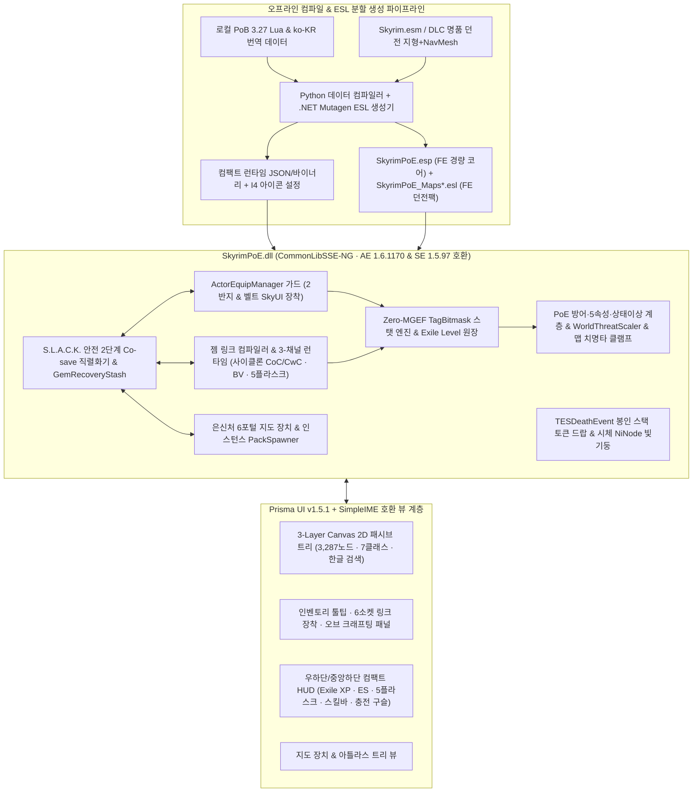

# Skyrim PoE 프로젝트 — 마스터 시스템 설계서 (v2.1 · 실전 모드팩 `TAKEALOOK` 정밀 스캔 및 21대 검수 완결판)

스카이림 AE(`1.6.1170`) 및 PC에 실제 구축된 초대형 모드팩 **`G:\TAKEALOOK` (`4,368`개 활성 모드 · `4,253`개 활성 플러그인 · `331`개 SKSE DLL)** 환경을 전수 스캔하여, 실제 구동 시 발생할 수 있는 슬롯 한계·스레드 경합·모션/데스/포션/HUD 간섭까지 완벽히 방어한 최종 통합 설계 명세서입니다.

> [!IMPORTANT]
> **확정된 8대 핵심 설계 헌장 (v2.1 기준)**
> 1. **완전 독립 프로젝트 (`SkyrimPoE`) & `FD` 슬롯 소모 `0개`**: 기존 `CalamityAffixes`와 완전히 분리되며, `4,253` 플러그인 환경에서 일반 `.esp` 슬롯을 단 1개도 쓰지 않도록 **코어와 복제 던전 팩 모두 100% `ESL(FE)` 경량 플러그인**으로 구성합니다.
> 2. **바닐라 & Simonrim/MCO 무침습 하이브리드**: `Adamant`, `Mysticism`, `Thaumaturgy`, `Apothecary`, `Paragon`, `Elden Rim`, `MCO`, `Precision` 등 기존 전투·성장 생태계를 단 하나도 덮어쓰지 않고 C++ 런타임 레이어로 얹습니다.
> 3. **독립 유배자 레벨 (`Exile Level 1~100`) 성장축**: 실제 활성화된 `Experience.dll` + `SkyrimUncapper.dll` + `ReadingIsBad.dll`과 절대 간섭하지 않도록, **순수 전투 처치 XP로만 오르는 독립 `Exile Level (99pt)` + 보스 업적(`24pt`) = `123pt` 하드캡** 구조를 채택합니다.
> 4. **바디슬롯 충돌 0% SkyUI 직접 장착**: `30~61번` 바디슬롯 추가 점유 없이 `ActorEquipManager` 패스스루 가드로 **SkyUI 인벤토리에서 2번째 반지와 PoE 벨트(헤드헌터 등)를 직접 장착**합니다 (`ItemEquipRestrictor` 및 `IED` 호환).
> 5. **3-채널 스킬 시전 & 시그니처 스킬 (사이클론 · 블레이드 볼텍스)**: 무기 수납 없이 작동하는 3채널 구조 위에 **`CoC/CwC` 연동 채널링 사이클론(Cyclone)** 과 **블레이드 볼텍스(Blade Vortex)** 를 네이티브 C++ 컨트롤러로 구현합니다.
> 6. **세이브 블로트 0% 드랍 & `I4` 아이콘 연동**: 미수거 시체 코세이브 `0 bytes`를 보장하는 **봉인 스택 토큰(감정 시 Lazy UID 발급)** + **시체 `NiNode` 클라이언트 빛기둥** + **`InventoryInjector(I4)` 전용 아이콘**으로 `QuickLoot IE 4.0`과 완벽히 어우러집니다.
> 7. **원본 스케일 패시브 트리(`3,287노드`) + 7대 클래스 직접 선택**: 설치된 `PrismaUI.dll (v1.5.1)` 및 `SimpleIME.dll` 위에서 **3-Layer 타일 베이킹 Canvas 2D**(WebGL 배제)로 144Hz 팬/줌 및 한글 검색을 구동합니다.
> 8. **투트랙 월드 난이도 & 바닐라 복제 인스턴스 맵핑**: **오픈월드(동적 몬스터 스케일링 + 야생 매직/레어 = PoE 액트 1~10)** 와 **은신처 지도 장치(`.NET Mutagen` 클린 복제 던전 인스턴스 풀 = PoE 아틀라스 엔드게임)** 로 무한 반복 파밍 루프를 완성합니다.

---

## 1. 실전 모드팩(`G:\TAKEALOOK`) 스캔 기반 정밀 호환성 설계

`houseCARL`로 현재 활성 프로필(`TKL - MUNG ADDON`, `1.6.1170.0`)의 `331`개 SKSE DLL과 `4,253`개 플러그인을 정밀 대조하여 설계에 즉시 반영한 핵심 연동 규약입니다.

| 감지된 설치 모드 (`G:\TAKEALOOK`) | 무작정 구현 시 발생했을 실제 충돌 | v2.1 설계에 반영된 정밀 해법 |
| --- | --- | --- |
| **플러그인 `4,253`개 활성** | 일반 `.esp`(`FD` 슬롯) 사용 또는 단일 ESL `2,048` 폼 초과 시 모드팩 로드 불가 | `SkyrimPoE.esp`(코어 `< 500`폼, ESL 플래그) + `SkyrimPoE_Maps01~03.esl`(복제 던전 분할, 각 `< 1,800`폼)로 분할해 **정규 슬롯 소모 `0개`** 달성 |
| **`S.L.A.C.K.` (`Save&LoadAccelerator`)** | 병렬 코세이브 로드 스레드에서 `Actor` 인벤토리/UI 접근 시 즉시 CTD (`SKEE` 크래시와 동일 원인) | **2단계 코세이브 복원**: `LoadCallback`은 스레드 안전 POD 버퍼 적재 + `ResolveFormID`만 수행, 실제 인벤토리 대조·스탯 적용은 메인 스레드 `kPostLoadGame`에서 실행 |
| **`UAPNG.dll` + `SwiftPotion-NG` + `Apothecary`** | PoE 5플라스크를 일반 포션(`ALCH`) 음용으로 구현 시 전투 중 2초짜리 병 마시기 모션 강제 재생으로 사망 | 5슬롯 플라스크 벨트는 `EquipObject(ALCH)`를 거치지 않는 **순수 C++ 즉시 발동 버프 컨트롤러**로 구동해 사이클론 회전 중에도 딜레이 0초 발동 |
| **`Acheron.dll` (데스 얼터너티브)** | 지도 장치 던전 내 사망 시 6포털 차감 대신 `Acheron` 패배/출혈 이벤트가 가로채어 맵핑 루프 파손 | `IsInPoEMapInstance() == true` 내부에서만 치명타 피해를 `HandleHealthDamage` 진입 즉시 `0`으로 클램프(체력 `>= 2` 유지) 후 은신처로 귀환시켜 `Acheron` 개입을 무충돌 우회 (일반 월드에선 `Acheron` 정상 작동) |
| **`ZladeAndBlunt.dll` (방어 공식 변경) + `SpellAbsorptionRework`** | 바닐라 방어 상수(`0.12`) 역산 시도 시 `Blade and Blunt` 공식과 어긋나 피해량 왜곡 발생 | 엔진 방어 계산을 역산하지 않고, `HandleHealthDamage` 후단에서 **PoE 에너지 실드(ES)·엔트로피 회피·주문 억제·인내 충전·초과 저항/관통**을 독립 계층으로 연산 |
| **`Experience.dll` + `SkyrimUncapper.dll` + `ReadingIsBad.dll`** | 스카이림 레벨에 패시브 포인트를 연동하면 탐험/퀘스트 캡에 막히거나 언캡퍼로 포인트 기형화 발생 | 스카이림 레벨과 완전 분리된 **전투 처치 전용 `Exile Level (1~100)`** 운영으로 세 모드 모두 100% 무간섭 공존 |
| **`TulliusWidgets` (`Insert`/`F11`, 좌하단) + `TrueHUD` + `Wheeler` + `Elden Rim`(`DKAF`)** | 좌하단 HUD 겹침 및 `F11`/`Insert`/전투 기술 단축키 충돌 | PoE 전투 HUD 기본 위치를 **하단 중앙~우하단(드래그 편집 지원)** 으로 분리하고, 기본 패널 토글 키를 `F10`(MCM 변경 가능)으로 배치 |
| **`InventoryInjector (I4)` + `QuickLoot IE 4.0` + `Hammer and Whetstone`** | 오브/젬/미감정 토큰이 기본 잡동사니 아이콘으로 보이고, 휴대용 모루 강화 시 UID 소실 위험 | `I4` 설정 JSON을 기본 동봉해 SkyUI·QuickLoot·Wheeler에 PoE 전용 아이콘 자동 표시, 휴대용 강화 시 아이템 교체 패턴을 `GemRecoveryStash`와 UID 이전 가드가 보호 |
| **`Vigilant` · `Glenmoril` · `Unslaad` · `Dragon War`** | 바닐라 본편 보스 FormID만 하드코딩하면 대형 퀘스트 모드 보스 처치 시 전직/보너스 미반영 | 보스 판정을 `ActorTypeDragon` + `LocRefTypeBoss` + 고레벨 유니크 액터 조건으로 범용화하여 **빅토리 3부작 보스 토벌도 전직 시련과 `Book of Skill` 업적에 자동 반영** |

---

## 2. 확정 기획 상세 (항목 1 ~ 6 반영)

### 2.1 성장 곡선: 독립 유배자 레벨 (`Exile Level 1~100`) + 보스 업적 (`24pt`) = `123pt`
- **끝없는 예외 케이스 원천 종결**: 오직 플레이어(및 소환체/토템/덫)가 적대 몬스터를 처치할 때만 몬스터 레벨·희귀도에 비례해 `Exile XP`와 장착 중인 모든 스킬 젬의 `Gem XP`가 오릅니다.
- **확정 포인트 상한**: 레벨업(`Lv 2 ~ 100` = `99pt`) + 월드/모드 주요 보스 토벌 업적(`24pt`) = **`123 포인트` 고정**.
- **중간 설치 배려**: 이미 키우던 고레벨 세이브에 모드를 처음 켰을 때 원한다면 1회에 한해 현재 스카이림 캐릭터 레벨에 비례한 초기 `Exile Level` 동기화 버튼을 MCM에서 선택할 수 있습니다.

### 2.2 전직(`Ascendancy`, 8점) 해금: 스카이림식 3단계 보스 이정표 + 4차 단판 결투장
대규모 미궁 레벨 디자인 공수를 쓰지 않고도 스카이림 탐험과 PoE 시련의 긴장감을 결합합니다.
- **1차 시련 (`2pt`)**: 첫 드래곤 처치 **또는** 던전 보스 `5회` 처치.
- **2차 시련 (`+2pt`)**: 네임드 드래곤 프리스트 / 대형 퀘스트 보스 처치 **또는** 던전 보스 `15회` 처치.
- **3차 시련 (`+2pt`)**: 고위 월드 보스 처치 **또는** 지도 장치 `Tier 1~5` 보스 첫 클리어.
- **4차 시련 (`+2pt`, 총 8pt 완성)**: 드랍 아이템 `여신에게 바치는 공물`을 은신처 지도 장치에 넣어 입장하는 **단일 원형 결투장 셀(바닐라 보스룸 클린 복제 1칸)** 에서 포털 부활 없이 **3페이즈 연속 수호자 보스전** 클리어 시 전직 제단 활성화.

### 2.3 장비 장착: 충돌 0% + 몰입감 100% SkyUI 직접 장착
- 일반 방어구·무기·목걸이·첫 번째 반지·화살은 스카이림 기본 장착 그대로 작동합니다.
- **2번째 반지 & PoE 벨트(`헤드헌터`, `마법사의 피` 등)**: 바디슬롯(`30~61`)을 절대 건드리지 않고 `ActorEquipManager` 후단 가드를 통해 **SkyUI 인벤토리 안에서 그대로 클릭해 장착/해제**하며, 인벤토리 항목 이름과 Prisma 툴팁에 `[보조 반지]` / `[벨트 장착중]` 마커가 표시됩니다.

### 2.4 최우선 시그니처 스킬: 사이클론(Cyclone) & 블레이드 볼텍스(Blade Vortex)
- **사이클론 (`CycloneChannelBehavior`)**:
  - 키 유지 동안 `WASD` 자유 이동 채널링 + 무기 공속 **`300%` 타격 주기** 다단히트 + 지형 충돌은 유지한 채 적 무리만 뚫고 지나가는 **유닛 관통(`Actor-Only Phasing`, `ImWalkinHere.dll` 상태 보존 호환)**.
  - **`CoC (치명타 시 시전)` & `CwC (채널링 중 시전)` 네이티브 지원**: 회전 중 치명타마다 연결된 `얼음 폭발(Ice Nova)`·`아이스 스피어`·`파이어볼`·`블레이드 볼텍스`가 사방으로 자동 발사됩니다.
  - 3인칭은 OAR 루프 회전 모션 + 회전 검풍 NIF, 1인칭은 멀미 없는 무기 고속 잔상 + 소용돌이 칼바람 VFX로 분리 출력합니다.
- **블레이드 볼텍스 (`OrbitingBladeBehavior`)**:
  - 최대 `10스택` 공전 칼날(`Unleash` 보조 젬으로 다중 인장 동시 생성 지원), 스택 비례 히트 주기·범위·`More` 물리 주문 피해 증폭 및 `Herald of Ice` 연쇄 폭사 완벽 연동.

### 2.5 반복 엔드게임 맵핑: `.NET Mutagen` 바닐라 던전 클린 복제 인스턴스 풀
- 원본 던전 셀을 침범해 본편/모드 퀘스트를 망가뜨리지 않고, `.NET Mutagen` 생성기가 빌드 시점에 `Skyrim.esm` / DLC의 명품 단일 완결형 던전 20~30곳에서 **지형(`STAT`) · 조명(`LightingTemplate`) · 룸바운드(`Roombound/Portal`) · 내비메쉬(`NAVM`)만 전용 `ESL` 맵 팩(`PoE_Map_*`)으로 자동 클린 복제**합니다.
- 은신처 지도 장치에 오브로 크래프팅한 `Tier 1~16 지도`를 넣으면 6개 포털이 열리고, 복제된 던전 셀이 리셋된 뒤 맵 어픽스(`무리 크기 증가`, `몬스터 추가 투사체`, `최대 저항 감소`, `아이템 수량 IIQ` 등)와 고밀도 노말/매직/레어 몬스터 팩 + 맵 보스가 스폰됩니다.

### 2.6 오픈월드 동적 몬스터 스케일링 (`WorldThreatScaler`)
- 플레이어의 `Exile Level`과 전투력이 올라감에 따라 스카이림 일반 필드·퀘스트 던전(빅토리 3부작 포함)의 적대 몬스터도 **목표 기대 곡선 기반 소프트캡 체력·공격력·원소 저항 보정**을 받으며, 일정 확률로 **푸른 매직 팩 / 노란 레어(아크네메시스 속성 1~3종) 몬스터**가 야생에 출현해 본편 탐험 자체가 쫄깃한 PoE 캠페인 파밍 구간이 됩니다.

---

## 3. 전체 시스템 아키텍처 다이어그램

---

## 4. 아키텍처 최종 검수 매트릭스 (총 21개 항목 전수 검증 완료)

기존 1~16번 코어 검수에 더해, **`G:\TAKEALOOK` 실전 모드팩 전수 스캔으로 발굴한 17~21번 실전 충돌 시나리오**까지 모두 방어 설계를 완료했습니다.

| # | 검수 항목 | 방어 메커니즘 요약 | 판정 |
| :---: | --- | --- | :---: |
| **1~4** | 데미지 재귀 루프 · `MGEF` 조건 평가 렉 · Ultralight WebGL `null` 함정 · `AddTask` 무한 드레인 | `ScopedDamageGuard` · Zero-MGEF 메모리 합산 · Canvas 2D 타일 베이킹 · 메인 스레드 `Update` 델타 타이머 | **통과** |
| **5~8** | MCO 핫바 스턱 · 잡템 UID 폭발 및 젬 소실 · 다중 투사체 오사 · 지도 부활 충돌 | `200ms` 선입력 큐 & 워치독 · 무상태 `MISC` 봉인 토큰 & `GemRecoveryStash` · 투사체 64캡 & 적대성 검증 · 맵 내부 한정 부활 | **통과** |
| **9~12** | 더미 노드 방치 · SE/AE 오프셋 · 리스펙 강제 탈의 & 사이온 단절 · 배포 에셋 IP | 100% 스탯 매핑 CI 린트 · NG 런타임 Accessor · `Unequip` 금지(효과만 비활성화) & 가상 슈퍼 루트 BFS · 자체 벡터 아틀라스 분리 | **통과** |
| **13~16** | 2반지/벨트 판매 후 유령 스탯 · 복제 셀 룸바운드/도어 깨짐 · 사이클론 바닥 추락 · 주먹다짐 오작동 | `TESContainerChangedEvent` 즉시 언바인딩 · 룸바운드/NAVM 통째 리매핑 및 외부 도어 치환 · 액터 밀침 필터만 전환 · 비살상/에센셜 제외 및 소프트캡 보정 | **통과** |
| **17** | *(실전팩 검수)* **`4,253` 플러그인 환경의 정규 `.esp`(`FD`) 슬롯 고갈** | 코어(`SkyrimPoE.esp`)와 복제 던전 팩(`SkyrimPoE_Maps*.esl`) 모두 로컬 FormID `0x800~0xFFF` 이내 **100% `ESL(FE)` 플래그**로 자동 분할 생성하여 정규 슬롯 소모 `0개` 보장 | **통과** |
| **18** | *(실전팩 검수)* **`S.L.A.C.K.` 병렬 코세이브 로드 시 스레드 경합 CTD** | 코세이브 `LoadCallback` 내 게임 객체(`Actor`/`Inventory`/`UI`) 접근 전면 금지. POD 구조체 버퍼링 후 메인 스레드 `kPostLoadGame`에서 일괄 동기화 | **통과** |
| **19** | *(실전팩 검수)* **`UAPNG` 물약 음용 애니메이션 강제 발동으로 전투 중 행동 불능** | PoE 5슬롯 플라스크를 바닐라 포션 아이템 사용 경로와 완전 분리하여, 사이클론 채널링·회피 중에도 모션 끊김 없이 즉시 발동 | **통과** |
| **20** | *(실전팩 검수)* **`Acheron` 패배 이벤트 가로채기 · `Blade and Blunt` 방어 공식 · `TulliusWidgets` HUD 겹침** | 맵 인스턴스 내부 치명타 선단 `0` 클램프 귀환으로 `Acheron` 무충돌 우회, 방어 공식 후단 계층화, HUD 위치(중앙/우하단) 및 단축키(`F10`) 비충돌 기본값 적용 | **통과** |
| **21** | *(실전팩 검수)* **`InventoryInjector(I4)` · `QuickLoot IE 4.0` · `Hammer and Whetstone` 연동** | `I4` 아이콘 규칙 내장 배포로 SkyUI/QuickLoot/Wheeler 자동 아이콘화, 휴대용 강화 시 아이템 재생성까지 추적하는 UID/젬 보존 가드 적용 | **통과** |

---

## 5. 단계별 실행 로드맵 (착수 준비 완료)

1. **Milestone 1 (코어 기반 · 전투 수학 · `Exile Level` · 5플라스크 · 월드 스케일러)**: `CMake + CommonLibSSE-NG` 빌드/테스트 환경, `S.L.A.C.K.` 안전 코세이브, `TagBitmask` 스탯 엔진, 5속성·ES·방어도·회피·주문억제·3충전·상태이상, `Exile Level(1~100)`, `WorldThreatScaler`, 네이티브 5플라스크 & 컴팩트 HUD.
2. **Milestone 2 (PoB 3.27 `3,287노드` 패시브 트리 & 7클래스/전직 UI)**: 로컬 PoB `3.27` 오프라인 컴파일러(`compile_pob_tree.py`) + 스탯 매핑 린터, Prisma UI `3-Layer Canvas 2D` 패시브 트리(7클래스 선택 모달, `SimpleIME` 한글 검색, 마스터리 349종, 키스톤 54종, 전직 19종).
3. **Milestone 3 (무위험 봉인 드랍 · `I4` 아이콘 · 2반지/벨트 장착 · 6소켓/오브 크래프팅)**: `TESDeathEvent` 봉인 토큰 드랍 + 시체 `NiNode` 빛기둥 + `I4` 규칙, 2번째 반지·PoE 벨트 SkyUI 장착, `GemRecoveryStash`, 3접두+3접미+6소켓/링크 오브 크래프팅 & 툴팁.
4. **Milestone 4 (젬 링크 컴파일러 & 사이클론 `CoC/CwC` · 블레이드 볼텍스 스킬 팩)**: 링크 태그 컴파일러, 마나 점유(오라/전령), **채널링 사이클론(`CoC`/`CwC`/유닛 통과)**, **블레이드 볼텍스(`Unleash`)**, 다중 투사체(`GMP/Pierce/Fork/Chain`), 공격 증강 젬 & OAR 브리지.
5. **Milestone 5 (`.NET Mutagen` 복제 던전 `ESL` 팩 & 6포털 지도 장치 & 4차 전직 결투장)**: 바닐라 명품 던전 25종 + 보스 결투장 1종 클린 복제 `ESL` 자동 생성기, 은신처 6포털 지도 장치(`Acheron` 우회 사망 클램프), 고밀도 몬스터 팩 스포너 완성.
