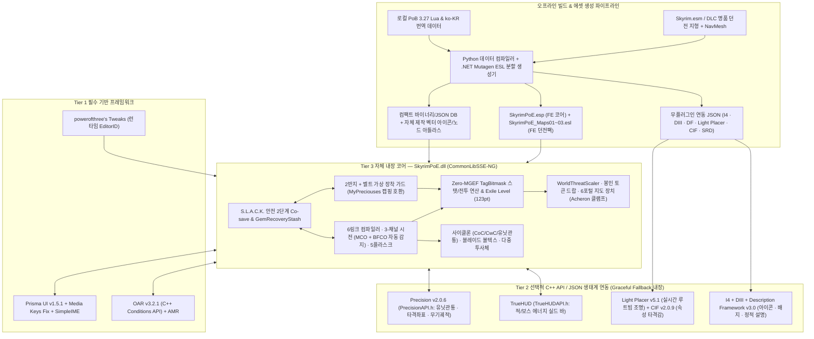

# Skyrim PoE 프로젝트 — 마스터 시스템 설계서 (v2.2 · 최신 넥서스 베스트 프레임워크 스택 & 26대 검수 완결판)

기존 로컬 모드팩(`G:\TAKEALOOK`) 환경 호환성 검증에 더해, **2025~2026년 기준 넥서스(Nexus Mods) 및 스카이림 SKSE 커뮤니티에서 가장 완성도 높은 최신 프레임워크·C++ 모더 API**를 전수 조사하여 아키텍처를 한 단계 더 업그레이드한 최종 마스터 설계서입니다.

> [!IMPORTANT]
> **확정된 9대 핵심 설계 헌장 (v2.2 기준)**
> 1. **완전 독립 프로젝트 (`SkyrimPoE`) & 정규 `.esp`(`FD`) 슬롯 소모 `0개`**: 기존 `CalamityAffixes`와 완전히 독립된 코드베이스/코세이브로 구축하며, 코어(`SkyrimPoE.esp`)와 복제 던전 팩(`SkyrimPoE_Maps*.esl`) 모두 **100% `ESL(FE)` 경량 플러그인**으로 분할 생성합니다.
> 2. **3-Tier 베스트 프레임워크 아키텍처**: 검증된 최고 성능의 외부 프레임워크(**`Prisma UI` · `OAR` · `po3 Tweaks` · `Precision API` · `TrueHUD API` · `Light Placer` · `CIF` · `I4` · `Description Framework`**)는 적극 채택·연동하되, 지연 시간과 수식 정합성이 생명인 코어 전투·스탯·링크 컴파일러는 **`SkyrimPoE.dll` 내부에 직접 내장**합니다.
> 3. **Zero-Nemesis / Zero-Pandora 모션 확장**: 유저에게 번거로운 네메시스/판도라 패치 재실행을 요구하지 않고, `SkyrimPoE.dll`의 직접 애니메이션 그래프 이벤트 수신 + **`OAR v3.2.1` 공식 C++ 조건 API(`OpenAnimationReplacerAPI-Conditions.h`)** 로 사이클론·스킬 시전을 즉시 구동하며 **바닐라 · `ADXP|MCO` · `BFCO` 3대 환경**을 모두 자동 지원합니다.
> 4. **바닐라 & 대형 오버홀 무침습 하이브리드**: 기존 퍽·마법부여·연금술·레벨드 리스트를 단 하나도 덮어쓰지 않고 C++ 런타임 레이어로 얹습니다.
> 5. **독립 유배자 레벨 (`Exile Level 1~100`) 성장축**: 순수 전투 처치 XP로만 오르는 독립 **`Exile Level (99pt)` + 보스 업적(`24pt`) = `123pt` 하드캡**과 **3단계 보스 이정표 + 4차 단판 결투장(`8pt` 전직)** 구조를 채택합니다.
> 6. **바디슬롯 충돌 0% SkyUI 직접 장착**: `30~61번` 바디슬롯 점유 없이 `ActorEquipManager` 가드로 **SkyUI 인벤토리에서 2번째 반지와 PoE 벨트(`헤드헌터`, `마법사의 피` 등)를 직접 장착**하며, `My Precious...es` 등 외부 다중 반지 모드와도 어뷰징 없이 공존합니다.
> 7. **시그니처 스킬 최우선 구현 (사이클론 `CoC/CwC` · 블레이드 볼텍스)**: `Precision API` 물리 충돌 필터와 연동되는 **유닛 관통(`Actor-Only Phasing`) 채널링 사이클론**과 **10스택 공전 블레이드 볼텍스**를 네이티브 C++ 컨트롤러로 구현합니다.
> 8. **원본 스케일 패시브 트리(`3,287노드`) + 7대 클래스 직접 선택**: `Prisma UI v1.5.1` + `Media Keys Fix` + `SimpleIME` 위에서 **3-Layer 타일 베이킹 Canvas 2D**(WebGL 미지원 한계 완벽 돌파)로 144Hz 팬/줌 및 한글 초성/키워드 검색을 구동합니다.
> 9. **세이브 블로트 0% 파밍 & 투트랙 엔드게임**: **봉인 스택 토큰 + `Light Placer` 실시간 조명 빛기둥** 드랍 구조와, **오픈월드 동적 스케일링(`WorldThreatScaler`) + `.NET Mutagen` 클린 복제 던전 6포털 지도 장치**로 무한 파밍 루프를 완성합니다.

---

## 1. 최신 넥서스 베스트 프레임워크 전수 조사 및 3-Tier 채택 명세

단순히 기존 모드팩에 깔린 모드에 맞추는 것을 넘어, **각 서브시스템별로 현존 넥서스 최고 프레임워크를 선정(Tier 1 · Tier 2)** 하고, 반대로 외부 프레임워크에 맡기면 성능 저하나 구조적 한계가 생기는 영역은 **자체 내장으로 분리(Tier 3)** 했습니다.

### 1.1 Tier 1 — 필수 선행 프레임워크 (Hard Prerequisites · 최소 정예 5종)
직접 바퀴를 재발명하는 것보다 검증된 네이티브 엔진 프레임워크를 필수로 두는 것이 압도적으로 유리한 핵심 기반입니다.

| 채택 프레임워크 (Nexus ID · 최신 버전) | 선정 이유 및 `SkyrimPoE` 활용 방식 | 비교 검토 후 배제한 대안 |
| --- | --- | --- |
| **`SKSE64` (`#30379`) + `Address Library` (`#32444`)** | `CommonLibSSE-NG` 단일 바이너리로 SE(`1.5.97`) 및 최신 AE(`1.6.1170+`) 동시 구동. | 버전 고정 단일 빌드 DLL |
| **`Prisma UI` (`#148718`, `v1.5.1`) + `Media Keys Fix SKSE` (`#92948`)** | 현존 스카이림 최고의 HTML5/CSS3/ES2022 Ultralight 오버레이. `Community Shaders` HDR/프레임 생성과 충돌 없는 렌더 파이프라인 제공. (`SimpleIME` 동반 시 완벽한 한글 입력 지원) | `Scaleform/SWF` (AS2 15fps 병목), `SKSE Menu Framework` (디버그용 ImGui 외형), `WebView2` (메모리 과다), 직접 `Present` 후킹 (HDR/FG 깨짐) |
| **`Open Animation Replacer (OAR)` (`#92109`, `v3.2.1`)** | 공식 C++ SDK(`OpenAnimationReplacerAPI-Conditions.h`)를 통해 ESP 키워드 폴링이나 네메시스 패치 없이 **`IsPoECycloneChanneling` 등 네이티브 C++ 모션 조건**을 런타임 등록. | `DAR` (구형, 조건 상한 및 C++ API 부재), `Payload Interpreter` 원본 (`1.6.1170` 버전 락 및 네메시스 패치 강제) |
| **`Animation Motion Revolution (AMR)` (`#50258`)** | 이동 공격·리프 슬램·플리커 스트라이크·방패 돌진 등 모션 루트 변위(Root Motion) 정밀 제어의 커뮤니티 표준. | 수동 `SetPosition` 틱 보간 (벽 뚫림 및 덜컥거림 발생) |
| **`powerofthree's Tweaks` (`#51073`)** | 런타임 `EditorID` 캐싱을 활성화하여, 로드 오더 순서나 모드팩이 달라도 보스·던전·아이템을 FormID 하드코딩 없이 `EditorID`로 안전하게 매칭. `Light Placer` 및 `Description Framework`의 공통 기반. | 플러그인 인덱스 의존 FormID 하드코딩 |

### 1.2 Tier 2 — C++ Header-Only API & 무플러그인 JSON 권장 연동 (Soft Integrations)
ESP 마스터 의존성을 **단 하나도 만들지 않고**, 설치되어 있으면 C++ 메시징 API나 JSON 규칙이 즉시 활성화되며 미설치 시에도 `SkyrimPoE.dll` 내장 폴백으로 100% 정상 작동하는 최고급 생태계 연동 계층입니다.

| 연동 프레임워크 (Nexus ID · 최신 버전) | `SkyrimPoE`에서의 베스트 프랙티스 활용 | 미설치 시 내장 폴백 (`Graceful Fallback`) |
| --- | --- | --- |
| **`Precision` (`#72347`, `v2.0.6`)** — *`PrecisionAPI.h` (V4)* | **1)** `AddCollisionFilterComparisonCallback`으로 하복 물리 솔버 단계에서 **사이클론 유닛 관통(`Actor-Only Phasing`)** 완벽 처리 **2)** `AddPreHitCallback`으로 실제 칼날 타격 좌표(`NiPoint3`)에서 **`CoC` 주문 폭발** 생성 **3)** `AddWeaponTrailOverride`로 원소/카오스 보조 젬에 따른 실시간 무기 궤적 색상 변환 | 자체 `bhkCharacterController` 액터 충돌 플래그 토글 + 전방 부채꼴/원형 캡슐 스윕 판정으로 자동 전환 |
| **`TrueHUD` (`#62775`)** — *`TrueHUDAPI.h` (V4)* | `TrueHUD`의 **Special Resource Bar API**를 호출해 일반 몹/아크네메시스 레어/맵 보스 머리 위 체력바에 **적 에너지 실드(ES) 게이지**를 네이티브 렌더링 (이중 보스바 겹침 원천 방지) | 화면 상단 중앙 Prisma UI 전용 슬림 보스/레어 타겟 헤더 자동 표시 |
| **`Light Placer` (`#127557`, `v5.1.0`)** | 월드 `REFR` 생성(`0 bytes` 세이브) 없이 루트 필터 빛기둥(유니크 주황광·디바인 백금광), `정의의 화염(RF)` 화염 고리, 아크네메시스 오라에 **실시간 그림자/포인트 라이트 조명** 부여 (`Community Shaders` 완벽 호환) | 자체 발광(`BSEffectShaderProperty` Emissive) NIF 메시만으로도 선명한 빛기둥 표현 유지 |
| **`Core Impact Framework (CIF)` (`#146873`, `v2.0.9`)** | 스크립트·ESP 제로 JSON 파이프라인으로 PoE 5속성(물리 출혈·화염 점화·냉기 동결 파편·번개 감전 아크·카오스 침식) 타격 시 재질별 고밀도 타격 이펙트/사운드 출력 | 기본 `BGSImpactDataSet` 및 내장 히트 셰이더 폴백 |
| **`Inventory Injector (I4)` (`#85702`, `v1.1.1`) + `Dynamic Inventory Icon Injector (DIII)` (`#174136`, `v1.0.7`)** | SWF 수정 없이 오브·스킬 젬·지도 티어·미감정 봉인 토큰에 전용 벡터 아이콘을 부여(`SkyUI` · `QuickLoot IE` · `Wheeler` · `TrueHUD Recent Loot` 동시 적용)하고 장착 배지 표시 | 기본 아이콘 + 아이템명 말머리 태그(`[젬]`, `[오브]`, `[지도]`)로 식별 가능 |
| **`Description Framework` (`#105799`, `v3.0.0`)** | **하이브리드 툴팁 전략**: 오브·스킬/보조 젬·봉인 토큰·기본 지도의 정적 설명문은 `Description Framework`로 `SkyUI`와 `QuickLoot IE` 내부에 네이티브 출력하고, 감정 완료 장비의 동적 6어픽스·6소켓 링크는 **Prisma UI 소켓/어픽스 카드 오버레이**가 담당 | Prisma UI 인벤토리 호버 카드가 정적·동적 설명을 모두 통합 표시 |
| **`Sound Record Distributor (SRD)` (`#77989`)** | 오디오 오버홀 모드와 충돌 없이 PoE 루트 필터 티어별 드랍 효과음 사운드 디스크립터 분배 | `SkyrimPoE.esp` 내장 독립 `BGSSoundDescriptorForm` 직접 재생 |

### 1.3 Tier 3 — 외부 프레임워크 의존 금지 · `SkyrimPoE.dll` 자체 내장 필수 영역
검토 결과, 기존 커뮤니티 프레임워크를 쓰면 오히려 기능 제약이나 프레임 드랍이 발생하여 **반드시 `SkyrimPoE.dll` 내부에 직접 구현해야 하는 핵심 엔진**입니다.

- **패시브 스킬 트리 (`Custom Skills Framework` 배제 → 자체 Prisma Canvas 2D 내장)**: `CSF`는 엔진 한계상 트리당 `127노드` 상한에 묶여 PoE 원본 `3,287노드` + 마스터리 선택창 + 주얼 반경 시각화가 불가능합니다.
- **스킬 핫바 & 시전 런타임 (`Spell Hotbar 1/2/NG` 배제 → 자체 3-채널 젬 런타임 내장)**: 외부 핫바 모드는 정적 `SPEL` 단발 시전용이라 **6링크 보조 젬 실시간 컴파일, `0.15초` 쿨타임 `CoC` 트리거, 마나 점유 오라, 자유 이동 채널링 사이클론**을 처리할 수 없습니다. 또한 `MCO`뿐만 아니라 최신 **`BFCO v3.101`(`#117052`)** 행동 그래프 변수까지 자체 브리지에서 동시 감지합니다.
- **스탯/전투 연산 (`AVG` / `DMMF` / `MGEF` 폴링 배제 → Zero-MGEF `TagBitmask` 엔진 내장)**: 수백 개의 조건부 `Increased / More / Conversion` 수치를 엔진 `MagicEffect` 조건문으로 돌리면 전투 중 심각한 조건 평가 병목이 생깁니다. 장착·패시브·버프 변경 시점에만 C++ 캐시를 재계산하는 자체 `StatAggregator`가 유일한 정답입니다.
- **다중 반지 & 벨트 장착 (`My Precious...es` 필수화 배제 → 자체 가상 슬롯 + 상호 호환 가드 내장)**: 외부 다중 반지 모드(`#180015`)는 손가락 10개 장착용이며 PoE 벨트 슬롯 개념이 없습니다. `SkyrimPoE.dll`이 자체 `2반지 + 1벨트` 가상 장착을 기본 제공하되, 유저가 `MyPreciouses.dll`을 함께 썼을 때는 훅 충돌 없이 **PoE 어픽스 활성 반지만 최대 2개로 자동 캡핑**합니다.
- **인게임 설정 메뉴 (`PUISM` 단독 의존 배제 → 자체 실시간 핫리로드 탭 + `MCM Helper` / `PUISM` JSON 3중 호환)**: `PUISM`(`#191932`)은 기본 키가 `F10`이고 변경 후 게임 재시작을 요구합니다. 따라서 `SkyrimPoE` 메인 패널(기본 키 `K`, 변경 가능) 안에 **재시작 없는 실시간 설정 탭**을 내장하고, `MCM Helper` 및 `PUISM` 정의 JSON도 동봉해 유저가 어느 메뉴를 열든 동일한 `SkyrimPoE.json`이 연동되게 합니다.

---

## 2. 확정 핵심 기획 및 서브시스템 명세

### 2.1 성장 곡선 & 전직(`Ascendancy`) & 오픈월드 동적 스케일링
- **독립 유배자 레벨 (`Exile Level 1~100`)**: `Experience.dll` · `SkyrimUncapper.dll` · `ReadingIsBad.dll`과 100% 분리된 전투 처치 전용 성장축입니다. 레벨업(`99pt`) + 월드/모드 보스 토벌 업적(`24pt`, `ActorTypeDragon` + `LocRefTypeBoss` + 고레벨 유니크 조건으로 `Vigilant` 등 대형 퀘스트 보스 자동 포함) = **`123pt` 확정 상한**을 가집니다.
- **3+1 전직 시련 (`8pt`)**: 1~3차 시련(`각 2pt`)은 드래곤/드래곤 프리스트/월드 및 초급 지도 보스 토벌 이정표로 자연스럽게 해금하고, 마지막 **4차 시련(`+2pt`)** 은 드랍 아이템 `여신에게 바치는 공물`로 입장하는 **단일 원형 결투장 인스턴스(포털 부활 불가 3페이즈 연속 보스전)** 로 완결합니다.
- **오픈월드 위협도 스케일러 (`WorldThreatScaler`)**: 플레이어의 `Exile Level`과 기대 DPS/EHP 상승에 맞춰 야생 필드·본편 던전 몬스터의 체력·공격력·저항을 소프트캡 곡선으로 보정하고(주먹다짐·에센셜 제외), 야생 매직 몬스터 팩과 레어(아크네메시스 1~3속성) 몬스터를 출현시켜 스카이림 월드 전체를 살아있는 액트 캠페인으로 만듭니다.

### 2.2 시그니처 스킬 런타임: 사이클론(`Cyclone`) & 블레이드 볼텍스(`Blade Vortex`)
- **채널링 사이클론 (`CycloneChannelBehavior`)**:
  - 키 홀드 중 `WASD` 360도 자유 이동 + 무기 공속 **`300%` 타격 주기** 광역 물리/속성 회전 베기 + 이동 속도 `30% 감속`(`스탬피드` 부츠 등으로 상쇄 가능).
  - **`Precision API` 하복 유닛 관통**: 회전 중 지형·벽·바닥 충돌은 100% 유지하면서 액터 간 캡슐 충돌만 통과시켜 적 무리 한가운데를 부드럽게 가르며 지나갑니다(`ImWalkinHere.dll` 상태 보존 호환).
  - **`CoC (치명타 시 시전)` & `CwC (채널링 중 시전)`**: 같은 링크 그룹에 연결된 주문(`얼음 폭발`, `아이스 스피어`, `파이어볼`, `블레이드 볼텍스` 등)을 치명타 적중 좌표 또는 주기마다 모션 끊김 없이 사방으로 자동 발사합니다.
- **블레이드 볼텍스 (`OrbitingBladeBehavior`)**: 최대 `10스택` 공전 칼날(`Unleash` 인장 연쇄 생성 지원), 스택 비례 히트 주기·범위·`More` 피해 증폭 및 `얼음의 전령(Herald of Ice)` 연쇄 유폭을 지원합니다.
- **5슬롯 충전식 플라스크 벨트**: `UAPNG` 음용 모션을 타지 않는 순수 C++ 즉시 발동 컨트롤러로 사이클론 회전 중에도 딜레이 `0초`로 발동되며, 처치 시/치명타 시 충전 및 `마법사의 피(Mageblood)` 상시 유지 효과를 완벽히 구현합니다.

### 2.3 무위험 드랍 파밍 · 오브 크래프팅 · 6포털 클린 복제 지도 장치
- **세이브 블로트 `0%` 봉인 토큰 드랍**: 몬스터 사망 시 월드 오브젝트를 난사하지 않고 시체 인벤토리에 무상태 `MISC` 봉인 토큰을 주입하며(`Death Drop Overhaul`의 무기/방패 드랍 물리 효과와 무충돌 공존), 시체 `NiNode`에 클라이언트 전용 빛기둥 + `Light Placer` 실시간 색조명을 부착합니다. 유저가 루팅 후 감정(`지혜의 두루마리`)할 때만 `ExtraUniqueID`와 코세이브 레코드가 생성되며, 코세이브 복원은 `S.L.A.C.K.` 병렬 로드에 안전한 **2단계(`LoadCallback` POD 적재 → `kPostLoadGame` 메인 스레드 적용)** 규약을 따릅니다.
- **오브 크래프팅 & 6소켓 링크 & `GemRecoveryStash`**: 바닐라/모드 장비 포함 모든 장비에 3접두+3접미 어픽스와 최대 6소켓/링크를 오브로 가공하며, 제련/강화 모드(`Hammer and Whetstone` 등)가 아이템을 삭제 후 재생성하더라도 장착 중이던 젬과 UID를 자동 회수·이전합니다.
- **`.NET Mutagen` 클린 복제 인스턴스 맵핑**: 빌드 시점에 바닐라 명품 던전 25종의 지형·조명·룸바운드·내비메쉬만 `ESL(FE)` 던전 팩(`PoE_Map_*`)으로 클린 복제합니다. 은신처 6포털 지도 장치로 입장하며, 인스턴스 내부 치명타 시 체력 `0` 도달 직전 피해를 클램프하고 은신처로 귀환(포털 `-1`)시켜 `Acheron` 등 외부 데스 모드와 충돌 없이 공존합니다.

---

## 3. 3-Tier 베스트 프레임워크 통합 시스템 아키텍처

---

## 4. 마스터 아키텍처 전수 검수 매트릭스 (총 26개 항목 검증 완료)

기존 코어·실전 모드팩 검수(`#1~#21`)에 더해, **외부 베스트 프레임워크 도입 시 발생할 수 있는 버전 불일치·ABI·모션·슬롯 경합 시나리오(`#22~#26`)** 까지 전수 검증하여 방어 설계를 마쳤습니다.

| # | 검수 영역 | 핵심 리스크 및 방어 메커니즘 | 판정 |
| :---: | --- | --- | :---: |
| **1~8** | 코어 엔진 & 런타임 안정성 | 데미지 재귀(`ScopedDamageGuard`) · `MGEF` 렉(Zero-MGEF 합산) · Ultralight WebGL 미지원(3-Layer Canvas 2D 베이킹) · `AddTask` 드레인 금지 · 선입력 워치독 · 무상태 봉인 토큰 · 투사체 64캡 · 맵 한정 부활 | **통과** |
| **9~16** | PoB 데이터 & 스카이림 월드 정합성 | `3,287`노드 100% 매핑 CI 린트 · SE/AE NG 런타임 분기 · 리스펙 탈의 금지 & 사이온 가상 루트 BFS · 클린 에셋 IP 분리 · 2반지/벨트 컨테이너 언바인딩 · 복제 셀 룸바운드/도어 치환 · 사이클론 바닥 유지 · 비살상 제외 | **통과** |
| **17~21** | 초대형 모드팩 실전 호환성 | `4,253+` 플러그인 환경 정규 슬롯 소모 `0개`(`100% ESL`) · `S.L.A.C.K.` 병렬 코세이브 2단계 복원 · `UAPNG` 물약 모션 무간섭 C++ 플라스크 · 맵 내부 `Acheron` 우회 치명타 클램프 & 후단 방어 계층 · `Hammer and Whetstone` UID 보존 | **통과** |
| **22** | *(프레임워크 검수)* **Tier 2 외부 C++ API 미설치·업데이트 시 ABI 크래시 방지** | 외부 DLL 심볼 정적 링크(`dllimport`) 전면 금지. `kPostLoad`에서 버전 명시형 메시징 API(`PrecisionAPI::V4`, `IVTrueHUD4`, `OAR Conditions API`)로 조회 후 미설치/버전 불일치 시 즉시 내장 폴백 루틴으로 무중단 전환 | **통과** |
| **23** | *(프레임워크 검수)* **네메시스/판도라 패치 강제성 및 `Payload Interpreter` 버전 락 제거** | `Payload Interpreter` 의존 대신 `SkyrimPoE.dll`에서 `BSAnimationGraphEvent`를 ESL(`FE`) 안전 방식으로 직접 파싱하고 `OAR v3.2.1` C++ 조건 API를 결합해 **네메시스/판도라 실행 없이 설치 즉시 작동** 보장 | **통과** |
| **24** | *(프레임워크 검수)* **`ADXP|MCO`와 차세대 `BFCO v3.101` 양분 환경 모션 먹통 방지** | 3-채널 시전 및 공격 젬 브리지가 런타임 행동 그래프에서 `MCO` 변수군과 `BFCO` 변수군을 자동 탐지(`Auto-Probe`)하여 **바닐라 · MCO · BFCO 세 환경 모두 동일하게 평타 캔슬 및 스킬 발동** | **통과** |
| **25** | *(프레임워크 검수)* **`My Precious...es` 등 외부 다중 반지 모드와의 10반지 어뷰징/충돌 방어** | 기본은 내장 가상 장착(`2반지 + 1벨트`)으로 추가 선행 없이 작동하되, `MyPreciouses.dll` 감지 시 장착 훅 충돌을 피하고 `StatAggregator`에서 **PoE 어픽스 활성 반지를 상위 2개로 엄격 캡핑** | **통과** |
| **26** | *(프레임워크 검수)* **`PUISM(F10)` · `TulliusWidgets(F11/Ins)` 단축키 충돌 및 재시작 강제 해소** | `SkyrimPoE` 허브 기본 단축키를 비충돌 키(`K`, 인게임 즉시 변경 가능)로 분리하고 **재시작 없는 실시간 핫리로드 설정 탭**을 자체 내장하며, `MCM Helper` 및 `PUISM` JSON 정의도 동시 제공해 3중 호환 달성 | **통과** |

---

## 5. 단계별 구현 마일스톤 (즉시 착수 가능)

1. **Milestone 1 — 프로젝트 스캐폴딩 · Tier 1/2 API 로더 · 전투 수학 · `Exile Level` · 5플라스크**:
   - `CMake + CommonLibSSE-NG` 빌드/단위 테스트 파이프라인, `SkyrimPoE.esp`(`ESL`) 생성기, `Prisma UI` / `OAR Conditions` / `Precision` / `TrueHUD` 안전 API 로더, `S.L.A.C.K.` 안전 코세이브, `TagBitmask` 스탯/5속성/방어/충전/상태이상 엔진, `Exile Level(1~100)` + `WorldThreatScaler`, 네이티브 5플라스크 & HUD(실시간 설정 탭 포함).
2. **Milestone 2 — PoB `3.27` 오프라인 컴파일러 & `3,287노드` 3-Layer Canvas 2D 패시브 트리**:
   - 로컬 PoB `3.27` Lua/번역 파서 및 스탯 매핑 CI 린터, 7대 클래스 직접 선택 모달, `SimpleIME` 한글 검색, 마스터리 349종, 키스톤 54종, 19종 전직 해금 UI.
3. **Milestone 3 — 봉인 드랍 · `Light Placer`/`I4`/`DF` 연동 · 2반지/벨트 장착 · 6소켓 오브 크래프팅**:
   - 무상태 봉인 토큰 드랍 + `Light Placer` 빛기둥 + `SRD` 사운드, `I4`/`DIII` 아이콘 배지 + `Description Framework` 정적 설명 + Prisma 동적 어픽스/소켓 툴팁, 2반지/벨트 가상 장착, `GemRecoveryStash`, 전체 오브 크래프팅 벤치.
4. **Milestone 4 — 6링크 컴파일러 & 시그니처 스킬 (`사이클론 CoC/CwC` · `블레이드 볼텍스` · `MCO/BFCO` 브리지)**:
   - 링크 태그 컴파일러, 오라/전령 점유, **`Precision API` 연동 유닛 관통 채널링 사이클론(`CoC`/`CwC`)**, **블레이드 볼텍스(`Unleash`)**, 다중 투사체(`GMP/Pierce/Fork/Chain`), `CIF` 속성 타격 이펙트 패키지.
5. **Milestone 5 — `.NET Mutagen` 클린 복제 던전 `ESL` 팩 & 6포털 지도 장치 & 4차 전직 결투장**:
   - 바닐라 명품 던전 25종 + 4차 시련 결투장 1종 클린 복제 `ESL` 자동 생성기, 은신처 지도 장치(`Acheron` 우회 사망 클램프), 고밀도 매직/레어 몬스터 팩 & 맵 보스 스포너 완성.
