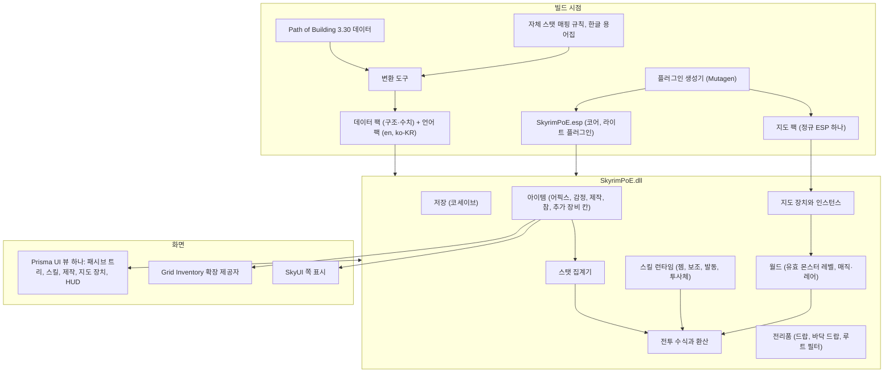

# Skyrim PoE — 통합 설계서 v3.3

작성: 2026-11-12 (v3.1: 같은 날 Codex 교차 검토의 지적을 반영. 사실 오류와 지나친 단정을 고치고 17장을 추가. v3.2: 같은 날 프로토타입 1·2의 결과로 사이클론 모션의 방식을 OAR로 확정하고(결정 48), 2.2·6.7·14장·부록을 맞춤. 그 뒤 6.7에 결정 49(최소 한 바퀴, 잠정)와 결정 50(회전과 타격은 DLL)을, 6.4에 결정 51(치명타의 출처)과 결정 52(스킬 주문은 우리 레코드, 아군과 자신 제외)를 반영. 프로토타입 2의 7차 시험 결과로 6.4의 빼는 방법 항목을 맞추고, 6.4와 7.3에 결정 53(스킬 피해는 난이도 배율을 그대로 받음)을, 6.7에 결정 54(강공격 입력이 여럿이면 공격 버튼 길게 누르기에만 채널링)를, 6.4에 결정 55(스킬 피해는 DLL이 직접 적용)를, 6.7에 결정 56(채널링 중 약한 경직 무시)을 반영. 프로토타입 4의 브라우저 단계 결과로 4.1·12.2·14장을 맞춤. v3.3: 2026-11-13 프로토타입 5의 결과로 어픽스를 아이템에 묶는 식별 수단을 확정하고(결정 59), 6.1·8.1·8.2·13장·14장·17장을 맞춤. 같은 날 프로토타입 5의 9차 시험 결과로 8.2와 14장의 확인 범위를 고침. 10차 시험 결과로 8.2와 14장의 저장 왕복 범위를 고침. 결정은 그대로. 같은 날 CommonLibSSE-NG의 판을 v16.4.0에 고정하기로 하고(결정 60) 그 사실을 DLL 항목에 적음. 같은 날 트리 화면의 성능 목표와 여는 방식을 정하고(결정 61) 12.2·14장·부록의 표를 맞춤. 같은 날 프로토타입 6(투사체)의 2·3차 결과로 6.4와 14장 3번의 확인 범위를 고침. 같은 날 환산의 식을 정하고(결정 62) 7.3과 17장을 맞춤)

스카이림 SE/AE에서 Path of Exile의 빌드·파밍·엔드게임을 구현하는 SKSE 모드의 현재 설계입니다.
Carbon이 쓴 설계서 6개 판(v0.1~v2.2)의 내용에, 2026-11-12에 검증한 사실과 사용자가 정한 결정을 반영해 하나로 합쳤습니다.

## 0. 이 문서를 읽는 법

- 결정이 내려진 경위와 조사 근거는 `docs/설계-현황.md`에 있습니다. 이 문서는 "지금 설계가 무엇인가"만 담습니다.
- 항목 끝의 표시는 다음을 뜻합니다.

| 표시 | 뜻 |
| --- | --- |
| [확정] | 사용자가 직접 정함. 괄호 안 번호는 설계-현황 2장의 결정 번호 |
| [잠정] | Claude가 제안했고 사용자가 반대하지 않음. 바꾸기 전에 확인 |
| [제안] | Claude가 이 문서를 쓰면서 새로 넣은 안. 사용자가 아직 보지 않음 |
| [원안] | Carbon 설계서의 내용을 그대로 둔 것. 사용자가 따로 확인한 적 없음 |
| [미정] | 아직 정하지 않음 |
| [미검증] | 실행으로 확인되지 않은 기술적 전제 |

- **기준 게임 전환 중(2026-11-24 결정 189):** 기준 게임이 PoE1 3.30에서 PoE2로 바뀌었습니다. 이 문서의 스킬·보조 젬·패시브 트리·전직·아이템·화폐·상태 이상·엔드게임 내용 가운데 PoE1을 전제로 한 부분(결정 41·104를 근거로 든 곳)은 전환 계획(`docs/7단계-PoE2-전환-계획.md`)의 각 마일스톤에서 결정이 바뀔 때마다 다시 씁니다. 다시 쓰기 전까지 그 부분의 [확정]·[잠정] 표시는 "PoE1 기준일 때의 결정"으로 읽습니다.
- 이 문서 전체가 아직 코드로 검증되지 않았습니다. Carbon 원문의 "검수 통과"는 문서상 점검이었고, 여기서는 그 표현을 쓰지 않습니다.
- 내부 이름은 `SkyrimPoE`입니다. 공개 제목은 미정입니다.

## 1. 무엇을 만드는가

스카이림의 1·3인칭 액션 전투를 그대로 두고, 그 위에 PoE의 성장·스킬·아이템·엔드게임을 얹습니다.

포함하는 것 [확정 1]:
- 스킬 젬과 보조 젬
- 접두·접미 어픽스가 붙는 장비와 오브 제작
- 패시브 트리, 키스톤, 전직
- PoE식 전투 수식(속성 피해, 방어 계층, 상태이상)
- 지도 장치 기반의 반복 엔드게임
- 사이클론, 블레이드 볼텍스 같은 PoE의 스킬

### 1.1 설계 원칙

1. **바닐라 위에 얹는다.** 바닐라와 다른 모드의 퍽, 마법부여, 연금술, 레벨드 리스트, 원본 던전을 수정하지 않습니다. 이유는 호환입니다. [확정 5]
2. **스카이림 조작이 기준이다.** PoE 요소는 스카이림의 조작과 체계에 녹이고, 녹이는 과정에서 불필요한 것은 쳐냅니다. [확정 36]
3. **특정 환경을 전제로 삼지 않는다.** 넥서스 공개 배포가 목표이므로, 개발에 쓰는 모드팩의 특징을 설계의 전제로 두지 않습니다. [확정 40]
4. **내용은 PoE1, 구조는 맞는 쪽에서.** 스킬·보조 젬·패시브 트리·전직·고유 아이템의 내용과 데이터는 PoE1 3.30을 따릅니다. 스카이림에 맞추기 쉬운 구조(젬의 보조 소켓, 지속 버프 자원, 참)는 PoE2에서 빌립니다. [잠정 41]
5. **Calamity와 독립.** 코드, 플러그인, 저장 데이터를 공유하지 않습니다. [확정 4]
6. **사실은 대조한 뒤에 쓴다.** 모드 버전, API 함수, 수치는 실제 파일이나 공식 문서로 확인한 것만 확정으로 취급합니다.

### 1.2 초기 범위에서 빼는 것

- 토템, 덫, 지뢰, 소환수 관련 스킬과 보조 젬. 설치물이나 소환 개체가 따로 필요해 부담이 큽니다. [잠정]
- 장비의 젬 소켓·링크·색과 그에 딸린 오브(쥬얼러, 퓨징, 크로마틱). [확정 42]
- 키를 눌러 쓰는 플라스크. [확정 37]
- 자체 스킬 핫바. [확정 47]
- 전직용 미궁. 규모가 커서 보스 이정표 방식으로 대체합니다. [확정 10]
- 탑다운 시점과 클릭 이동. [확정 2]

## 2. 배포와 환경

### 2.1 배포 방침

| 항목 | 내용 | 상태 |
| --- | --- | --- |
| 배포 | 넥서스 공개 배포가 목표 | [확정 19] |
| 지원 런타임 | SE 1.5.97과 AE 1.6.x | [확정 19] |
| 라이선스 | GPL-3.0. 같은 라이선스의 모드 코드를 가져다 쓸 수 있음 | [확정 30] |
| 라이선스 경계 | Prisma UI는 GPL이 아닌 자체 라이선스이고 스카이림 자체도 비공개 프로그램임. GPL 모드가 이들과 함께 동작하려면 Grid Inventory처럼 모딩·링크 예외 조항을 붙이는 것이 통례. 가져오는 코드·헤더·에셋별 출처와 조건 표도 필요 | [미정] |
| PoE 이름과 트리 | 그대로 쓰고 배포물에 포함. 다만 젬·어픽스·고유 아이템 데이터의 원천인 PoB의 `Data`는 게임 파일에서 추출된 것이고(파일 머리말에 GGG 저작권 표기), 비수익과 비제휴 표기는 위험을 줄일 뿐 권한의 증명은 아님. 사용자는 이 점을 알고 정했음 | [확정 27] |
| 수익화 | 하지 않음. 넥서스 기부 포인트도 받지 않음 | [확정 28], [잠정 33] |
| 제목 | 자체 제목에 PoE를 함께 표기. 설명에 GGG와 제휴·승인 관계가 아님을 적음 | [확정 29], [잠정 33] |
| 이미지·음향 | PoE의 이미지와 음향은 넣지 않음. 아이콘은 자체 제작 | [확정 19] |
| 설명 글·수치 | PoB 원문을 복사하지 않고 우리 스탯 매핑에서 생성. 수치는 스카이림에 맞춰 조정 | [잠정 31] |

### 2.2 선행 모드

선행 모드는 개발에 쓰는 모드팩에 무엇이 깔려 있는지가 아니라, 넥서스와 커뮤니티에서 가장 나은 것을 기준으로 고릅니다. [확정 14]

| 구분 | 모드 | 쓰임 | 상태 |
| --- | --- | --- | --- |
| 필수 | SKSE64, Address Library | 기반 | [확정] |
| 필수 | Prisma UI 1.5.1 이상, Media Keys Fix SKSE | 모든 자체 화면. 사용자는 "Prisma UI에 얽매이지 말고 가장 좋은 것을 고르라"고 했고(확정 7), Carbon의 비교와 Claude의 문서 확인을 거쳐 Prisma UI로 둠 | [잠정]. Media Keys Fix가 Prisma UI의 필수 요구인 것은 확인됨 |
| 필수 | Open Animation Replacer | 사이클론의 회전 모션. 채널링 중에 무기를 든 이동 클립을 회전 모션으로 바꿈. Animation Injector는 사이클론에 쓰지 않음 | [확정 48]. 첫 스킬인 사이클론의 모션이 여기에 기대므로 "조건부"에서 "필수"로 옮김(분류는 Claude의 판단). AE 1.6.1170 + MCO에서 실행 확인, 바닐라·BFCO 환경과 SE 1.5.97은 [미검증] |
| 권장 | Grid Inventory | 최상의 아이템 화면(카드 안 어픽스, 소켓 배지, 끌어다 놓기) | [확정 26] |
| 선택 | TrueHUD | 적 에너지 실드를 특수 바에 표시(비어 있을 때만) | [확정 23] |
| 선택 | Light Placer | 전리품 빛기둥에 실제 조명 | [원안] |
| 선택 | Inventory Interface Information Injector | SkyUI에서 전용 아이콘 | [원안] |
| 선택 | Death Drop Overhaul | 바닥 드랍의 물리 연출과 회수 | [미정] |
| 선택 | Precision | 사이클론 중 적 통과 | [원안], [미검증] |
| 선택 | Sound Record Distributor(넥서스 77815) | 드랍 효과음 분배 | [원안] |
| 호환 | Spell Hotbar NG | 주문 스킬이 실제 주문이라 그대로 쓸 수 있음 | [확정 47], [미검증] |

원문에서 필수로 꼽았던 Animation Motion Revolution과 powerofthree's Tweaks는 실제로 필요한지 다시 따져야 합니다. [미정]

선택 모드가 없어도 모드는 동작해야 합니다. 외부 DLL의 기능은 정적 링크하지 않고, 로드 시점에 버전을 확인해 얻으며, 없거나 버전이 다르면 내장 방식으로 돌립니다. [확정 19], [원안]

### 2.3 다른 모드와의 관계

- 아이템에 어픽스나 소켓을 붙이는 모드(Calamity, DiabloRim, Socketing 등)와는 함께 쓰지 않는 것을 전제로 합니다. 감지되면 시작할 때 한 번 경고하고 동작은 막지 않습니다. [확정 38]
- 적의 레코드와 능력치를 건드리지 않으므로 적 오버홀, 조우 지역 모드, 난이도 모드와 레코드 충돌은 없습니다(7.3 참고). [확정 45] 그러나 이것이 실행 중의 호환까지 보장하지는 않습니다. 피해 훅, 무적 시간, 방어 계산, 처치 판정은 레코드와 무관하게 다른 모드와 겹칠 수 있어 따로 검증해야 합니다. [미검증]
- 전설 적처럼 다른 모드가 만든 정예 개체에 우리의 매직·레어 승격이 겹치는 경우의 규칙은 미정입니다. [미정]

## 3. 전체 구조

- DLL은 CommonLibSSE-NG로 SE와 AE를 한 바이너리로 지원합니다. 버전 분기는 컴파일 시점이 아니라 실행 시점에 합니다. [원안]
- CommonLibSSE-NG는 공식 저장소(`alandtse/CommonLibSSE-NG`)의 v16.4.0에 고정합니다. [확정 60] 프로토타입을 빌드한 v9.0.2에는 AE 주소 번호가 틀린 함수가 있었고(프로토타입 5의 첫 시험이 그 때문에 튕김), 그 뒤의 판에서 고쳐졌습니다. 프로토타입 2·5는 2026-11-19에 v16.4.0으로 옮겨 게임에서 다시 돌렸고 v9.0.2 때와 같은 결과를 얻었습니다(AE 1.6.1170). 4는 그대로 v9.0.2입니다. 저장소에는 서브모듈(`external/CommonLibSSE-NG`)로 두었습니다. 그 커밋에 고정하고, 상류의 새 판은 변경 기록을 읽고 일부러 올릴 때만 따라갑니다. 본 모드의 첫 작업으로 정한 프로토타입 2와 5의 재확인은 2026-11-19에 마쳤습니다.
- 코어 플러그인은 폼 수가 적어 라이트 플러그인으로 둡니다. 지도 팩은 정규 ESP 하나입니다. [확정 20]
- 스킬, 어픽스, 패시브의 효과는 주문이나 퍽 레코드를 액터에 붙이지 않고 DLL 안에서 계산합니다. 수백 개의 능력을 붙이면 엔진의 조건 평가가 느려지기 때문입니다. 엔진에 꼭 반영해야 하는 값(이동 속도, 최대 생명력 등)만 한 곳에서 더하고 제거 시 되돌립니다. [원안]

## 4. 데이터

### 4.1 출처

- 기준 데이터는 Path of Building Community 2.68.1의 PoE 3.30 데이터입니다. 로컬 경로는 `G:\poe\PathOfBuilding-2.68.1\`. [확정 34, 104] 3.29(2.67.2)에서 옮길 때 몬스터 표, 사이클론·치명타 시 시전·블레이드 볼텍스 데이터, 방어 공식이 같음을 확인했습니다.
- 위키는 스킬과 메커니즘이 어떻게 동작하는지 읽는 참고 자료로만 씁니다. [확정 34]
- 3.29 실측: 패시브 노드 3,396(트리에 놓이는 것은 2,916. 나머지는 그룹이 없는 노드 402와 프록시 78), 키스톤 57, 주요 패시브 1,003, 마스터리 353, 주얼 소켓 60, 전직 이름 37종, 젬 항목 821(액티브 558, 보조 263, 보조는 각성판을 합쳐 226종).
- 3.30에서 달라진 것(2026-11-19 실측): 프록시 노드가 72개 늘어 노드 3,468, 주요 패시브 1,027(늘어난 24개도 프록시). 늘어난 노드는 새 주얼(Putrid Seed, 하나만 장착)을 큰 주얼 소켓 6곳 가운데 하나에 넣으면 그 자리에 나타나는 것이고, 72개는 여섯 자리 몫의 합입니다. 기본 트리에 놓이는 노드 집합(2,916)과 연결선 수는 같고, 노드 2개의 좌표와 큰 주얼 소켓의 연결, 그룹 번호가 바뀌었습니다. 기존 노드 93개는 `stats` 문자열이 바뀌었고(문구만 바뀐 것 포함), 56개는 `masteryEffects`가 바뀜. 젬 항목 824(액티브 561, 보조 263). 키스톤·마스터리·주얼 소켓·전직 수는 같습니다.

### 4.2 변환 도구

- PoB의 데이터 파일은 형식이 한 가지가 아닙니다. `Gems.lua`는 `return { … }` 형태의 표라서 그대로 불러올 수 있지만, `Data/Skills/*.lua`는 PoB가 넘겨주는 `skills, mod, flag, skill` 인자와 전역 열거형(`SkillType`, `ModFlag`), `bit.bor`에 의존하고 함수(예: Blade Vortex의 `preDamageFunc`)도 들어 있습니다. 따라서 PoB의 로더를 흉내 낸 제한된 실행 환경을 만들어 불러와야 하고(2.68.1에서는 `return function(skills, mod, flag, skill) … end` 형태로 바뀌었고 `Misc.lua`도 `return data`로 끝남), 함수로 표현된 동작은 표로 옮겨지지 않으므로 스킬별로 직접 구현합니다.
- PoB 버전마다 파일 배치가 다릅니다(3.29에서 어픽스 파일이 여러 개로 나뉨). 버전을 설정으로 받고 배치 차이는 버전별 어댑터에서 흡수합니다.
- 트리는 빌드 시점에 노드의 최종 좌표, 연결선의 호 정보, 아이콘 좌표를 미리 계산합니다. [원안]
- 트리에는 리그 전용 전직과 프록시 노드가 섞여 있습니다. 기본 전직 19종만 쓰려면 변환 단계에서 걸러야 합니다.
- 세이브는 표시 이름이 아니라 바뀌지 않는 내부 ID로 노드와 전직을 기록합니다. 예: 레인저 전직의 내부 ID는 `Raider`, 표시 이름은 `Warden`. [원안]

### 4.3 데이터 팩과 언어 팩

- 이름, 설명 글, 수치를 코드와 분리해 데이터 팩으로 둡니다. 방침이 바뀌어도 팩만 교체하면 됩니다. [잠정 32]
- 언어는 팩으로 분리합니다. 영어만으로 동작하고 `ko-KR`은 선택입니다. [확정 35]
- 스탯 매핑: PoE의 효과를 우리 스탯 엔진의 항목으로 옮기는 규칙입니다. 이 규칙이 설명 글 생성의 원천이기도 합니다. [원안]
  - 입력이 한 종류가 아닙니다. 패시브 노드의 효과는 사람이 읽는 문장으로 들어 있고(예: Blood Magic은 네 가지 효과가 한 문자열), 스킬은 스탯 ID와 조건과 함수로 들어 있습니다. 그래서 "스탯 하나 → 항목 하나"의 단순한 표가 아니라, 문장을 해석하는 파서와 조건·범위·무기 한정 같은 의미를 담는 중간 표현이 필요합니다.
  - 모든 노드·젬·어픽스를 "지원", "재설계", "제외" 가운데 하나로 분류한 목록을 둡니다. 변환 도구는 분류되지 않은 것이 있으면 빌드를 실패시킵니다. 제외로 분류한 것은 화면에 비활성으로 표시합니다. 이렇게 해야 "빈 껍데기 금지"와 "일부 노드는 비워 둔다"가 서로 부딪치지 않습니다.

### 4.4 한글화

- 남의 번역 묶음을 쓰지 않고 직접 합니다. [확정 35]
- 이름은 공개된 자료에서 공식 한글 명칭을 확인해 맞춥니다.
- 설명 글은 스탯 매핑에서 한글과 영어로 직접 생성합니다.
- 기본 용어(생명력, 에너지 보호막, 치명타 확률 등)는 공식 한글판 표기를 따르는 용어집을 먼저 만듭니다.
- 구현하는 콘텐츠 범위만큼만 채워 갑니다.

## 5. 캐릭터 성장

### 5.1 유배자 레벨 [확정 17]

- 스카이림 레벨과 분리된 1~100 레벨입니다. 적을 처치해 얻는 경험치로만 오릅니다.
- 패시브 포인트는 레벨로 99점, 보스 업적으로 24점, 합쳐 최대 123점입니다. 3.30 트리 파일의 `totalPoints`와 같습니다(3.29도 같음).
- 스카이림 쪽 레벨링 모드(경험치 방식 변경, 레벨 상한 해제, 스킬 책 등)와 경험치 변수를 공유하지 않습니다. 다만 다른 모드가 적의 수, 레벨, 처치 속도를 바꾸면 처치 기반인 유배자 경험치의 진행 속도는 달라집니다. 유효 몬스터 레벨이 적과 플레이어의 스카이림 레벨 차이를 보므로(결정 116), 스카이림 레벨을 빨리 올리는 모드가 있으면 적이 상대적으로 낮게 잡혀 유배자 경험치가 줄어들 수 있습니다(적도 함께 레벨이 오르면 달라짐).
- 장착한 스킬 젬도 같은 처치 경험치로 성장합니다. [원안]
- 처치 보상(경험치, 드랍, 참 충전, 전직 이정표의 처치)은 모두 같은 처치 정의(결정 113)를 씁니다. 결정 113·114대로면 셀 초기화로 다시 살아난 같은 보스도 이정표의 "N회 처치"에 다시 셉니다. "첫 처치"는 캐릭터(세이브)당 업적·보스 종류별 1회입니다. [확정 149]
  - 그 적이 이번에 살아 있는 동안 플레이어가 한 번이라도 피해를 줬으면, 마지막 타격을 동료나 소환수가 쳐도 보상을 줍니다. 동료 혼자 잡은 적은 보상이 없습니다. 동료와 소환수의 피해는 환산을 받지 않으므로(7.3, [확정 142]) 동료만으로 레벨을 올리는 길을 막습니다. 기여와 첫 피해 때의 적대 기록은 메모리에만 두고 저장하지 않으므로, 결정 113·134는 저장·불러오기를 건너지 않는 한 세션의 삶에 적용합니다. [확정 113, 138] 바닐라 공격으로 준 피해와 제3자·환경의 마무리도 원문대로면 지급 대상입니다. 플레이어 소환수의 피해는 플레이어의 피해로 치지 않아 소환수 혼자 잡은 적도 보상이 없습니다. [제안]
  - 보상은 살아난 삶마다 한 번입니다. 셀 초기화로 다시 살아난 적은 다시 보상을 주고, 같은 삶에서 죽음 판정이 두 번 와도 한 번만 줍니다. [확정 114] 보스 업적·전직의 "첫 처치"는 캐릭터(세이브)당 업적·보스 종류별 1회로 셉니다(2단계 첫 조각은 유배자 레벨 경험치만 먼저 구현). [확정 149]
  - 적이 소환한 존재와 되살아난 시체는 경험치·드랍·참 충전을 주지 않습니다. 되살아나기 전의 삶에서 보상을 받았는지와 무관합니다. 판정은 엔진의 소환·되살림 상태로 합니다. [확정 115], [미검증] 전직 이정표에도 세지 않습니다. [제안]
  - 경험치와 드랍 등급에 쓰는 오픈월드 적의 유효 몬스터 레벨은 유배자 레벨을 기본으로, 스카이림 레벨 차 1:1 보정(`[-10, +10]` 클램프) + 보스·드래곤 `+3`(최대 `+5`)을 더한 뒤 `[1, 100]`으로 클램프합니다. 지도 안에서는 지도가 정합니다. 오픈월드 환산의 기준은 결정 45·62대로 유배자 레벨입니다. [확정 116, 146] 유효 몬스터 레벨을 다른 용도에는 쓰지 않습니다. [잠정]
  - 비적대였던 대상은 그 삶에서 처음 맞을 때 이미 적대였던 경우에만 보상합니다. [확정 134] 처치 경험치와 레벨업 곡선은 "레벨마다 같은 레벨 적을 몇 마리 잡으면 오르는가"로 설계하고(2단계 첫 조각은 선형 임시 곡선 `kills(L) = 10 + 2 × (L − 1)`, 기본 처치 경험치 100 × 배율, 레벨 100 상한) [확정 135, 147], 플레이어보다 낮은 적에게만 PoB 2.68.1 레벨 차 벌칙 식(안전 폭 `3 + ⌊L/16⌋`, 하한 1%)을 적용하고 높은 적은 레벨당 `+10%`(상한 2배)를 줍니다(모든 수치는 INI 설정 노출). [확정 136, 146]
  - 기여는 체력이나 에너지 실드를 실제로 0보다 많이 깎은 피해만 셉니다(부분 막기로 체력이 깎이면 인정, 완전 0피해·완전 막기만 제외). 첫 피해의 적대 여부는 피해 적용 직전에 읽고, 기여는 피해 적용 직전(예상 피해 > 0)에 선기록한 뒤 실제 감소가 0이면 취소합니다. [확정 140] 보상은 사망 확정에서만 주고, 사망 시작에서는 소환·되살림 상태를 고정합니다. 새 삶은 우리가 매기는 삶 번호로 압니다. [잠정 137]
  - 소환·되살림 판정 함수가 실제로 무엇에 참인지, 부분 지급의 복구, 처치 시 효과와의 관계는 설계-현황 5장 46번에 있습니다. [미정]
- 고레벨에서 사망 시 현재 레벨 안의 경험치 일부를 잃는 벌칙, 진행 중인 세이브에 처음 설치했을 때의 초기 레벨 보정은 원안에 있으나 확정되지 않았습니다. [원안]

### 5.2 클래스와 능력치

- 시작 클래스는 PoE1의 7종이고 플레이어가 직접 고릅니다. 새 게임 시작 때 강제로 묻지 않고, 패시브 트리를 처음 열 때 고릅니다. 그 전까지 포인트는 쌓입니다. [확정 8], [원안]
- 클래스별 기본 힘·민첩·지능은 PoE1의 값을 따릅니다(예: 마로더 32/14/14, 사이온 20/20/20). [원안]
- 할당한 노드를 모두 회수하면 클래스를 다시 고를 수 있으며, 이때 전직도 함께 초기화됩니다. [확정 153]
- 능력치가 모자라 젬이나 아이템의 요구치를 못 채우면, 장비를 벗기지 않고 그 아이템의 PoE 효과만 끕니다. 스카이림의 장비 해제를 강제로 부르면 의상 모드에서 사고가 납니다. [원안]

### 5.3 패시브 트리

- PoE1 3.30의 트리를 원본 규모로 씁니다. [확정 6, 27]
- 노드 회수 시 연결성 검사는 현재 클래스의 시작점뿐 아니라, 사이온 전직이 열어 주는 다른 클래스의 시작점까지 출발점으로 삼습니다. [원안] 3단계 노드 회수는 무료로 시작해 4단계 오브 구현 시 후회의 오브 소비로 전환합니다(`FreePassiveRefund` INI 설정 유지). [확정 152]
- 마스터리는 주변의 주요 패시브를 찍으면 열리고, 효과 목록에서 하나를 고릅니다. 같은 마스터리 효과는 중복 선택할 수 없으며, 근거 주요 패시브를 모두 회수하면 연결된 마스터리도 자동 회수됩니다. [확정 153]
- 주얼 소켓은 트리에 주얼을 끼우는 자리입니다. 장비의 젬 소켓과는 별개라서 그대로 둡니다. 군단·시간 초월 주얼 같은 복잡한 종류는 초기 범위 밖입니다. [제안]
- 플라스크, 토템, 덫, 지뢰, 소환수, 주얼 장착처럼 후속 단계(4~5단계) 기능을 전제로 하는 노드는 3단계에서 경로 통과용으로 표시·할당 가능하되 툴팁에 `[추후 적용]` 배지를 표시합니다. [확정 153] 3단계 노드 아이콘은 노드 종류 × 스탯 계열별 자체 SVG/Canvas 벡터 심볼로 제공합니다. [확정 154]

### 5.4 전직 [확정 10, 18, 151]

- 전직 포인트는 8점이고 2점씩 네 번 얻습니다. 3단계에서 기본 전직 19종의 트리 구조·선택·노드 할당·스탯 매핑과 1~3차 보스 이정표(6점) + 개발/시험용 지급 옵션을 먼저 구현하고, 4차 결투장(2점)은 6단계에서 붙입니다. [확정 151]
- 1~3차는 보스 처치 이정표로 풉니다. 원안의 조건은 다음과 같고 수치는 확정되지 않았습니다. [원안]

| 차수 | 조건(원안) |
| --- | --- |
| 1차 | 첫 드래곤 처치 또는 던전 보스 5회 처치 |
| 2차 | 이름 있는 드래곤 프리스트나 대형 퀘스트의 중간 보스 처치 또는 던전 보스 15회 처치 |
| 3차 | 고위 보스 처치 또는 지도 장치의 낮은 티어 보스 첫 처치 |
| 4차 | 공물 아이템으로 입장하는 전용 결투장에서 부활 없이 3페이즈 보스 처치 |

- 보스 판정은 특정 FormID가 아니라 종류와 위치 표식(드래곤, 보스 위치 참조, 고유 액터 여부 등)으로 합니다. 모드가 추가한 보스도 포함되게 하려는 것입니다. [원안], [미검증]
- 이정표의 처치도 5.1의 처치 정의(결정 113)를 따릅니다. 결정 113·114대로면 셀 초기화로 다시 살아난 같은 보스도 "N회 처치"에 다시 셉니다. 적이 소환한 존재와 되살아난 시체를 이정표에 세지 않는 것(결정 115를 넓힌 것)은 [제안]입니다. "첫 처치"는 캐릭터(세이브)당 업적·보스 종류별 1회로 셉니다(패시브 보스 업적 24점과 마지막 전직 2점은 1회 지급). [확정 149]
- 기본 전직은 PoE1의 기본 19종(내부 `id` 기준 매칭, 예: `Raider`→`Warden`)입니다. 리그/블러드라인 전직과 고유 아이템 의존 Scion 추가 전직(`Reliquarian`, `Luminary`)은 제외합니다. [확정 151]

## 6. 스킬

### 6.1 젬의 구조 [확정 42]

- 스킬 젬이 보조 소켓을 직접 가집니다. 장비에는 젬 소켓이 없습니다.
- 보조 젬은 스킬 젬에 끼웁니다. 호환 여부는 화면에 보이는 태그가 아니라 PoE1 데이터의 스킬 유형 규칙으로 판정합니다. 보조 젬마다 요구 유형(`requireSkillTypes`, 논리 연산 포함), 제외 유형(`excludeSkillTypes`), 스킬에 더하는 유형(`addSkillTypes`)이 있습니다. 예: Spell Echo는 발동된 스킬·즉발·토템 등을 제외합니다. 보조가 유형을 더하므로 평가 순서도 정해야 합니다.
- 젬 하나의 보조 소켓 수와 늘리는 방법은 미정입니다. PoE1의 6링크가 보조 5개에 해당하므로 최대 5개가 기준선입니다. [미정]
- 같은 종류의 보조 젬을 한 스킬에 중복해 끼울 수 있는지는 미정입니다. [미정]
- 스킬 칸에 장착한 젬과 그 젬에 끼운 보조 젬은 인벤토리에서 빠지고 우리 데이터로만 있습니다. 칸에서 빼면 다시 아이템으로 나옵니다. [확정 105]
- 갓 얻은 레벨 1·품질 0 젬은 데이터 없는 아이템이라 겹쳐 쌓이고, 처음 장착하거나 보조로 끼울 때 고유 ID와 데이터(레벨, 품질, 경험치, 끼운 보조)가 생깁니다. [확정 106] 칸에서 빼서 나온 데이터 있는 젬 아이템은 장비와 같은 식별 수단(8.2, 결정 59)으로 따라갑니다. [제안]
- 보조를 끼운 스킬 젬을 칸에서 빼면 보조를 끼운 채 하나의 아이템으로 나옵니다. 그 젬을 팔거나 잃으면 보조도 함께 갑니다. [확정 107]
- 보조 젬도 PoE1처럼 레벨·품질을 가지고, 장착한 동안 경험치를 얻습니다. [확정 108] 발동 젬 안에 담긴 주문 젬과 그 보조 젬도 결정 105~108과 같은 소유 규칙(장착 시 인벤토리 제거, 첫 장착 시 ID 발급, 발동 젬을 빼면 함께 나옴)을 따릅니다. [확정 145] 장착하지 않은 젬에 보조를 끼울 때, 우리 인스턴스 ID와 결정 59 키의 연결, 젬 아이템의 폼, 모드를 지울 때 등 남은 세부는 설계-현황 5장 44번에 있습니다. [미정] 같은 젬 둘이 각자의 주문으로 이어지는지는 아직 프로토타입으로 보지 않았습니다(14장 12번).

### 6.2 스킬 화면과 발동 방식 [확정 47]

스킬 화면의 칸마다 스킬 젬을 넣고 "어느 입력에 얹을지"를 고릅니다. 새 키를 만들지 않고 스카이림이 이미 가진 입력을 씁니다.

| 스킬 종류 | 얹는 입력 | 예 |
| --- | --- | --- |
| 공격 스킬 | 일반 공격, 강공격, 질주 중 공격 가운데 하나 | 번개 타격, 대지 강타 |
| 채널링 | 강공격 버튼을 누르고 있는 동안 | 사이클론 |
| 이동기 | 질주 중 공격 | 도약 강타, 방패 돌진 |
| 주문 스킬 | 실제 주문으로 등록되어 손에 장착 | 화염구, 얼음 폭발 |
| 즉발 스킬 | 파워로 등록되어 포효 키로 사용 | 가드 스킬, 함성 |
| 지속 버프 | 입력 없음. 켜 둠 | 오라, 전령 |
| 발동 젬 | 입력 없음. 조건이 되면 자동 | 치명타 시 시전 |

- 공격 스킬은 무기 종류 조건을 가집니다. 조건에 맞지 않는 무기를 들면 그 입력은 원래 공격으로 돌아갑니다.
- 대부분의 공격 스킬은 지금 쓰는 공격 모션을 그대로 쓰고, 타격이나 발사 시점에 효과를 얹습니다. 새 모션이 꼭 필요한 것은 채널링 정도입니다.
- 주문 스킬을 실제 주문 폼으로 두는 것은 즐겨찾기, Wheeler, Spell Hotbar NG, Grid Inventory의 퀵 휠에서 쓸 수 있게 하려는 것입니다. 다만 외부 도구는 자체 시전 시간과 쿨다운을 갖고 손 시전을 거치지 않고 직접 시전하기도 합니다. 손 시전만 가로채면 젬의 비용·요구치·쿨다운을 우회할 수 있으므로, 어느 경로로 시전하든 통과하는 공통 검증·비용 확정 지점이 필요합니다. [미검증]
- 같은 스킬 젬을 둘 가지고 서로 다른 보조를 끼울 수 있으므로, 젬은 스킬 칸마다 미리 둔 고정 대리 주문(주문용과 파워용)으로 내보냅니다. 그 칸에 든 젬이 대리 주문의 이름·효과·비용을 정하고, 실행 중에 폼을 만들지 않습니다. 젬을 다른 칸으로 옮기면 즐겨찾기를 다시 등록해야 합니다. [확정 89] 대리 주문의 이름·비용·시전 시간·투사체는 실행 중에 바꿀 수 있고 다음 시전부터 반영되며, 손 HUD·즐겨찾기·마법 메뉴에 바뀐 이름이 보입니다(프로토타입 10). 바꾼 값은 세이브에 남지 않으므로 불러올 때마다 다시 적용합니다. 아이콘, Wheeler·Spell Hotbar NG의 반영은 [미검증]입니다.
- 같은 이름의 대리 주문이 둘 이상이면 그 주문들에만 칸 번호를 붙입니다("화염 화살 [2]"). [확정 91]
- DLL이 내는 내부 발동(6.4의 치명타 시 시전)은 대리 주문을 쓰지 않고 엔진의 시전을 거치지 않으며, 별도 내부 관문(연결 공격의 치명타 + 젬 쿨다운 + 매지카 차감)을 통과한 DLL 직접 발동만 허용합니다. [확정 145]
- 스킬의 피해와 효과는 우리 관문(쿨다운 판정과 비용 차감을 지난 시전)을 지난 시전에만 DLL이 줍니다. 콘솔·스크립트·외부 도구로 대리 주문을 직접 시전하면 관문을 거치지 않으므로(프로토타입 10), 그런 시전은 보이는 투사체만 나가고 효과가 없습니다. [확정 90] 손 시전의 투사체는 엔진이 시전 판정을 통과시킨 바로 그 호출 안에서 나가므로, 그 동안 나간 투사체를 허가로 표시하고 적중 때 그 표시를 확인합니다(프로토타입 10, 미사일로 실행 확인). 광선·분사·구름 투사체와 액터 적중은 [미검증]입니다.
- 강공격과 질주 공격에 자체 모션을 넣는 무브셋(MCO, BFCO)을 그대로 두고 싶은 사람을 위해 "스킬 키" 1~2개를 선택 사항으로 둡니다.
- 스킬 칸은 9개이고 처음부터 모두 열립니다. 칸의 종류는 나누지 않아 어느 칸에나 어떤 스킬이든 넣을 수 있고, 발동 젬 안의 주문 젬은 칸을 따로 쓰지 않습니다. 9는 조절값입니다. [확정 88]
- 공격 입력을 가로채 스킬로 바꾸는 부분이 여러 전투 모드와 함께 안정적으로 도는지, 주문의 시전 시간과 비용을 우리 쪽에서 통제하는 방법은 프로토타입으로 확인합니다. [미검증]

### 6.3 지속 버프의 자원 [확정 43]

- 오라와 전령 같은 지속 버프는 매지카를 점유하지 않고 전용 자원을 씁니다(PoE2의 Spirit에 해당).
- 지속 버프는 매지카를 점유하지 않습니다. 매지카는 스킬 비용에 씁니다(주문뿐 아니라 공격 스킬과 채널링도, [확정 95]).
- 자원의 이름, 총량을 얻는 방법, PoE1 오라의 점유 비율을 이 자원의 비용으로 옮기는 기준은 미정입니다. [미정]

### 6.4 발동 젬 [확정 47]

- 소켓이 젬 쪽에 있으므로, 발동 젬은 주문 젬을 담는 젬입니다(구조는 PoE2의 메타 젬).
- 발동 조건은 PoE1식입니다. 예: "치명타 시 시전"은 공격이 치명타로 적중하면 담긴 주문을 시전하고, 쿨다운은 0.15초입니다.
- 발동 젬 칸은 연결할 공격 칸 하나를 고르고, 그 공격 스킬의 치명타 적중만 발동을 일으킵니다. 다른 칸의 공격과 바닐라 평타는 일으키지 않습니다. [확정 100]
- 담긴 주문이 여럿이면 발동마다 하나씩 돌아가며 시전하고 쿨다운 중인 주문은 건너뜁니다. [확정 101] 쿨다운 0.15초는 주문마다 따로 돕니다. [확정 102]
- 발동으로 나간 주문은 어떤 발동도 일으키지 않습니다(깊이 1). 그 주문의 상태이상, 처치 시 효과, 흡수는 그대로 적용합니다. [확정 103] 구현은 피해마다 출처 표시를 달아 발동으로 나간 것을 가리는 방식입니다. [원안] 비용과 담을 수 있는 주문 수는 아래(결정 126·132), 발동 주문의 내부 관문은 위 6.2(결정 145)입니다.
- 발동된 주문은 발동할 때마다 그 주문의 비용(PoB의 +20%)을 매지카에서 냅니다. [확정 126] 차례인 주문의 비용이 모자라면 그 발동은 일어나지 않고 차례는 그 주문에 남으며 쿨다운도 돌지 않습니다. [확정 127] 매지카의 단위는 스카이림 매지카가 주인이고 비용이 풀에서 차지하는 몫이 PoE와 같게 옮깁니다(생명력(7.2)과 같은 꼴): 최대 매지카 = 스카이림이 원래 정한 최대 매지카 × (PoE 마나 ÷ 그 유배자 레벨의 기대 마나), 비용 = PoE 비용 × (최대 매지카 ÷ PoE 마나). [확정 125] 기대 마나(L)는 `(34 + 6 × L) × (1 + I_마나)`(PoB 2.68.1 기본 마나, 지능 몫 제외, 첫 조각 `I_마나 = 0`)이고, PoE 마나가 0 이하인 빌드(Blood Magic 등)는 최대 매지카를 스카이림 원본으로 유지하며 비용은 혈마법 규칙(체력) 또는 0으로 처리해 `0 ÷ 0`을 방지합니다. [확정 144]
- 한 타격 주기에 치명타가 여럿이면 대상마다 차례인 주문을 시도하고, 쿨다운이 도는 주문은 건너뜁니다. [확정 129] 쿨다운은 담긴 주문 젬 하나하나에 붙어 젬을 옮기면 따라갑니다. [확정 130] 한 공격 칸을 고르는 발동 젬은 하나뿐이고 [확정 131], 발동 젬은 자기 소켓 수만큼 주문 젬을 담습니다. [확정 132] 담긴 주문 젬의 보조는 그 주문 젬의 소켓을 씁니다. [잠정, 결정 132의 Claude 해석]
- 치명타 확률과 배율은 우리 스탯으로 계산합니다(무기의 기본 확률에 패시브·젬·아이템을 반영). 스카이림의 치명타 확률(액터 값 `CriticalChance`와 퍽의 진입점)은 버리지 않고 우리 확률에 더합니다. 스카이림의 치명타는 기본 확률이 0이고 퍽으로만 생기는 체계라 그것만으로는 PoE의 치명타가 되지 않고, 더해 주면 다른 모드의 치명타 퍽이 쓸모를 잃지 않습니다. [확정 51]
- 스카이림의 값을 더하는 자리(최종 확률에 퍼센트포인트로 더할지, 기본 확률에 더할지), 엔진이 근접 타격마다 따로 굴리는 치명타를 끄는 방법, 대상의 퍽이 치명타 확률을 깎는 경우의 처리는 남아 있습니다(설계-현황 5장 31번). 프로토타입 2는 INI의 임시 기본 확률에 스카이림의 값을 퍼센트포인트로 더합니다. [미정]
- 젬의 스킬 주문은 바닐라 주문을 빌려 쓰지 않고 우리 레코드로 만들며, 플레이어 자신과 아군(동료, 소환수)에게는 닿지 않게 합니다. 바닐라 화염구를 발동 주문으로 쓴 프로토타입 2의 5차 시험에서 본체와 폭발이 동료와 플레이어 자신에게 적중 이벤트를 냈습니다. [확정 52]
- 스킬의 피해는 DLL이 적대 대상에게 직접 적용하고(직접 맞힌 비적대는 예외, 6.6의 [확정 110]), 눈에 보이는 투사체와 폭발은 피해 없는 연출로만 씁니다. [확정 55] 프로토타입 2의 6·7·9차 시험에서 체력이 깎이고, 그 피해로 죽이면 플레이어의 처치로 남으며, 반경 안에 있던 동료가 대상에서 빠지는 것을 로그로 확인했고, 피해 없는 폭발 연출이 화면에 보이며 동료가 반응하지 않는 것을 사용자가 확인했습니다. 확인된 범위는 근접 타격의 치명타에서 발동한 즉발 범위 피해와, 날아가는 미사일 투사체입니다. 투사체는 주문 없이 쏘면 무해하고(프로토타입 6, 2026-11-13: 주문을 실은 대조 발사와 견줌), 적중은 미사일의 적중 가상 함수에 끼어들어 알며, 그때 DLL이 피해를 한 번 줍니다. 끼어들지 않고는 적중을 알 수 없었습니다. 맞은 자리에서 다시 쏘는 연쇄, 분기, 관통이 모두 됐습니다. 엔진은 미사일이 처음 움직일 때 쏘는 사람과 발사 원점 사이에 있는 것을 맞은 것으로 처리하므로(프로토타입 6의 3차에서 가르는 시험으로 확인), 맞힌 표적의 뒤쪽으로 다시 쏠 때는 쏘는 사람을 플레이어가 아니라 그 표적으로 합니다. [제안] 그렇게 쏜 발이 AI가 켜진 적이나 플레이어 편에 맞을 때의 반응은 보지 않았습니다. 폭발이 달린 투사체·광선·화살, 속성 저항의 반영, 이 경로가 적중 이벤트를 내지 않는 것의 처리는 남았습니다(설계-현황 5장 32번). [미검증] 이 경로로 준 피해에는 스카이림의 난이도 배율이 곱해집니다(다음 항목).
- 바닐라 주문이나 다른 모드의 주문을 젬에 담는 기능은 만들지 않습니다. [잠정]
- 스킬 피해는 스카이림의 난이도 배율을 그대로 받습니다. 무기 타격이 배율을 받으므로 스킬만 빼면 둘이 어긋나고, 플레이어가 고른 난이도가 스킬에도 통해야 하기 때문입니다. 난이도 배율을 바꾸는 모드(이 모드팩의 Combat Difficulty Customizer)가 정한 값도 그대로 따릅니다. [확정 53] 적이 플레이어에게 주는 피해 쪽 배율도 같은 원칙으로 받습니다. [잠정]

### 6.5 보조 젬의 구현 방식

226종을 하나씩 만들지 않고 "동작 방식"을 만든 뒤 젬을 그 설정값으로 둡니다. [잠정]

| 방식 | 대표 젬 | 구현 | 난이도 |
| --- | --- | --- | --- |
| 수치 변경 | 피해, 속도, 치명타, 관통, 전환 계열. Pulverise도 여기에 속함(근접 범위 피해 증폭, 범위 증가, 공격 속도 감소) | 스탯 계산에 반영 | 쉬움 |
| 추가 투사체 | Lesser/Greater Multiple Projectiles, Volley | 각도를 나눠 여러 발 발사 | 쉬움 |
| 관통·연쇄·분기·귀환 | Pierce, Chain, Fork, Returning Projectiles | 적중 지점에서 새 투사체를 다시 발사 | 중간 |
| 근접 범위 | Melee Splash | 맞은 대상 주변에 범위 피해 | 쉬움~중간 |
| 근접 추가 타격 | Ancestral Call | 주변 적에게 추가 타격 적용 | 중간 |
| 근접 반복 | Multistrike | 자동 연속 공격 또는 추가 타격을 계산으로 처리 | 중간~어려움 |
| 주문 반복 | Spell Echo, Unleash | 시전을 한 번 더 하거나 모았다가 함. 투사체가 없는 주문도 대상이라 "다시 발사"가 아니라 "시전 반복"으로 구현 | 쉬움~중간 |
| 범위 조절 | Increased Area of Effect, Concentrated Effect, Spell Cascade | 폭발 반경과 반복 위치 조절 | 쉬움~중간 |
| 발동 | Cast On Critical Strike 등 | 조건 감지 후 자동 시전 | 중간 |

### 6.6 투사체

- 엔진에 투사체를 직접 쏘는 진입점이 있습니다(`Projectile::Launch`와 `LaunchData`: 발사 원점, 각도, 표적, 주문, 크기, 위력). 충돌 정보에서 맞은 대상도 얻을 수 있습니다.
- 처리 순서는 PoE1을 따릅니다: 관통, 분기, 연쇄, 귀환. [원안]
- 동시에 떠 있는 투사체 수에 상한을 둡니다. 원안의 값은 64입니다. [원안]
- 화살과 날아가는 주문은 같은 방식으로 다룰 수 있고, 광선형과 원뿔형 주문은 엔진에서 다른 종류라 따로 다룹니다. [미검증]
- 범위 효과, 연쇄, 발동 주문처럼 번지는 피해는 지금 플레이어에게 적대인 대상에게만 닿습니다. 동료나 주민을 맞혀 현상금이 붙는 일을 막습니다. [확정 109] 플레이어 자신과 아군을 빼는 것도 확정입니다(6.4, 결정 52).
- 범위·연쇄의 표적 후보도 지금 적대인 대상에서 고르고 [원안], 피해를 줄 때 번지는 피해(결정 109)에 한해 다시 확인합니다(직접 맞힌 대상은 예외). [확정 133, 139] 적대 판정은 엔진의 `Actor::IsHostileToActor(player)`를 그대로 기준으로 삼습니다(진정으로 비적대가 되면 번지는 피해 제외, 광란으로 적대가 되면 포함; 동료와 플레이어 소환수는 항상 아군으로 제외). [확정 148] 처치 보상의 첫 타격 적대 판정에서만, 활성 회차가 스폰한 지도 몬스터는 교전 전이라도 늘 적대로 봅니다. [확정 181]
- 무기로 직접 맞힌 대상과 투사체가 직접 맞은 대상은 비적대여도 피해를 받고(무기 직격은 엔진 근접 타격, 투사체 직격은 DLL 피해. 사이클론의 회전 타격은 무기 충돌이 아닌 범위 타격이라 위의 번지는 피해를 따름 [잠정]), 범죄와 적대 전환은 엔진 규칙대로 일어납니다(DLL이 직접 주는 피해가 이를 일으키는지는 [미검증], 안 되면 따로 걸어 줌). [확정 110, 112] 투사체는 길에 있는 아군과 비적대를 지나갑니다(엔진에서 안 되면 맞고 사라짐). [확정 111] 둘의 경계는 쏠 때 조준한 대상으로 가릅니다. [제안] 젬의 스킬 주문은 직접 조준해도 자신과 아군에게 닿지 않습니다(결정 52). 결정 110의 비적대는 아군이 아닌 비적대로 봅니다. [잠정] 남은 세부는 설계-현황 5장 45번에 있습니다. [미정]

### 6.7 먼저 만들 스킬

- 사이클론이 최우선입니다. [확정 9]
  - 강공격 버튼을 누르는 동안 회전하며 자유롭게 이동합니다. 타격 주기는 무기 레코드 속도의 300%에 PoE 공격 속도 배율을 곱한 것입니다(아래, [확정 98]).
  - 비용은 매지카에서 냅니다(PoE의 마나 = 매지카). [확정 95] 시작할 때 첫 비용을 내고 그 뒤 타격 주기마다 내며, 맞힌 적이 없어도 냅니다. [확정 96] 시작 이벤트에서는 잔액을 읽기만 하고, 첫 비용을 포함한 차감은 주 갱신의 타격 주기에서 합니다(7.1). [확정 122] 시작 뒤 첫 주 갱신에서 첫 비용을 빼고, 성공하면 회전 모션을 켭니다. 첫 타격은 반 주기 뒤이고 그 비용에 들어갑니다. 모자라면 모션 없이 끝납니다. [확정 128] 시작할 때 매지카가 모자라면 원래 강공격이 나가고, 회전 중에 모자라면 최소 한 바퀴가 남았어도 그 자리에서 멈춥니다. [확정 97]
  - 타격 주기는 무기 레코드의 속도 × 3 × PoE 공격 속도 배율이고, 스카이림 쪽 무기 속도 배율(퍽·마법부여)은 곱하지 않습니다. [확정 98] 매지카는 비율로 옮깁니다(6장 발동의 식). [확정 125]
  - 시작·유지·끝·복귀의 상태표, 한 입력에 둘을 얹을 때의 규칙, 적의 몸 통과(Precision이 있으면 쓰고, 없을 때의 내장 방식을 찾기 전까지는 몸 충돌을 그대로 두는 임시안)는 설계-현황 5장 42번의 안대로 둡니다. [잠정 99] 여기에 4건을 보완 확정합니다: 비강공격 입력(막기·활·방패 강타·메뉴 등)은 가로채지 않고 엔진에 맡기며, 마무리 구간에는 추가 비용 차감·새 타격이 없고, 한도 초과 `staggerStart`를 통과시키는 시점에 채널링을 즉시 종료하며, 메뉴 진입 시 즉시 채널링 종료 및 불러오기 뒤 주 갱신에서 OAR 조건 값을 0으로 강제 복원합니다(코세이브 콜백 내 엔진 쓰기 금지). [확정 150]
  - 지형과 벽 충돌은 유지하고 적과의 몸 충돌만 무시합니다. Precision의 충돌 필터 콜백이 후보이고, 없을 때의 내장 방식이 필요합니다. [원안], [미검증]
  - 회전 모션은 네메시스나 판도라 패치를 요구하지 않습니다. [확정 22] 방식은 OAR 이동 클립 교체입니다. 우리 DLL이 "채널링 중" 조건을 켜면 OAR이 무기를 든 걷기·달리기·대기 클립을 사이클론 자세로 바꾸고, 끄면 되돌립니다. 이동은 평소의 이동 그대로라서 이동 속도 변화가 회전 중에도 반영됩니다. [확정 48]
  - 회전과 타격은 DLL이 맡습니다. [확정 50]
    - 교체되는 클립은 무기를 뻗은 정지 자세만 담습니다. 몸의 회전은 DLL이 스켈레톤의 `NPC` 노드(애니메이션이 쓰지 않는 상위 노드)를 매 프레임 돌려 만듭니다. 액터의 방향·이동·충돌은 그대로이고 보이는 몸만 돕니다. 회전을 클립에 구워 넣으면 이동 중에 섞이는 이동 클립 여러 벌의 시점이 어긋나 모션이 끊겼습니다(프로토타입 3).
    - 타격은 무기 충돌이 아니라 범위 타격입니다. DLL이 일정 주기로 주변의 적에게 근접 타격을 적용합니다. 주기는 무기 속도에 비례하고(무기 속도 1.0에서 초당 3회), 회전 속도는 타격 주기에 비례합니다.
    - 이 방식은 프로토타입 2의 4차 시험에서 실행으로 확인했습니다(AE 1.6.1170, MCO, XPMSSE 기반 스켈레톤). 이동 중에도 회전이 끊기지 않고 타격이 들어갑니다. 바닐라 스켈레톤과 SE 1.5.97은 [미검증]
    - 프로토타입은 엔진의 근접 타격 함수를 그대로 부르고 피해 배율만 낮춥니다. 피해를 우리 수식으로 계산하는 것은 7장의 과제입니다. 반경, 피해 배율, 벽 너머 판정, 막혔을 때의 튕김, 타격 소리와 이펙트는 정하지 않았습니다. [미정]
    - 프로토타입 1·2에서 Animation Injector 방식과 비교했습니다. 두 방식 모두 회전과 타격이 됐고, 평소 이동을 쓰는 점과 의존이 가벼운 점으로 OAR을 골랐습니다.
    - 시작은 입력을 가로채지 않고, 게임이 강공격을 시작하려고 보내는 애니메이션 이벤트를 받아 채널링으로 바꾸는 방식입니다. AE 1.6.1170 + MCO에서 실행으로 확인했습니다. 바닐라·BFCO 환경은 [미검증]
    - 조건을 OAR에 전하는 방법은 프로토타입에서는 액터 값(`Variable09`)이었습니다. 이 값은 세이브에 남으므로 제품에서는 OAR의 플러그인 조건 API로 바꾸는 것이 후보입니다. [제안]
    - 강공격 입력을 짧게 눌렀다 떼어도 최소 한 바퀴는 돕니다. 그 사이에 다시 누르면 이어집니다. [잠정 49]
    - 강공격을 내는 입력이 여러 가지인 환경이 있습니다(시험한 모드팩은 우클릭과 좌클릭 길게 누르기). 강공격 시작 이벤트를 받는 방식이라 어느 쪽이든 같은 처리로 받을 수 있고, 채널링은 그때 누르고 있던 버튼에 묶입니다. 채널링은 공격 버튼을 길게 눌러 나오는 강공격에만 얹고, 다른 입력(우클릭)의 강공격은 원래의 강공격으로 남깁니다. [확정 54] 어느 입력에 얹을지는 설정으로 바꿀 수 있게 둡니다. [잠정] 프로토타입 2의 9차 시험에서 확인했습니다(우클릭 강공격은 원래 모습대로 나가고, 좌클릭 길게 누르기로 채널링 시작). 공격 버튼을 길게 누르면 강공격 이벤트가 오기 전에 일반 공격이 먼저 시작되는데, 사용자가 거슬리지 않는다고 확인해 그대로 둡니다.
    - 채널링 중에는 약한 경직(작은·중간 단계)을 무시하고 회전을 이어 갑니다. 큰 경직에는 끊깁니다. 무시하는 단계는 빌드 스탯(기절 회피·면역)으로 올릴 수 있게 합니다. [확정 56] PoE의 사이클론은 채널링 중 밀려남에만 면역이고 기절에는 끊기지만, 스카이림은 경직이 훨씬 잦아 그대로 옮기지 않았습니다. 구현은 플레이어에게 오는 경직 시작 이벤트를 세기에 따라 버리는 방식입니다. 프로토타입 2의 10차 시험에서 약한 경직을 버리면 회전이 이어지는 것은 확인했고, 큰 경직을 통과시켰을 때 회전이 끊기는 것은 확인되지 않았습니다(통과시켰는데 끊기지 않음, 원인 미확인). [미검증]
    - 회전 모션 자체는 자체 제작하거나 사용 허락을 받은 것이어야 합니다. 프로토타입 1·2는 다른 모드의 클립을 빌려 이 컴퓨터에서만 시험했습니다. 직접 만드는 방식(프로토타입 3, 스크립트로 자세를 계산해 HKX로 변환)의 초안이 게임에서 재생됐고 사용자 평가는 "쓸 만함"입니다. 회전 모션은 직접 만드는 쪽으로 갑니다. 한손 무기용 자세와 시작·마무리 동작, 세부 다듬기가 남았고, 바탕 자세가 바닐라 애니메이션의 한 프레임이라는 점은 배포 전에 확인이 필요합니다. [미정]
  - 1인칭에서는 시점을 강제로 돌리지 않고 무기 잔상과 주변 효과로 표현합니다. [원안]
- 블레이드 볼텍스: 시전마다 공전하는 칼날을 쌓고(최대 10), 칼날 수에 따라 적중 빈도와 피해가 커집니다. PoB 3.29 데이터로 확인한(3.30도 같음) 수치는 칼날당 적중 빈도 +30%, 칼날당 피해 30% 증폭, 기본 반경 15이고, 반경은 칼날 수와 연동되지 않습니다(원안의 "범위도 커진다"는 틀림).
- 사이클론 + 치명타 시 시전 + 범위 주문의 조합이 첫 목표 빌드입니다.

## 7. 전투 수식

### 7.1 구성 [원안, 4번 원칙에 따라 PoE1 기준]

- 속성: 물리, 화염, 냉기, 번개, 카오스. 피해 전환은 한 방향입니다.
- 방어: 방어도, 회피, 에너지 실드, 주문 억제, 원소 저항과 상한.
- 충전: 인내, 격분, 권능. 그리고 격노.
- 상태이상: 점화, 냉각, 동결, 감전, 출혈, 중독, 꿰뚫기.
- 스탯 합산은 PoE의 방식(더하기, 증가, 증폭, 전환)을 따릅니다.
- 스탯은 세 층으로 나눠 계산합니다. ① 장비·패시브·젬·레벨로 정해지는 값은 그것이 바뀔 때만, ② 충전·버프·생명력 비율·이동 여부처럼 변하는 상태는 그 상태가 바뀔 때 그 층만, ③ 대상의 상태이상·거리·치명타 같은 타격마다의 조건은 타격 때 계산합니다. [확정 117]
- 계산된 스탯은 다 만든 읽기용 사본을 통째로 바꿔 끼우고, 피해 훅은 그 사본을 잠금 없이 읽습니다. 쿨다운·충전·기여 기록처럼 타격 중에 바뀌는 것만 종류별로 작은 잠금을 짧게 걸고, 잠금 안에서 엔진 함수를 부르지 않습니다. 피해는 여러 스레드에서 들어오기 때문입니다. [확정 118]
- 인벤토리, 주문 레코드 값, 액터 값처럼 엔진 상태를 바꾸는 일은 게임의 주 갱신 함수에 끼어든 한 자리에서 매 프레임 한 번 처리합니다. 예약에는 원시 포인터 대신 핸들·폼 ID와 로드 세대 번호를 담고 실행할 때 다시 확인합니다. [확정 119] AE 1.6.1170에서는 ID 36544+0x160의 `Main::Update` 호출이 이 자리입니다. 게임이 도는 동안과 일지·인벤토리 메뉴로 멈춘 동안 단계별 호출 합계가 갱신 증가량과 일치했고, 관측한 호출은 모두 같은 주 스레드였으며, 그 진입부에서 플레이어에게 한 쓰기 시험 한 건이 정상이었습니다(프로토타입 12). 로드 메뉴 동안에는 이 자리도 SKSE 작업도 돌지 않았습니다. 이 자리를 조건부로 채택했습니다(로드 중에는 돌지 않음을 받아들임). [확정 124] 그 사이의 예약을 로드가 끝난 뒤 세대 번호로 거르는 것은 결정 119의 방침이며 실행으로는 보지 않았습니다. [미검증] `Main::Update`의 시그니처는 `void(Main*)`입니다(정적 분석, 호출 자리가 `rcx`만 채우고 반환값을 쓰지 않음). 같은 자리에 먼저 걸린 훅과의 순서·재진입, SE 1.5.97, Alt+Tab 중, 콘솔·대화 같은 다른 멈춤, 다른 모드 목록에서의 동작은 [미검증]입니다. 피해 훅이나 `CheckCast`처럼 그 자리에서 답해야 하는 곳은 호출자가 그 자리에서 쓰는 결과(근접 타격의 `HitData` 필드, `CheckCast`의 반환값과 거부 사유)를 완성하고, 그와 별개인 인벤토리·액터 변경은 예약합니다. [제안] DLL이 직접 주는 스킬 피해(`DoDamage`: 발동 주문, 투사체 직격)는 예약하고 주 갱신에서 줍니다. 미사일 적중 훅은 그 자리에서만 살아 있는 값(맞은 대상의 핸들, 충돌점, 젬·허가·발동 깊이)을 복사해 예약합니다. [확정 121] 사이클론 치명타의 즉발 발동 주문은 주 갱신 안에서 범위를 찾아 예약하고, 사이클론 본체 타격은 결정 65대로 `HitData`를 바꾸므로 이 예약에 넣지 않습니다. [잠정] 사이클론의 매지카는 강공격 시작 이벤트에서 잔액을 읽기만 하고(모자라면 원래 강공격), 첫 차감과 회전 중 차감은 주 갱신의 타격 주기에서 합니다. 그 사이에 모자라지면 첫 주기에서 멈추고 원래 강공격은 다시 내지 않습니다. [확정 122] 바닥 아이템(8.2, 결정 59)은 버릴 때 바닥 참조에 번호를 남기는 일만 예외로 고유 ID 변경 이벤트 안에서 하고, 주운 뒤 바꿔 쓰는 일은 주 갱신으로 예약합니다. [확정 123]
- 예약은 프레임을 시작할 때 꺼낸 것만 넣은 순서대로 처리하고 처리 중에 생긴 예약은 다음 프레임으로 넘깁니다. 예약에는 적중·발사 때 값을 고정하고 실행 직전에는 대상의 유효성만 다시 봅니다. 스탯 사본은 주 갱신만 다시 만들어 불변 객체로 바꿔 끼우고, 잠금은 한 번에 하나만 잡으며 잠금 안에서 엔진 함수를 부르지 않습니다. 되돌리기 때 로드 세대를 올리고 예약·기여·쿨다운을 비웁니다. 자세한 것은 설계-현황 5장 48번. [잠정 137] 진행 중 전투의 기여·첫 적대 기록은 메모리에만 두고 저장하지 않으며(결정 113·134는 저장·불러오기 전까지 유효한 것으로 좁힘), [확정 138] 예약 피해의 적대 재검사(결정 133)는 번지는 피해(결정 109)에만 걸고 직접 맞힌 대상(결정 110)은 예외로 둡니다. [확정 139] 체력·에너지 실드가 실제로 0보다 많이 깎이면 부분 막기도 기여로 인정하며, 첫 피해의 적대 여부는 피해 적용 직전에 읽고 기여는 피해 적용 직전(예상 피해 > 0)에 선기록한 뒤 실제 감소가 0이면 취소합니다. [확정 140] 2단계 첫 조각은 AE 1.6.1170 기준으로 먼저 구현·검증하고 SE 1.5.97 주소는 추후 일괄 대조합니다(`REL::RelocationID` 겸용 틀 유지, 미확인 SE 오프셋은 안전 가드). [확정 141]
- 층 ②의 상태 목록과 처리 시간 상한의 값은 설계-현황 5장 47번에 있습니다. [미정]

각 항목을 스카이림에서 어떻게 표현할지(예: 동결과 스카이림의 마비, 기절과 비틀거림)는 구현 단계에서 하나씩 정합니다. [미정]

### 7.2 바닐라와의 경계

- 엔진의 방어 계산을 거꾸로 풀지 않습니다. 방어 공식을 바꾸는 모드가 있으면 어긋나기 때문입니다. 엔진이 계산해 둔 값을 읽어 씁니다. [원안]
- 플레이어가 받는 근접 타격과 화살은 엔진이 플레이어의 스카이림 방어도를 걸기 전의 값(`physicalDamage × (1 − 막은 비율)`)에서 시작해 PoE의 방어 계층만 거칩니다. 갑옷이 두 번 걸리지 않게 하려는 것이고, 스카이림의 방어도 퍽과 단련은 받는 타격에 더 들어가지 않습니다. 원안의 "엔진이 계산한 뒤의 피해에 PoE 방어를 덧붙인다"는 받는 타격에 대해서는 이것으로 바뀌었습니다. [확정 68]
- 플레이어가 받는 마법 피해도 같은 원칙입니다. 엔진이 효과를 붙이며 건 스카이림 저항을 엔진의 저항 배율로 나눠 저항 전 값에서 시작하고, PoE 저항만 거칩니다. 스카이림의 저항 마법부여와 종족 저항은 받는 마법에 더 들어가지 않습니다. [확정 71] 자리는 마법 효과가 체력을 바꾸는 함수(ID 35086)이고, 그 함수를 가리키는 vtable 15개와 직접 부르는 자리 8곳(냉기·전격 피해가 지나는 곳 포함)을 모두 가로챕니다. 프로토타입 9에서 화염·냉기·전격·집중 주문이 이 자리로 들어오고, 엔진 저항이 크기에 그대로 곱해지는 것을 실행으로 확인했습니다(2026-11-18, 설계-현황 6장 9번).
- 받는 마법 크기는 엔진에서 `기본 × 저항 × power × 시전자 퍽 × 플레이어 퍽`으로 정해집니다(프로토타입 9 실측). 이 중 저항만 빼고, 플레이어에게 붙은 "받는 주문 크기" 퍽(다른 모드의 방어 기술이나 수호석 등)은 그대로 둡니다. 적 쪽의 크기 퍽과 power도 그대로입니다. [확정 78]
- 받는 타격도 같은 원칙입니다. 플레이어의 "받는 피해" 퍽은 남깁니다. 근접·화살·광선은 엔진이 이 퍽을 `physicalDamage`에 이미 넣으므로 위의 시작 값만으로 그렇게 됩니다. [확정 79] 폭발은 이 퍽과 적의 공격 퍽·은신·치명타가 `totalDamage`에만 들어가므로, 폭발 초기화가 그것들을 곱하는 함수(44016)의 앞뒤 비율을 읽어 시작 값에 곱합니다. [확정 80] 이 자리와 비율은 공격자 없는 폭발로 실행해 확인했습니다(2026-11-18, 설계-현황 6장 9번). 근접과 액터의 화살에서 퍽이 `physicalDamage`에 들어 있는 것도 실행으로 확인했습니다(38/38). 공격자가 있는 폭발도 실행으로 확인했습니다(거인 발구르기, ratio 1.485에 공격자 쪽 배율이 들어감). 액터가 쏜 광선은 근접 타격 함수(38627)를 지나 근접·화살과 같은 길이고, 광선 투사체 자리(44123)는 쏜 쪽이 액터가 아닐 때만 쓰입니다(디컴파일, 설계-현황 4.6). 이 로드 오더에는 광선 투사체를 쓰는 화살·볼트가 없어, 그 자리에 오는 것은 피해가 0으로 보이는 광선 주문뿐입니다. 광선 자리의 실행은 [미검증]입니다.
- PoE 회피로 피한 타격은 피해만 0으로 하고 "회피"를 띄웁니다. 맞는 반응은 남을 수 있습니다. [확정 72] 맞는 반응까지 없애는 것은 본 모드의 받는 피해가 돌아간 뒤 다시 정합니다(2026-11-18).
- 스카이림의 막기(버튼)는 막은 비율만큼 줄이고, 그와 별개로 받는 타격마다 PoE 막기 확률을 굴려 성공하면 그 타격을 통째로 막습니다. [확정 73] 받는 주문 타격(쏘는 주문의 첫 적용)에도 PoE 주문 막기 확률을 굴려, 성공하면 그 주문의 피해를 꼬리까지 0으로 합니다. 집중 주문은 기댓값으로 곱하고, 지속 피해에는 걸지 않습니다. 막으면 "막음"을 띄웁니다. [확정 82]
- 냉기·전격 피해는 체력 몫만 PoE 저항을 거치고, 함께 깎이는 지구력·매지카 몫은 엔진 그대로 둡니다. [확정 83] 효과가 끝나면 되돌아오는 일시 체력 감소(되돌림 표시가 있는 효과)는 피해로 보지 않고 엔진에 맡깁니다. [확정 81]
- 받는 마법 효과는 주문에 적힌 효과 항목의 지속 시간이 0이면 타격(주문 막기·주문 억제가 걸림), 0보다 크면 지속 피해(저항만)로 가릅니다. 쏘는 주문 뒤에 이어지는 꼬리 피해는 그 타격의 일부로 봅니다. 집중 주문은 시전 방식으로 타격입니다. [확정 87]
- 받는 마법의 기대 저항: 원소는 min(75%, 3 × 그 레벨의 단일 저항 어픽스 최고 등급)이고(레벨 36부터 75%), 막의 저항 감소는 플레이어가 메운다고 봅니다. 카오스는 막 감소 그대로(0, -30, -60%)입니다. [확정 74] 어픽스 수 3과 막의 레벨은 [잠정] 조절값입니다.
- 적의 집중 주문은 타격으로 보고, 주문 억제는 확률 대신 기댓값으로 늘 곱합니다. [확정 75]
- 근접 타격과 액터의 화살 말고도 플레이어가 타격으로 받는 피해(폭발, 광선 투사체, 함정과 함정 화살, 물체 충돌 등)는 모두 같은 길로 PoE 방어를 거칩니다. [확정 76] 자리는 디컴파일로 찾았고 [미검증]입니다.
- 낙하·익사 같은 환경 피해는 엔진 그대로 둡니다. [확정 77]
- 플레이어의 생명력은 스카이림 체력입니다. PoE의 "최대 생명력 +"와 에너지 실드는 환산해 스카이림 단위로 더합니다. 물약, 재생, 다른 모드의 회복과 피해가 그대로 맞게 하려는 것입니다. [확정 67] PoE 단위의 수치(생명력, 에너지 실드, 저항, 방어도 등)는 능력치 화면에만 보이고, 전투 HUD는 스카이림 체력 막대와 에너지 실드 막대만 둡니다. [확정 86]
  - 옮기는 비율은 기대 대비 배수입니다: 최대 체력 = 스카이림이 원래 정한 최대 체력 × (PoE 생명력 ÷ 그 유배자 레벨의 기대 생명력), 에너지 실드 풀 = 같은 기준 × (에너지 실드 ÷ 기대 생명력). 기대만큼 키운 빌드는 바닐라와 같은 체력이고, 레벨업의 체력 선택과 다른 모드의 체력 변화는 그대로 살아 있습니다. [확정 70] 기대 생명력 = (38 + 12 × 레벨) × (1 + I_생명력)은 [잠정]입니다. 힘으로 얻는 생명력은 기대 생명력에 넣지 않습니다. [확정 84] 에너지 실드는 PoE 규칙대로, 마지막으로 피해를 받은 뒤 2초가 지나면 초당 최대치의 33%씩 다시 찹니다. [확정 85]
- 바닐라 마법부여와 PoE 어픽스는 같은 아이템에 함께 있을 수 있습니다. 둘이 겹쳤을 때의 균형은 따로 봐야 합니다. [원안], [미정]
- 우리가 계산해 입히는 피해가 다시 우리 훅으로 들어와 재귀하지 않도록 보호 장치를 둡니다. [원안]
- 지속 효과는 메뉴나 일시정지 중에 멈추는 시간 기준으로 갱신합니다. 작업 큐에 스스로를 다시 넣는 방식은 쓰지 않습니다. [원안]

### 7.3 월드와의 균형: 환산 [확정 45]

PoE의 수치는 몬스터 생명력이 레벨에 따라 지수적으로 커지는 세계를 전제로 합니다. 스카이림의 적은 그렇지 않으므로, 적을 바꾸는 대신 피해를 환산합니다.

- 적의 레코드와 능력치는 건드리지 않습니다.
- 플레이어가 주는 피해는 "그 유배자 레벨에서 기대되는 화력"에 대해 환산합니다. 빌드의 화력이 기대치와 같으면 바닐라와 비슷한 속도로 적을 잡고, 기대치의 세 배면 세 배 빨리 잡습니다.
- 받는 피해도 "기대되는 방어"에 대해 같은 식으로 환산합니다.
- 기준은 실제 빌드가 아니라 유배자 레벨의 기대 곡선입니다. 잘 짠 빌드는 그만큼 앞서고 못 짠 빌드는 뒤처집니다.
- 조절값은 "얼마나 되돌릴지"입니다. 0%면 레벨이 오를수록 월드가 금방 쉬워지고, 100%면 기대 빌드의 피해가 레벨 1에 머물러 레벨을 따라 강해지는 스카이림 적에게 점점 밀립니다. 이 모드 목록의 초반 던전에서는 r = 0.5가 레벨 20까지 대략 같은 난도이고, 레벨 30부터 셀 구성에 따라 같거나 쉬워지며, 레벨 50에서는 1.4~2.8배 쉽습니다(프로토타입 11, 설계-현황 5장 40번 (1)). 설정으로 노출하고 주는 피해와 받는 피해를 따로 둘 수 있게 합니다. 시작값은 오픈월드 50%이고 플레이 시험으로 정합니다. [잠정 46]
- 오픈월드는 일부만 되돌려 성장할수록 쉬워지게 하고(PoE의 캠페인처럼), 본격 난이도는 지도 장치가 맡습니다.
- 스카이림의 난이도 배율은 환산과 별개로 그 위에 그대로 곱해집니다. [확정 53] 기대 곡선은 난이도 배율을 곱하기 전의 값을 기준으로 합니다. [잠정]

주는 피해의 식 [확정 62]:
- 기대 곡선은 PoE의 몬스터 표에서 가져옵니다. 유배자 레벨 L의 기대 타격 피해 E(L)은 그 레벨 보통 몬스터의 생명력(PoB의 `monsterLifeTable`, 3.29와 3.30이 같음)을 기준 타격 수 N으로 나눈 값입니다. 젬과 장비의 수치가 이 표에 맞춰 균형이 잡혀 있으므로, 기준 빌드를 따로 계산하지 않습니다.
- 단위는 타격당입니다. 적중 한 번마다 그 타격의 피해를 환산하고, 공격 속도는 실제 타격의 잦기로만 셉니다. 지속 피해는 초당으로 계산해 기준 타격률로 타격당과 잇습니다.
- 스카이림 피해 = B × (P ÷ E(L)) × G(L)^(1 − r). P는 그 타격의 PoE 피해, G(L) = E(L) ÷ E(1)은 성장 배수, r은 되돌리는 정도, B는 기준 피해입니다. 보간이 지수인 까닭은 PoE의 성장이 지수적이기 때문입니다(레벨 60에 168배. 선형으로 50%를 되돌리면 85배가 남고 지수로는 13배).
- B는 고정된 값 하나이고 설정으로 둡니다. 스카이림의 무기 수치, 단련, 퍽은 우리 스킬 피해에 들어가지 않습니다.
- 환산은 플레이어의 PoE 스킬(공격, 주문, 발동, 우리 지속 피해와 반사)에만 적용하고, 스킬이 얹히지 않은 바닐라 평타, 바닐라 주문, 무기 마법부여, 독, 동료, 소환수는 엔진 그대로 둡니다. PoE의 스탯이 바닐라 피해를 키우지 않게 합니다. [확정 142]
- 환산의 상·하한은 2단계 첫 조각에서 0 하한 외 별도 배율 클램프 없이 시작합니다(플레이 시험 후 필요 시 설정 추가). [확정 142] 환산 기준 레벨은 미배분 패시브 포인트 보정 없이 유배자 레벨 L을 그대로 씁니다. [확정 143]
- 기준 타격률은 초당 1.6회입니다. 프로토타입 7이 잰 평소 플레이의 근접 타격 잦기(철 대검 하나, 레벨 14)에서 정했습니다. [확정 64]
- K = B × N은 75입니다. [확정 92] 프로토타입 11이 이 모드 목록에서 플레이어 레벨 1로 초반 던전 16곳에 처음 들어갔을 때 적 196명의 최대 체력 중앙값으로 잰 값입니다. 초반 적을 이렇게 고른 규칙은 Claude 판단입니다. [잠정] N은 3으로 두어 B = 25입니다. [잠정] N은 피해의 크기를 바꾸지 않습니다. 한 모드 목록·한 난이도의 값이라 공개 배포의 기본값은 따로 정합니다(결정 40). 식은 아직 플레이로 확인하지 않았습니다. [미검증]
- 식을 풀면 B와 N은 곱으로만 나타납니다: `(B × N) × (P ÷ 생명력(L)) × (생명력(L) ÷ 생명력(1))^(1 − r)`. 스카이림에서 재서 정할 수 있는 것은 K = B × N 하나이고, N은 "기대 대비 100%"의 뜻(보통 몬스터를 N번에 잡는 빌드)만 정합니다. 값을 잰 플러그인은 프로토타입 7(기준 타격률, 결정 64)과 프로토타입 11(K, 결정 92)입니다. [Claude가 식을 풀어 본 것. 설계-현황 5장 40번]

받는 피해의 식과 남은 세부:
- 받는 피해 쪽의 식: 받는 타격을 PoE 몬스터의 타격 크기(1.5 × `monsterDamageTable`, 기준 받는 피해 Dref로 나눠 옮김)로 올려 PoE 방어 계층을 거치게 하고, 통과 비율을 기대 방어의 통과 비율에 대해 주는 쪽과 같은 꼴(`D × m ÷ (m_e(L)^r × m_e(1)^(1 − r))`)로 되돌립니다. 생명력과 에너지 실드 풀은 기대 생명력 대비로 옮깁니다(7.2, [확정 70]). [확정 142]
  - 기대 방어는 레벨별 "기대만큼 입은 캐릭터"의 프로필로 계산합니다(PoE에 플레이어의 기대 방어 표가 없으므로). [확정 69] 프로필의 모양(방어도·회피·에너지 실드 원형의 평균, 그 레벨의 가장 좋은 기본 장비 × (1 + I))과 I의 값은 [잠정]이고 설계-현황 5장 40번의 (3)에 있습니다.
  - Dref는 10.7, 레벨과 무관한 고정값입니다. 이 모드 목록의 초반 던전 적이 플레이어 레벨 1에서 주는 갑옷 전 타격의 중앙값입니다(프로토타입 11). 스카이림 적의 타격은 레벨 50까지 2배 안팎만 자라므로, 레벨이 오를수록 받는 타격이 PoE 기대 타격보다 크게 옮겨져 방어도가 기대보다 덜 막습니다. [확정 94]
- 엔진의 근접 타격으로 주는 스킬(사이클론)에서 엔진이 계산한 무기 피해는 우리 값으로 바꿉니다. 근접 타격 함수가 피해를 적용하기 전에 타격 자료의 `totalDamage`를 우리 값으로 바꾸고, 엔진의 다른 처리(무기 치명타 효과, 영혼 포획 등)는 그대로 둡니다. [확정 65]
  - 엔진 값에 들어 있던 적의 방어구, 막기, 은신 공격 배율은 엔진이 계산한 것을 따릅니다: `바꿀 값 = 우리 값 × (엔진의 totalDamage ÷ physicalDamage) × 은신 배율`. 비율에는 방어구와 막기만 남고 스카이림의 치명타는 빠집니다. 엔진의 방어 계산을 거꾸로 풀지 않으므로(7.2) 방어·막기·은신 퍽과 그것을 바꾸는 다른 모드를 그대로 따릅니다. [확정 66]
  - 그래서 공격 스킬은 적의 방어구만큼 주문보다 덜 들어가는데, 이 차이를 K로 메우지 않고 적의 방어로 남깁니다(공격 스킬도 K = 75). 초반 적의 방어구 비율은 중앙값 0.941이었습니다(프로토타입 11). [확정 93]
- 값을 맞추는 방법. 개발용 화면에 "기대 대비 내 화력·방어 %"를 띄워 플레이하면서 보정하는 안.
- 적마다의 유효 몬스터 레벨. 경험치와 드랍 등급 계산에 필요합니다. 오픈월드는 유배자 레벨 + 스카이림 레벨 차 1:1(`±10`) + 보스·드래곤 `+3`(최대 `+5`)으로 정했습니다(5.1, [확정 116, 146]). 지도 안에서는 지도가 정합니다.
- 다른 모드가 주는 피해(바닐라 마법, 동료, 소환수)와 우리 환산의 관계는 위의 적용 표([확정 142])를 따릅니다.

환산 방식이 가진 성질과 빈틈(Codex 검토에서 지적, 사실로 확인):
- 레벨이 오르면 기대치가 커지므로, 장비와 젬이 그대로면 같은 적에게 주는 피해가 줄어듭니다. 미배분 포인트 보정은 두지 않고 유배자 레벨 L을 그대로 씁니다. [확정 143]
- 지도의 난이도가 어디서 나오는지가 비어 있었습니다. 적의 능력치를 바꾸지 않는다면, 지도 안에서는 기대 곡선의 기준을 유배자 레벨이 아니라 그 지도의 몬스터 레벨로 바꿔 환산하는 방식이 원칙과 맞습니다. 티어가 높을수록 같은 빌드가 덜 아프게 때리고 더 아프게 맞습니다. [제안]
  - 채택하지 않았습니다. 지도 난이도는 지도 장치가 스폰한 적의 티어별 강화로 만들고, 환산 기준은 유배자 레벨 그대로입니다(11.1). [확정 169]
- 엔진의 피해 처리 함수는 공격자와 피해량만 넘겨받습니다(`HandleHealthDamage(Actor*, float)`). 속성, 공격·주문 구분, 치명타 여부는 그 지점에서 알 수 없으므로 앞 단계에서 모아 넘겨야 합니다. 어느 경로에서 정보를 모으고 어디서 최종 체력을 깎는지 정해야 합니다. [미정]
- 방어는 하나의 수치로 줄일 수 없습니다. 큰 한 방, 잦은 작은 타격, 지속 피해에서 같은 빌드의 유효 방어가 다릅니다. 기대 방어는 피해 종류별 기준 상황으로 정의해야 합니다. [미정]

## 8. 아이템

### 8.1 어픽스와 희귀도

- 바닐라와 모드의 모든 장비가 베이스가 됩니다. [원안]
- 희귀 장비는 접두 3개, 접미 3개까지 가집니다. [원안, PoE1·2 공통]
- 방어구의 종류에 따른 방어 유형 매핑은 원안이 경갑은 회피, 중갑은 방어도, 의복과 로브는 에너지 실드입니다. [원안]
- 장비에는 젬 소켓이 없습니다. [확정 42]
- 어픽스 정보는 아이템을 가리키는 키에 묶어 코세이브에 저장합니다. 키는 (가진 쪽의 폼 ID, 그 인벤토리 안에서의 번호)이고 엔진의 고유 ID와 같은 모양입니다. 키를 따라가는 방법은 8.2에 있습니다. [확정 59]

### 8.2 감정과 제작

- 전리품은 "미감정 희귀 갑옷 [T3]" 같은 봉인 토큰으로 얻습니다. 토큰은 고유 데이터가 없는 일반 잡화 아이템이라 겹쳐 쌓이고, 줍지 않은 토큰에 대해서는 우리 코세이브에 아무것도 저장하지 않습니다. [확정 16] 엔진의 세이브에는 시체 인벤토리 변경이나 바닥에 놓인 레퍼런스가 기록될 수 있습니다.
- 토큰은 **5단계 아이템 레벨 티어(T1: 1~20 / T2: 21~40 / T3: 41~60 / T4: 61~80 / T5: 81+) × 부위 × 매직/희귀**로 나누어 무상태 스택 구조를 유지하면서도 저레벨 파밍 악용을 막습니다. [확정 157]
- 감정하거나, 가진 장비에 오브를 쓰는 순간에만 고유 ID가 발급되고 저장 대상이 됩니다. [확정 16] 젬은 처음 장착하거나 보조로 끼울 때입니다(6.1, [확정 106]).
- 오브 제작은 PoE1 핵심 12종(감정 주문서, 진화·확장·변화·제왕·연금술·카오스·엑잘티드·정제·신성한·후회의 오브 + 스킬 젬 보조 소켓 2→5 확장용 쥬얼러 오브)으로 구현하며 장비 소켓 오브는 없습니다. 이름은 PoE 공식 한국어 번역을 따릅니다. [확정 42], [확정 158], [확정 188]
- 아이템을 다시 찾는 방법 [확정 59]. 엔진의 고유 ID는 (가진 쪽의 폼 ID, 그 인벤토리 안에서의 16비트 번호)의 쌍이고, 컨테이너를 옮길 때마다 둘 다 바뀌며 번호는 재사용됩니다. 그래서 값을 그대로 기억하지 않고 다음과 같이 따라갑니다(프로토타입 5, 2026-11-13).
    - 컨테이너 사이의 이동: 엔진이 번호를 바꿀 때 보내는 고유 ID 변경 이벤트(옛 가진 쪽·번호, 새 가진 쪽·번호)를 받아 키를 옮깁니다. 상자에 넣고 꺼내기, 판매 이유의 이동과 되찾기에서 맞았고, 사용자가 실제 메뉴로 한 상인에게 팔았다 되사기, 동료에게 줬다 받기, 시체에서 꺼내기에서도 맞았습니다(각 한 번). 판 아이템의 가진 쪽은 상인이 아니라 상인의 상자입니다. 장착과 해제는 번호를 바꾸지 않습니다.
    - 제작: 단련과 마법 부여는 같은 묶음을 그 자리에서 바꾸고 번호를 바꾸지 않습니다(각 한 번). 키는 그대로입니다.
    - 키가 가리키는 가진 쪽 참조를 찾을 수 없는 동안에도 키는 옳을 수 있습니다(그 참조가 메모리에 없는 동안으로 추정). 찾을 수 없다는 것만으로 키를 지우지 않습니다. [제안]
    - 저장: 코세이브에 키를 적습니다. 불러올 때 가진 쪽의 폼 ID를 SKSE에 물어 풀고, 그 키로 다시 찾습니다. 가진 쪽이 플레이어가 아니어도 됩니다. 아이템을 상인의 상자, 동료, 죽은 액터, 상자에 둔 채 저장하고 불러온 뒤에도 키가 그 아이템을 가리켰습니다(같은 프로세스 안에서 각 한 번. 가진 쪽은 경량 플러그인의 참조와 실행 중에 만들어진 참조).
    - 고유 ID가 없는 아이템(주괴처럼 엔진이 저절로 번호를 주지 않는 종류): 우리가 고유 ID를 직접 붙입니다. 붙인 뒤로는 엔진이 붙인 것과 똑같이 다뤄집니다.
    - 바닥에 내려놓을 때: 엔진은 고유 ID를 떼어 내고 변경 이벤트(가진 쪽:번호 → 바닥의 참조:0)를 보냅니다. 이 이벤트로 바닥의 참조를 알고, 그 참조에 고유 ID(그 참조의 폼 ID, 우리 번호)를 이 이벤트 안에서 남깁니다(결정 123). 남긴 것은 저장하고 불러와도 그대로입니다.
    - 바닥에서 주울 때: 변경 이벤트는 오지 않습니다. 대신 컨테이너 변경 이벤트의 고유 ID 칸에 남겨 둔 번호가 실려 오고, 그 순간 인벤토리에는 그 고유 ID를 그대로 단 새 묶음이 들어와 있습니다. 그 묶음을 플레이어의 번호로 바꿔 쓰고 키를 옮깁니다. 바꿔 쓰기는 주 갱신으로 예약합니다(결정 123. 남긴 번호는 줍기가 끝난 뒤에도 그대로 있음). 줍기 함수에 끼어드는 훅은 쓰지 않습니다.
    - 번호를 남기지 않으면 주운 아이템을 이을 수 없는 경우가 있습니다. 부가 데이터가 없는 아이템은 묶음 없이 돌아와 표시 없는 것과 합쳐집니다.
    - 바닥 참조의 폼 ID는 곧 다시 쓰입니다. 폼 ID만이 아니라 남긴 번호까지 함께 봅니다.
- 위에서 실행으로 본 범위는 플레이어와 상자 사이의 이동, 장착, 판매 이유의 이동, 저장 왕복, 바닥을 거치는 경로(플러그인이 한 것과 사용자가 메뉴에서 버리고 조준해서 주운 것), 그리고 사용자가 실제 메뉴로 한 상인·동료·시체·상자·단련·마법 부여(각 한 번), 아이템을 상인·동료·시체·상자에 둔 채의 저장 왕복(한 번)입니다. 게임을 다시 켠 뒤나 플러그인 순서가 바뀐 뒤에 그 세이브를 부르는 경우, 상인의 상자가 초기화되거나 재료로 쓰여 아이템이 없어진 경우, NPC가 주운 경우, 바닥에서 사라진 경우, 한 번에 여러 개를 옮기는 경우는 보지 않았습니다. 번호를 매기는 방법과 낡은 키를 지우는 때도 정해야 합니다(설계-현황 5장 38번). [미정]
- 아이템의 동일성은 조건 없이 보장할 수 없습니다. 다른 모드가 아이템을 지우고 새로 만들면서 대응 정보를 주지 않으면 원래 개체를 가려낼 방법이 없습니다. 따라서 "어떤 경우에도 어픽스가 따라간다"가 아니라, 어픽스가 보존되는 이동·변환 경로의 목록(위의 것부터 시작)과 보존하지 못했을 때의 복구 방침을 정합니다. [미정]
- 모든 장비를 베이스로 삼으면 망토, 장신구, 보조 의상처럼 바디슬롯을 많이 쓰는 구성이 그만큼 어픽스를 더 받습니다. 따라서 PoE 어픽스가 적용되는 칸은 **논리 8칸(주무기·보조무기/방패·투구·갑옷·장갑·장화·목걸이·반지1)**으로 고정하고 추가 바디슬롯 장비는 외형 전용으로 제외하며, 다중 바디슬롯 장비는 우선순위 단일 칸 1곳에만 귀속합니다(반지2·벨트·주얼 장착은 5단계). [확정 156]

### 8.3 추가 장비 칸 [확정 11, 162]

- 2번째 반지와 벨트를 둡니다. 어떤 바디슬롯도 차지하지 않습니다.
- 5단계에서는 **바디슬롯 비점유 가상 슬롯(자체 `장비·제작` 탭 장착 + 코세이브 저장)**으로 반지2와 벨트를 구현해 논리 10칸 장비 체계를 완성합니다. 엔진의 반지 슬롯 비트나 3D 장착을 변조하지 않아 `Grid Inventory` 및 다중 반지 모드와 충돌하지 않습니다. [확정 162]
- 패시브 트리의 할당된 주얼 소켓에 매직·희귀 주얼을 장착해 스탯에 합산합니다. [확정 164]

### 8.4 참 [확정 44, 162]

- 플라스크 대신 참을 씁니다. 장착한 벨트의 티어·희귀도에 따라 1~3칸이 개방됩니다. [확정 162]
- 핵심 6종(화염·냉기·번개·카오스 저항 참, 빙결·출혈 면역 참, 생명력 위기 방어 참)이 조건(피격/상태이상/위기) 충족 시 자동으로 발동하고, 적 처치 보상으로 충전됩니다(5.1, 결정 113~115). 누르는 키는 없으며 상시 HUD에 충전 상태를 표시합니다. [확정 162]
- 생명력과 매지카 회복은 스카이림의 물약 체계에 맡깁니다.

### 8.5 고유 아이템 [확정 27, 160, 164]

- PoE1의 고유 아이템을 이름 그대로 씁니다. [확정 27] 4단계에서는 기본 매직·희귀 장비 및 오브 제작을 먼저 완성하고, 5단계에서 소켓·플라스크 전제(`Tabula Rasa`, `Mageblood` 등)를 제외한 **PoE1 대표 고유 아이템 16종**(전 부위 골고루, `Headhunter` 포함)을 보스·레어 적 드랍 + `[고유]` 텍스트 배지로 구현합니다. [확정 160, 164]

## 9. 전리품

- 드랍은 처치 보상의 조건(5.1, 결정 113~115)을 채운 죽음에서만 판정하고, 시체 인벤토리에 봉인 토큰으로 넣습니다. 레벨드 리스트와 컨테이너는 건드리지 않습니다. [확정 16], [원안]
- 설정한 등급 이상의 전리품은 개수 상한 안에서 바닥에 물리 아이템으로 나옵니다. 줍지 않으면 시간이 지나 시체로 회수됩니다. 등급 기준과 상한은 설정에서 조절합니다. [확정 16]
- 바닥으로 낼 때는 인벤토리에서 빼서 월드로 옮깁니다. 복제하지 않습니다.
- 추적과 회수는 **자체 추적기 단독 구현**(Death Drop Overhaul 미의존)으로 확정했습니다. 생성부터 회수·정리까지 우리 추적기가 단일 책임자로 관리하며, 등급 기준·동시 상한·회수 시간은 INI 설정으로 조절합니다. [확정 159]
- 가치 있는 전리품은 빛기둥과 소리로 알립니다. 빛기둥은 저장되지 않는 임시 표시로 만듭니다. Light Placer가 있으면 실제 조명을 더합니다. [확정 159], [원안]
- 바닥 아이템의 이름표와 루트 필터는 ARPG POV에 선례가 있습니다. 넣을지는 미정입니다. [미정]

## 10. 월드의 몬스터 [확정 13, 45, 164]

- 능력치 보정은 하지 않습니다. 균형은 7.3의 환산이 맡습니다. [확정 45]
- 적대 전투 진입 시 일부 적을 DLL 런타임 상태(`MonsterModTracker`)로 매직(기본 12%)이나 레어(기본 4%, 속성 1~3개·적 ES·피해/방어 배율)로 승격합니다. 적의 레코드와 바닐라 스탯은 수정하지 않으며, PoE1 대표 몬스터 속성 12종을 부여합니다. [확정 13, 164]
- 비살상 전투, 동료, 필수 NPC는 승격에서 제외합니다. [확정 164]
- 승격한 개체는 더 좋은 전리품(드랍 확률·희귀도·고유 아이템 판정 보너스)을 줍니다. [확정 164]

## 11. 엔드게임

### 11.1 지도 장치 [확정 12, 166]

- 은신처에 지도 장치를 둡니다. 지도 아이템을 넣으면 포털 6개가 열립니다. [원안]
- 6단계에서는 은신처 없이 지도 장치를 Prisma UI 탭에서 전투가 아닐 때 엽니다. 은신처는 6단계 범위에 넣지 않습니다. [확정 166·169]
- 지도에는 티어(1~16)와 속성(무리 크기 증가, 추가 투사체, 플레이어 최대 저항 감소, 전리품 수량 증가 등)이 있고 오브로 가공합니다. [원안]
- 지도 안에서는 몬스터 레벨을 우리가 직접 정합니다. 본격 난이도가 여기서 나옵니다. [확정 45]
- 구체적으로는 지도 안 적(지도 장치가 스폰한 액터)의 체력·피해를 티어별 배율로 올립니다. 피해 환산의 기준은 유배자 레벨 그대로이고, 지도 레벨을 환산 분모로 쓰지 않습니다. [확정 169]
  - 배율은 PoB 3.30 표를 T1(Lv68) 기준 비율로 씁니다. 생명은 몬스터 생명 표 × 지도 생명 배율 표(T16 ×4.98), 피해는 몬스터 피해 표(T16 ×2.10)입니다. 결투장은 T8 줄입니다. [확정 170]
  - 스폰 원형은 테마 레벨드 목록의 맨 위 항목이고, 체력을 공통 기준값에 맞춘 뒤 배율을 곱합니다. [확정 170]
  - 공통 기준값은 환산 식이 가정하는 "그 유배자 레벨의 보통 몬스터" 체력입니다(Lv68 약 1,252). 그래서 레벨만 올려서는 지도가 쉬워지지 않습니다. 테마별 원형은 산적·흡혈귀·드라우그·드웨머이고, 결투장은 드레모라입니다(목록은 설계-현황 결정 173). [확정 173]
  - 맞춤은 피해 시점에 플레이어 피해를 "티어 생명 배율 × 기준 체력 ÷ 액터 최대 체력"으로 나눠 합니다. 지도 공간은 복제 던전 팩(`SkyrimPoE_Maps.esp`와 목록 파일)이고, 팩 검증에 실패하면 소비 전에 입장을 거절합니다. 맞지 않는 세이브의 회차는 불러온 뒤 끝내고 귀환시키며, 보스를 처치하지 않았으면 소모품을 돌려줍니다. [잠정 174]
  - 적의 명중은 유배자 레벨 기준입니다. 상태이상 문턱은 유배자 레벨의 몬스터 생명 × 티어 생명 배율입니다. 처치 보상은 지도 레벨입니다(결정 116). [확정 170]
  - 생명 배율은 액터의 체력 값을 바꾸지 않습니다. 플레이어가 그 적에게 주는 피해를 배율로 나눕니다(희귀도의 생명 보정과 같은 방식). 그래서 동료·소환수·함정의 피해에는 배율이 붙지 않습니다. 바닐라 타격을 PoE 크기로 되돌리는 추정에는 티어 배율을 곱하지 않습니다. [잠정 172]
  - 지도 적인지는 그 회차가 스폰한 액터 목록에 들어 있는지로 정합니다. 몬스터 쪽 지도 속성도 이것으로 적용하고, 플레이어 쪽 불이익(최대 저항 감소 등)은 플레이어가 회차 셀 안에 있는지로 적용합니다. 처치 보상은 사망 순간의 회차 정보로 정합니다. [잠정 172]
- 지도 안에서 죽으면 포털 하나를 잃고 은신처로 돌아옵니다. 사망 가로채기는 지도 인스턴스 안에서만 동작하고 일반 월드의 사망은 건드리지 않습니다. [원안], [미검증]
- 6단계 규칙: 지도 안에서 치명 피해를 받으면 진입 직전 셀·좌표로 안전 귀환합니다. 입장 때 이미 포털을 썼으므로 이중으로 깎지 않습니다. 포털이 0개일 때 죽으면 지도 실패로 끝납니다. 다른 사망 대체 모드와 함께 쓰도록 INI로 끌 수 있습니다. [확정 166·169], [미검증]
- 회차가 끝나는 때: 보스를 처치한 뒤 귀환하거나, 포털 0개에서 귀환·사망하거나, 포기하면 끝납니다. 보스를 처치해도 안에서 계속 사냥할 수 있고, 보스 전 귀환은 재입장할 수 있습니다. [확정 175]
- 입장과 귀환은 이동을 요청한 뒤 도착을 확인하고 나서 소비·회차 상태를 확정합니다. 허가된 입장(도착 확인. 허가 여부는 세이브에 남김)만 지도 상태와 지도 보상을 켜고, `coc` 등으로 들어오면 귀환 문이나 지도 탭의 안전 탈출로 고정 마커(화이트런 마구간)에 보냅니다. [잠정 176]
- 회차가 끝나면 그 셀을 다음 로드 때 초기화하게 하고(`Cell.Reset`), 그 회차의 바닥 드랍을 지웁니다. 같은 회차의 재입장은 그대로 둡니다. 지도 셀 바닥보다 일정 이상 떨어지면 입구로 되돌립니다(허가가 없으면 안전 탈출). 입구로 되돌릴 수 없으면 포털 귀환으로 내보내며, 이때 보스를 처치했거나 결투장이면 회차가 끝납니다. [잠정 177] 지도의 자동 출구는 막지 않습니다. 플레이어가 출구 구역에 들어오면 우리 귀환으로 지도를 떠나고(허가된 회차면 포털 귀환, 아니면 안전 탈출), 출구 너머 허공으로 떨어지면 낙하 복귀가 받습니다. 출구 판정은 엔진의 자동 문이 아니라 런타임이 매 틱 위치로 합니다. [확정 177 ③, 2026-11-24 재보완] 구역은 출구 문 자리 중심, 엔진 자동 문 발동 거리(350)를 반경으로 하는 구이고, 출구 문은 복제 ESP에서 처음부터 꺼 둡니다. 한 번 구역에 들면 이동이 시작될 때까지 귀환을 다시 시도합니다. [잠정 177 ③ 세부] 다만 이 귀환이 보스 처치 전에 회차를 끝내게 되면(포털 0이고 보스 생존: 결투장의 결투 중, 포털을 다 쓴 지도) 귀환을 거절하고 안내만 합니다. 이렇게 거절된 경우는 구역 안에 있는 동안만 다시 시도하고, 벗어나면 잊습니다. 일부러 끝내려면 지도 탭의 귀환·포기를 씁니다. [확정 182]
- 보스가 죽으면 기여나 플레이어 위치와 관계없이 회차가 진행되지만(동료 단독 처치, 플레이어가 나간 뒤의 사망 포함), 아틀라스 클리어·드랍 같은 보상은 플레이어가 피해에 기여한 처치에만 줍니다. [잠정 179]
- 회차를 끝낼 귀환을 요청하면 그 회차의 적을 바로 숨기고, 삭제는 몇 초 뒤 그 적이 맞는지 다시 확인한 다음 합니다. 보스가 막 쓰러져 처치 처리가 끝나지 않았으면 포털 귀환을 잠시(최대 10초) 미룹니다. 포기를 요청하면 세이브에도 남아 그 회차는 다음 귀환에서 끝납니다. 같은 회차 안의 바닥 드랍은 시간이 지나도 시체로 돌아가지 않습니다. 무리 크기 속성은 총 몬스터 수에 적용합니다. 첫 T6+ 공물은 실제로 생긴 것을 확인한 뒤 지급 기록을 남깁니다. [잠정 178]
- 플레이어가 이미 떠나 셀이 붙어 있지 않으면 그 셀의 적은 숨기지 않고 셀 초기화에 맡깁니다(그런 적에 예약된 숨김이 지워진 액터에서 실행되며 튕긴 기록이 두 번 있음. 그 숨김을 우리 정리가 예약했는지는 미확정). 초기화 뒤에도 남은 적이 있으면, 그 셀에 다시 들어오거나 새 회차를 스폰할 때 지금 회차에 속하지 않은 지도 적을 찾아 숨기고 지웁니다. 지금 회차의 보스를 찾는 중에는 보스 원형은 건드리지 않습니다. [확정 178 ⑦]
- 치명적인 피해를 죽기 직전에 막는 것만으로는 다른 사망 대체 모드를 배제할 수 없습니다. 엔진에는 피해 처리와 별개인 사망 진입점(`KillImpl`)이 있고, 다른 모드가 더 앞에서 패배를 판정하거나 처형 동작으로 직접 죽일 수 있으며 훅 순서도 보장되지 않습니다. 지원할 사망 경로, 다른 사망 모드가 있을 때의 방침, 훅이 실패했을 때의 처리를 정하고 프로토타입으로 확인합니다. [미정]
- 포털의 규칙도 정해야 합니다. 정상 출입이 포털을 쓰는지, 연속 피해나 로드 중 재처리로 두 번 깎이지 않게 하는 방법, 마지막 포털을 쓴 뒤 지도 안에서 저장했을 때, 동료와 소환수의 동행. [미정]
  - 정한 것: 일반 지도는 포털 6개이고, 입장·재입장 때 1개씩 쓰며 정상 귀환은 쓰지 않습니다. 4차 전직 결투장은 포털 1개입니다. [확정 166·169]
  - 남은 것: 연속 피해·로드 중 재처리의 이중 차감 방지 구현, 마지막 포털 뒤 저장, 동료와 소환수의 동행. [미정]
- 은신처가 어디에 있고 어떻게 들어가는지는 미정입니다. 6단계 범위에는 넣지 않았습니다. [미정], [확정 166·169]

### 11.2 복제 던전 [확정 12, 20, 21, 169, 170]

- 원본 던전을 직접 초기화하며 반복하면 퀘스트와 다른 모드의 배치가 깨집니다. 그래서 빌드 시점에 Mutagen으로 바닐라 던전의 지형, 조명, 룸바운드, 내비메쉬만 새 셀로 복제합니다. 원본 퀘스트 NPC, 퍼즐 잠금, 외부로 나가는 문은 뺍니다. [확정 12], [원안], [미검증]
- 6단계는 처음부터 이 복제 던전을 씁니다. 바닐라 던전 위에 런타임으로 덮어쓰는 안(결정 166 ①)은 버렸습니다. 원래 주민이 남고, 퀘스트·월드 상태가 바뀌며, 다른 모드가 그 던전을 고치면 배치가 달라지기 때문입니다. [확정 169]
- 6단계의 던전은 한 칸짜리 4곳입니다. Embershard(광산), Pinemoon Cave(자연 동굴), Ironbind Barrow(노르드 고분), Raldbthar 첫 칸(드웨머 유적). 4차 결투장은 Shrouded Grove입니다. [확정 170]
- 같은 회차의 재입장은 상태를 보존합니다. 새 회차에는 앞 회차의 스폰·시체·드랍이 남지 않습니다. 바닐라 바닥 물건·열쇠·상자·광맥은 복제할 때 빼고 안쪽 문 잠금은 풉니다. 지도 보상은 우리 드랍뿐입니다. [확정 170]
  - 예외: 횃불 촛대는 조명이라 남깁니다. 촛대에서 바닐라 횃불을 얻을 수 있습니다. [확정 171]
- 프로토타입 13(2026-11-21)에서 Embershard를 Mutagen으로 복제해 보았습니다(설계-현황 4.6).
  - 셀·배치 참조·내비메쉬를 새 번호로 옮기고 셀 안 연결을 다시 이었습니다. 배치된 NPC와 바깥문 순간이동은 뺐습니다.
  - 바닐라 퀘스트·스토리 이벤트를 가리키는 참조 스크립트는 뗐습니다.
  - 게임에서 영구 입구 마커로 콘솔 입장과 NPC의 부분 추격을 봤습니다.
  - 퍼즐 잠금, 기본 객체 스크립트, 룸바운드 가림, 끝까지의 경로는 아직입니다. [미검증](일부는 프로토타입 13에서 실행으로 확인)
- 지도 팩은 정규 ESP 하나입니다. 던전 하나가 1,400~3,800 레코드입니다. 라이트 플러그인의 한도는 1.6.1130 이후 형식에서 4,096개라 한두 개가 들어가고, SE 1.5.97이 쓰는 예전 형식에서는 2,048개라 큰 던전은 하나도 들어가지 않습니다. [확정 20]
- 복제의 핵심은 레코드 복사가 아니라 참조의 재연결입니다. 내비메쉬는 부모 셀, 바깥 경계, 문 삼각형을 가리키고, 내비메쉬 정보 맵(NAVI)과 룸 포털도 각자 참조를 가집니다. 새 ID로 복사만 하면 원본을 가리키거나 끊어진 참조가 남습니다. 복제 대상 집합, ID 재매핑, NAVI 처리, 바깥 참조 허용 목록을 정합니다. [미정]
  - 프로토타입 13의 답: 복제 대상은 셀과 그 영구·임시 참조·내비메쉬이고, ID는 셀 안 연결 전체를 새 번호로 재매핑합니다. 단일 내비메쉬 셀은 NAVI 항목을 더하지 않은 채 부분 추격을 봤습니다. 내비메쉬가 여럿인 셀의 NAVI 처리와 바깥 참조 허용 목록은 아직 정하지 않았습니다. [미정], [미검증](일부는 프로토타입 13에서 실행으로 확인)
- "퍼즐을 뺀다"가 지나갈 수 있는 던전을 보장하지 않습니다. 퍼즐로 내려오는 다리나 열리는 철문을 빼면 길이 끊깁니다. 자동 복제가 되는 유형과 손으로 고쳐야 하는 유형을 나누고, 시작점에서 보스와 출구까지 지나갈 수 있는지 검사합니다. [미정]
- 빌드 때 만든 셀과 매번의 지도 실행 사이가 비어 있습니다. 같은 셀을 다시 쓰면 이전 몬스터, 시체, 전리품, 문 상태가 남습니다. 실행마다 번호를 붙이고 셀의 예약·생성·진행·종료·정리 상태와, 한 번에 지도 하나만 여는지를 정합니다. [미정]
  - 규칙은 정했습니다. 같은 회차의 재입장은 상태를 보존하고, 새 회차에는 앞 회차의 것이 남지 않습니다. [확정 170]
  - 그 규칙을 지키는 기술 수단은 아직 정하지 않았습니다. 재작업 계획의 실험 G-1·G-2로 고릅니다. [미정]
- 코어 플러그인을 라이트로 둘 수 있는지는 실제 폼 목록(젬 아이템, 대리 주문, 효과, 토큰)으로 다시 셉니다. SE 1.5.97까지 지원하려면 예전 형식의 한도 2,048개 안이어야 합니다. [미검증]
- 유형이 다른 3~5종(노르드 고분, 동굴, 드웨머 유적 등)으로 시작해 복제 과정을 검증한 뒤 늘립니다. [확정 21]
  - 6단계의 던전은 결정 170으로 정했습니다(11.2의 목록). [확정 170]
- 몬스터 무리와 보스를 놓을 위치는 내비메쉬를 따라 자동으로 잡는 것이 원안입니다. [원안], [미검증]

### 11.3 4차 전직 결투장 및 아틀라스 +24 패시브 [확정 17, 18, 149, 166]

- 공물 아이템을 지도 장치에 넣어 입장하는 전용 셀 한 칸입니다. 셀은 Shrouded Grove 복제본입니다. [확정 18·170]
- 공물(`SPOE_Tribute_Ascendancy4`)은 T6 이상 지도의 보스에서 떨어지고, 첫 T6+ 보스는 한 번 확정으로 줍니다. 이 출처는 브랜치 구현이고 결정 기록은 없습니다(재작업 계획 D-6). 첫 지급은 공물이 실제로 생긴 것을 확인한 뒤 기록합니다[잠정 178]. 드랍 확률 수치는 잠정입니다. [미정], [잠정 169]
- 6단계 규칙: 공물을 넣는 3페이즈 보스전이고 포털은 1개입니다. 보상은 세이브당 한 번이며, 4차 전직(전직 8/8)과 정신력 최대 220을 해금합니다. [확정 166·169]
- 1~3차 전직을 모두 마친 세이브만 들어갑니다. 조건이 안 되거나 이미 4차를 받았으면 공물을 쓰지 않고 거절합니다. [확정 170]
  - "마친"은 1·2·3차 전직 이정표를 모두 달성한 것으로 판단합니다. 결투장 버튼은 조건이 안 되면 막고 이유를 보입니다. [잠정 179]
- 4차 해금은 3페이즈 전환이 끝난 뒤, 전환 무적이 아닐 때, 플레이어가 피해에 기여한 처치에만 줍니다. 3페이즈 전환이 끝나기 전이나 전환 무적 중의 처치(체력 하한을 우회한 경우), 동료 단독 처치는 보스 처치로 회차가 진행돼 귀환 때 끝나지만 보상은 없고, 쓴 공물도 돌려주지 않습니다. 전환이 끝날 때까지는 보스가 피해를 받지 않습니다. [잠정 179] 보스 처치의 회차 실패·허가 셀 조건은 치명타(사망 시작) 시점으로 판정합니다. 보스를 쓰러뜨린 뒤 사망 연출 사이에 플레이어가 쓰러져도 클리어는 인정되고, 회차를 끝내는 귀환과 사망 귀환은 보스 처치 반영이 끝날 때까지(최대 10초) 기다리고, 그때의 드랍은 주울 수 없으므로 가방에 바로 들어갑니다. 일반 지도 보스도 같습니다. [확정 179 ⑦]
- 부활 없이 3페이즈 보스를 잡으면 마지막 전직 포인트 2점(8/8), 정신력 +30(기본 최대 220), 이정표 패시브 +2점을 얻습니다. [확정 18·149·166]
- 페이즈 구성은 브랜치 구현이고 결정 기록은 없습니다. 보스 체력이 66.5%·33.5% 아래로 내려가지 않게 막고, 전환마다 증원 2체를 부르며, 2페이즈에 가속·추가 화염, 3페이즈에 가속·치명·추가 번개를 붙입니다. [미정]
- 보스와 증원의 원형은 결정 170의 원형 정책을 따르고, 보스는 `EncDremoraWarlock06`, 증원은 `EncDremoraMelee06`입니다(설계-현황 결정 173). 체력은 기준값에 맞춥니다. [확정 170·173]
- 아틀라스 패시브 +24점(결정 17): T1~T16 첫 클리어 각 +1점(16점), 1~4차 보스·결투장 이정표 각 +2점(8점). 유배자 Lv 1~100의 99점과 합쳐 123점입니다. [확정 17·166]

## 12. 화면

### 12.1 자체 화면

- Prisma UI 뷰는 플러그인당 하나를 쓰라는 것이 공식 권장입니다. 패시브 트리, 스킬, 제작, 지도 장치, HUD를 한 뷰 안에서 전환합니다. HUD와 전체 화면 패널이 같은 뷰에 있으므로 포커스 전환을 따로 설계해야 합니다. [잠정], [미검증] 큰 방향은 아래 결정 120으로 정했습니다.
- 입력은 패널만 가집니다. HUD는 입력을 받지 않는 표시 전용입니다. 패널이 열린 동안만 입력을 가져가고, 다른 메뉴가 열리거나 로드·사망·창 전환이 생기면 패널을 닫고 입력을 돌려줍니다. 패널을 닫아도 뷰는 숨기지 않아 HUD는 남습니다. [확정 120] 포커스를 풀어도 뷰가 보이고 입력을 받지 않는지는 실행으로 확인하지 않았습니다. [미검증] 감지할 사건 목록과 키 입력 차단(12.2)을 반드시 푸는 경로는 설계-현황 5장 47번에 있습니다. [미정]
- Prisma UI의 제약: CPU 렌더링, WebGL·비디오·오디오 미지원. UI 작업은 게임의 프레임마다 한 번 돌고, 걸린 시간만큼 게임의 프레임이 늦어집니다(2026-11-13 프로토타입 4와 Prisma UI 소스로 확인. 예전에 적었던 "UI 갱신 60 FPS 상한"은 따로 없습니다). 뷰는 게임 해상도 크기입니다. Canvas 2D는 동작합니다. OffscreenCanvas는 문서의 지원 목록에 있지만 게임 안에서는 없었습니다(2026-11-13, 보통의 캔버스 요소로 대신함). 그림자·필터·흐림 같은 무거운 CSS는 피합니다.
- 패널 기본 키는 `K`이고 게임 안에서 바꿀 수 있습니다. [잠정 24]
- 설정은 패널 안의 탭에서 재시작 없이 바꿉니다. [원안]

### 12.2 패시브 트리 화면

- 3단 구성입니다. 바닥층은 변하지 않는 배경과 비활성 노드를 큰 타일로 미리 그려 둔 것, 가운데층은 화면에 보이는 범위의 활성 경로와 강조 표시, 위층은 HTML로 그리는 툴팁과 검색창입니다. [원안]
- 성능 목표는 FPS가 아니라 프레임당 더해지는 시간으로 둡니다: 캔버스 세로 1080 이하, 게임을 멈추고 연 상태에서, 움직이는 동안 평균 +8ms 이하이고 가장 느린 1%에서 +17ms 이하, 가만히 있을 때는 0입니다(다시 그리지 않음). [확정 61] Prisma UI에서는 그리는 시간이 게임의 프레임 시간에 더해지므로 FPS 값은 사용자의 기준 프레임에 따라 달라지기 때문입니다. 예전의 "60 FPS"(결정 25)를 대신합니다. 프로토타입 4는 평균 +5.0ms, 가장 느린 1%에서 +15.4ms였습니다(화면 3840x2160, 캔버스 1920x1080, 기준 약 60 FPS). 다른 해상도·기준 프레임·CPU와, 본 모드의 트리가 더 그리는 것을 넣은 뒤의 값은 재지 않았습니다. [미검증]
- 트리 화면은 게임을 멈추고 엽니다. 게임을 돌린 채 여는 것은 넣지 않습니다. [확정 61] 돌린 채 열면 움직이는 동안의 부담이 두 배쯤이고(평균 +9.7ms), 화면이 열린 동안에는 키보드가 게임으로 가지 않아 캐릭터가 조작되지 않습니다. 필요해지면 나중에 설정으로 더합니다.
- 캔버스의 내부 해상도는 세로 1080을 넘지 않게 그리고 화면 크기로 늘려 보여 줍니다. 3840x2160을 그대로 그리면 움직이는 동안 평균 25~27 FPS이고, 이렇게 하면 38~47 FPS입니다. 글자와 버튼은 HTML이라 흐려지지 않습니다. [잠정 57]
- 한글 검색: Prisma UI는 조합 중인 글자를 입력창에 넣어 주지 않고 `prismaIME_state` 이벤트로 상태만 알려 주므로, 화면이 조합 글자와 후보를 직접 그립니다(2026-11-13 프로토타입 4에서 동작 확인). SimpleIME가 켜져 있으면 Prisma UI 화면에 글자가 닿지 않으므로(2.2.1에서는 영문도 안 들어감) 함께 쓰는 연동을 둡니다. [확정 58] 방식은 프로토타입 4에서 확인했습니다(SimpleIME 2.2.1): 글자 입력칸이 포커스를 받는 동안 게임에 글자 입력칸이 열렸다고 알려 SimpleIME의 입력기를 켜고, SimpleIME가 메뉴 쪽으로 보내는 글자를 우리 메뉴로 받아 화면에 넣으며, 편집 키는 게임의 키 입력에서 받아 조합 중이 아닐 때만 넘깁니다.
- 글자 입력칸이 있는 화면이 열려 있는 동안에는 키보드 입력이 게임과 다른 모드로 새지 않게 막습니다. Prisma UI는 화면에 포커스가 있어도 게임의 키 입력 이벤트를 막지 않아, 친 글자가 다른 모드의 단축키로도 들어갑니다(프로토타입 4에서 확인). 입력 이벤트를 돌리는 자리에 끼어들어 키보드 부분만 빼며, 같은 자리에 끼어드는 다른 모드보다 먼저 받도록 화면을 처음 여는 순간에 설치합니다.
- 캔버스 사이의 복사 성능, 한글 글꼴 렌더링 품질, 3.29의 3,396노드(3.30은 3,468, 기본 트리에 그리는 것은 2,916)를 CPU 렌더링으로 그릴 수 있는지는 프로토타입으로 확인합니다. [미검증]
- 프로토타입 4의 브라우저 단계(2026-11-12)에서 3단 구성을 만들어 쟀습니다. 바닥 타일 방식은 GPU 가속 없는 캔버스에서 1920x1080 기준 프레임당 평균 4.5ms였고, 타일 없이 매 프레임 전부 그리면 전체가 보이게 축소했을 때 16.7ms를 넘겼습니다. 3단 구성은 필요합니다. 움직임이 없을 때는 다시 그리지 않게 했습니다. 브라우저와 Prisma UI는 렌더러가 달라 게임 안 측정이 남았습니다. [미검증]

### 12.3 아이템 화면 [확정 26]

어픽스와 소켓을 설명하는 줄은 DLL 한 곳에서 만들고, 출력만 두 갈래로 내보냅니다.

| | Grid Inventory (권장) | SkyUI (기능 보장) |
| --- | --- | --- |
| 어픽스 | 아이템 카드 안의 줄(최대 16줄) | 글 상자 또는 자체 패널 |
| 보조 소켓 | 스킬 젬 타일의 배지 칸(최대 8개) | 자체 패널 |
| 젬 장착, 오브 사용 | 끌어다 놓기 | 자체 패널 |
| 아이콘 | 지정 폴더의 PNG | Inventory Interface Information Injector |

- Grid Inventory에는 확장 제공자로 등록합니다. 제공자가 동시에 하나만 등록되는 제한이 있어, 다른 제공자 모드와 함께 쓰면 한쪽이 꺼집니다. 제작자에게 다중 등록을 요청하는 것이 과제입니다. [미정]
- 제공자 API로는 타일의 배경색을 바꿀 수 없습니다. 희귀도 색은 배지 색으로 대신하거나 상류에 요청합니다. [미정]
- SkyUI 쪽을 LoreBox와 Dynamic Translation Framework로 할지, 자체 패널로 통일할지는 미정입니다. 그 프레임워크는 어느 아이템에 대한 요청인지 알려 주지 않아 비용이 예상보다 큽니다. [미정] 6.5단계에서는 LoreBox 카드를 넣지 않고 미루며, 결정 26의 약속은 그대로 둡니다. 그동안 SkyUI 환경의 기능은 자체 `장비·제작` 탭이 보장합니다. [확정 184]
- 어떤 인벤토리 환경에서도 자체 패널(Prisma UI 3번째 탭 `장비·제작`)에서 어픽스 확인, 젬 장착, 토큰 감정, 오브 사용을 100% 보장합니다. 4단계는 이 자체 패널과 공통 설명 포맷터 분리를 우선 완성하고, 선택 연동(`Grid Inventory` 제공자·`SkyUI`/`LoreBox` 카드)은 추후 확장합니다. [확정 160]
- Grid Inventory의 카드는 16줄, 줄당 127바이트라 한글은 더 빨리 찹니다. 카드에는 요약만 넣고 전체 설명은 자체 패널에서 엽니다. 글자 중간에서 잘리지 않게 자릅니다. [제안]
- Grid Inventory의 놓기 판정(`OfferDrop`)은 렌더 스레드에서 불리고 "수락"은 작업이 이루어졌다는 뜻입니다. 그 자리에서 인벤토리를 고치면 스레드 문제가 생기고, 예약만 하고 수락을 돌려주면 실행 시점에 대상이 사라졌을 수 있습니다. 우리 쪽 고정 ID로 예약하고 다시 확인하는 방식과, 실패를 화면에 반영하는 방법을 프로토타입으로 확인합니다. [미검증]

### 12.4 HUD

- 유배자 경험치, 에너지 실드, 충전, 참의 충전 상태를 보여 줍니다. [원안] 위치는 패널 안의 편집 모드에서 바꿉니다. HUD 자체는 입력을 받지 않습니다. [확정 120] 편집 모드에서 끌어서 옮기는 것은 [원안]입니다.
- 적의 에너지 실드는 자체 표시가 기본이고, TrueHUD의 특수 바는 비어 있을 때만 쓰는 선택 연동입니다. [확정 23] TrueHUD 연동은 INI 기본 끔이고, 켜면 특수 바 소유권을 실제로 얻었을 때만 씁니다. [확정 184] 자체 표시는 화면 위 가운데에 적 이름(희귀도 색)·ES 막대·수치를 보여 줍니다. 조준점이 살아 있는 적을 가리키면 그 적(ES가 없으면 숨김), 아니면 플레이어가 마지막으로 맞혔거나 플레이어를 마지막으로 맞힌 적을 5초 동안 보여 줍니다. 아군은 대상이 아니고, 지속 피해 틱과 회피·막음은 교전으로 세지 않습니다. [확정 185] TrueHUD 연동을 켜서 특수 바를 실제로 얻은 동안에는 자체 표시를 숨기고, 못 얻거나 잃으면(다른 모드가 먼저 차지한 경우 포함) 자체 표시를 씁니다. [확정 186]

## 13. 저장

- SKSE 코세이브에 저장합니다. 저장 대상은 유배자 레벨과 경험치, 클래스와 전직, 할당한 노드와 마스터리 선택, 스킬 칸 구성, 젬 인스턴스(레벨, 경험치, 끼운 보조 젬), 감정된 아이템의 어픽스, 추가 장비 칸, 참, 지도 진행입니다.
- 로드 콜백에서는 데이터만 읽어 두고, 인벤토리나 화면을 건드리는 적용은 게임 로드가 끝난 뒤 주 갱신 자리(7.1, 결정 119)에서 합니다. [잠정 137] 코세이브를 병렬로 읽는 가속 모드가 있는 환경에서 충돌을 피하기 위한 규칙입니다. [원안], [미검증]
- 아이템은 (가진 쪽의 폼 ID, 번호) 키로 가리키고, 그 키를 코세이브에 적습니다. 키는 컨테이너를 옮길 때마다 바뀌므로 엔진의 고유 ID 변경 이벤트로 따라가고, 바닥을 거칠 때는 8.2의 방법으로 잇습니다. 가진 쪽이 실행 중에 만들어진 참조(바닥의 참조 등)이면 불러올 때 폼 ID를 게임에 다시 물어 풉니다. [확정 59]
- 코세이브의 콜백 순서는 불러올 때마다 되돌리기가 먼저이고 그다음이 불러오기입니다. 우리 기록이 없는 세이브에서는 아무것도 읽히지 않습니다(프로토타입 5).
- 장비가 팔리거나 버려지거나 다른 컨테이너로 가면 장착 상태와 효과를 정리합니다. [원안] 우리 쪽의 논리적 해제(장착 상태와 스탯 사본)는 이벤트를 받은 즉시 하고, 엔진에 반영한 효과의 제거는 주 갱신 자리(결정 119)에서 합니다. [제안]
- 제거: DLL을 먼저 지우면 되돌리는 코드가 실행되지 않으므로 "지우면 흔적이 남지 않는다"는 보장은 할 수 없습니다. 모드가 설치된 상태에서 실행하는 정리 절차(엔진에 반영한 값 되돌리기, 추가 장비 칸 해제, 지도에서 나오기)를 제공하고, 그 뒤 저장한 다음 지우도록 안내합니다. 되돌릴 수 없는 범위(우리 아이템과 주문 폼, 지도 셀에 있던 플레이어 위치)를 문서에 적습니다. 엔진에 반영한 값은 한 곳에서 관리합니다.
- 복원의 완료 조건: 같은 실행 중에 세이브 A를 불렀다가 B를 부르면 A의 예약 작업이 B에 적용될 수 있습니다. 로드마다 세대 번호를 붙여 이전 작업을 무효로 합니다(결정 119로 정함). 적용은 여러 번 실행해도 결과가 같게 만듭니다. 되돌리기 콜백에서 세대를 올리고 예약·기여·쿨다운·보류 거래를 비우며, 보류 중인 예약은 저장하지 않습니다. [잠정 137] 새 게임, 코세이브가 없는 세이브, 실패한 로드의 경로는 설계-현황 5장 47번 (6)에 있습니다. [미정]
- 지도 진행은 영구 기록(아틀라스)과 일회성 기록(활성 회차)을 따로 저장합니다. 활성 회차 기록이 손상돼도 아틀라스는 살리고, 아틀라스를 읽지 못하면 첫 공물은 이미 받은 것으로 봅니다. 회차를 복원하지 못하면 지도 팩 셀에서 자동으로 안전 탈출하고, 보스만 잃은 회차는 취소하고 소모품을 돌려줍니다. [잠정 180]
- 안전 제거 정리는 돌려주는 데 성공한 것만 비우고, 남은 것이 있으면 완료로 표시하지 않습니다. 정리 뒤에는 상태를 다시 적용하는 예약 작업만 버리고, 아이템 추적을 맞추는 작업은 계속합니다. [잠정 180]
- 저장 형식에 스키마 버전과 데이터 팩 버전을 넣습니다. 트리가 바뀌거나 젬을 다시 설계했을 때의 환불, 폼 번호가 바뀌었을 때의 재해석, 손상된 데이터의 검사를 정합니다. 데이터 팩만 바꾸면 된다는 말은 세이브에는 해당하지 않습니다. [미정]

## 14. 위험과 검증 계획

설계의 전제 중 실행으로 확인되지 않은 것이 많습니다. 본 구현 전에 작은 프로토타입으로 확인합니다.

| # | 프로토타입 | 확인할 것 |
| --- | --- | --- |
| 1 | 사이클론 모션 | Animation Injector 방식과 OAR 클립 교체 방식 비교. 회전 중 자유 이동, 버튼을 떼면 즉시 정지, 1·3인칭, SE 1.5.97 동작. **2026-11-12: 비교를 마치고 OAR 방식으로 확정(결정 48).** 회전·이동·타격은 확인, 즉시 정지의 모습·1인칭·SE 1.5.97은 남음 |
| 2 | 입력에 스킬 얹기 | 일반 공격·강공격·질주 공격을 가로채 스킬로 바꾸기. 바닐라, MCO, BFCO 환경에서 각각. **2026-11-12: MCO 환경의 강공격은 확인**(입력은 그대로 두고 강공격 시작 이벤트를 받아 바꿈). 일반 공격·질주 공격, 바닐라·BFCO 환경, 짧게 눌렀을 때의 처리는 남음 |
| 3 | 투사체 | 여러 발 발사, 적중 지점에서 다시 발사(관통·연쇄·분기), 동시 개수와 성능, 피해가 우리 수식을 거치는지. **2026-11-13: 프로토타입 6의 2차 시험까지**(`prototypes/06-projectile/`). 주문 없이 쏜 미사일은 무해하고, 적중 함수에 끼어들어 적중을 알며, 적중마다 DLL의 피해가 한 번 들어가고 처치는 플레이어의 것. 96발까지 엔진이 받아 주고 프레임 간격의 증가는 2ms 안쪽. **3차 시험에서 연쇄·분기·관통이 모두 됨.** 관통은 다시 쏘는 발의 쏘는 사람을 맞은 대상으로 해야 함(엔진이 쏘는 사람과 발사 원점 사이의 것을 맞은 것으로 처리. 가르는 시험으로 확인). 프로토타입이 물은 것에는 답이 나옴. 폭발·광선·화살, AI가 켜진 적과 비적대 액터는 보지 않음 |
| 4 | 주문 등록 | 스킬 젬을 실제 주문으로 내보내 손에 장착해 쓰기. 시전 시간과 비용 통제, Spell Hotbar NG에서의 동작 |
| 5 | 환산 | 기대 곡선의 뼈대와 "기대 대비 %" 표시. 서로 다른 난이도 구성에서 체감 확인. **2026-11-18~19: 값을 재는 부분을 마침(기준 타격률 1.6, 결정 64. K = 75, 결정 92).** "기대 대비 %" 표시와 난이도 구성별 체감은 환산을 적용하는 코드가 있어야 하므로 남음 |
| 6 | 패시브 트리 렌더 | Prisma UI에서 Canvas 2D로 3,396노드, 60 FPS, 한글 검색. **2026-11-12: 브라우저 단계 마침**(`prototypes/04-passive-tree/`). 트리에 놓이는 노드는 2,916개이고, 바닥을 타일로 미리 그려 두는 방식이 GPU 가속 없는 캔버스에서 프레임당 평균 4.5ms였음(매 프레임 전부 그리면 평균 7.7ms이고 축소했을 때 16.7ms를 넘김). **2026-11-13: 게임 안 1차 시험.** 화면은 뜨고 그림도 불러오지만 3840x2160에서 움직이는 동안 타일 방식 평균 약 31 FPS(직접 방식 약 25 FPS). 트리를 그리는 시간이 게임 프레임 시간에 더해지는 구조임을 확인. **같은 날 2차 시험**: 캔버스를 1920x1080으로 그려 늘리면 평균 약 50 FPS(그리는 시간 14ms → 5ms). 한글 입력은 되지 않았음(Prisma UI는 조합 상태를 자체 이벤트로만 알려 주므로 화면이 직접 처리해야 함. 처리를 넣었고 확인은 남음). 글자와 버튼이 4K에서 작아 화면 크기에 맞춘 배율을 넣음. **같은 날 3차 시험**: 가만히 있을 때는 게임의 프레임을 먹지 않음(60 FPS 그대로). 게임을 돌린 채 움직이면 3840x2160 그대로는 평균 약 25 FPS, 1920x1080 캔버스는 약 38 FPS. 글자·버튼 크기는 괜찮음. 한글 입력은 영문이 들어갔는데, **4차 시험**에서 SimpleIME를 끄자 한글이 들어감(조합 글자를 화면이 직접 그림). 게임을 멈춘 채로는 1920x1080 캔버스가 평균 약 47 FPS. 프로토타입이 물은 것에는 답이 나왔고, 그 뒤 캔버스 해상도(결정 57), SimpleIME 연동(결정 58), 성능 목표와 여는 방식(결정 61: 프레임당 더해지는 시간, 게임을 멈추고 열기)이 정해짐. 본 모드의 트리를 만든 뒤 결정 61의 목표로 다시 잼 |
| 7 | Grid Inventory 제공자 | 툴팁 줄과 배지, 끌어다 놓기. 같은 줄을 SkyUI 쪽으로도 내보내기 |
| 8 | 던전 복제 | Mutagen으로 던전 하나를 정규 ESP에 복제. 룸바운드와 내비메쉬가 살아 있는지. **2026-11-21 프로토타입 13으로 부분 확인**: Embershard 복제, 게임에서 영구 마커 입장과 NPC 부분 추격(설계-현황 4.6). 룸바운드 가림과 다중 내비메쉬는 남음 |
| 9 | 바닥 드랍 | 토큰을 바닥에 내고 회수. 저장하고 다시 불러온 뒤의 상태. (프로토타입 5에서 미리 본 것: 플레이어가 내려놓은 아이템의 참조는 저장하고 불러온 뒤에도 같은 폼 ID로 있고, 거기에 남긴 부가 데이터도 그대로임. 바닥 참조의 폼 ID는 주워진 뒤 곧 다른 참조에 다시 쓰임) |
| 10 | 추가 장비 칸 | 벨트 한 칸을 먼저. 장착 판정과 판매·이동 시 정리 |
| 11 | 저장 왕복 | 최소한의 상태를 저장하고 불러오기. 세이브 A에서 B로 넘어가기, 새 게임, 코세이브가 없는 세이브. **2026-11-13: 프로토타입 5에서 확인**(`prototypes/05-item-identity/`). 아이템의 키를 코세이브에 적고 불러온 뒤 다시 찾음. 세이브 A에서 B로 넘어가면 되돌리기 콜백이 우리 상태를 비우고 그 세이브의 기록만 읽힘. 코세이브에 우리 기록이 없는 세이브에서는 0건. 10차 시험에서 아이템을 상인의 상자·동료·시체·상자에 둔 채 저장하고 불러와도 키가 풀리고 맞음(같은 프로세스 안, 한 번). 새 게임, 실패한 불러오기, 게임을 다시 켠 뒤의 불러오기, 플러그인 순서가 바뀐 뒤의 불러오기는 일으켜 보지 않음 |
| 12 | 아이템과 젬의 동일성 | 같은 베이스 아이템 둘과 같은 스킬 젬 둘을 나누고 합치고 옮기고 팔았을 때 어픽스와 보조 구성이 제 개체를 따라가는지. 같은 젬 둘이 각자의 주문으로 연결되는지. **2026-11-13: 아이템 쪽은 프로토타입 5에서 확인하고 식별 수단을 확정(결정 59, 8.2).** 같은 베이스의 표시한 아이템 둘이 나누기·합치기·상자 왕복·판매 이유의 이동·저장 왕복·바닥을 거치는 경로에서 서로 바뀌지 않고 제 키를 따라감. 9차 시험에서 실제 상인·동료·시체·상자·단련·마법 부여 경로도 한 번씩 확인(같은 베이스의 검 둘과 투구가 서로 번호를 바꿔 받는 동안에도 제 키를 따라감). 10차 시험에서 표시한 넷(같은 베이스의 검 셋과 투구)을 상인의 상자·동료·시체·상자에 하나씩 둔 채 저장하고 불러온 뒤에도 제 키를 따라감. 젬 쪽(같은 젬 둘의 주문 연결)은 남음 |
| 13 | 지도의 사망과 복귀 | 지도 안에서 죽었을 때 포털이 이중으로 깎이지 않고 진입 직전 자리로 돌아오는지(6단계는 은신처 없음, 결정 166·169). 다른 사망 대체 모드가 있을 때 |
| 14 | 화면의 확정 작업 | 끌어다 놓기로 젬 장착과 오브 사용. 중복 입력, 대상이 그사이 옮겨진 경우, 저장과 겹친 경우에 자원이 사라지거나 복제되지 않는지 |

각 프로토타입은 "되는 것 같다"가 아니라 통과 기준을 먼저 적고 시작합니다. 기능 하나씩은 되더라도 사이클론 → 발동 주문 → 범위 피해 → 처치 → 드랍이 한꺼번에 돌 때의 프레임과 이벤트 수는 따로 잽니다. 피해가 한 번만 적용되는지, 아이템 수량이 보존되는지, 저장 왕복, 선택 모드가 없을 때의 동작을 되풀이해 확인하는 기준으로 삼습니다.

그 밖의 위험:
- 범위가 큽니다. 원본 규모 트리, 젬 수백 종, 아이템, 지도 장치를 한꺼번에 만들 수 없습니다. 15장의 순서대로 작은 조각부터 끝까지 완성합니다.
- 기준으로 삼은 외부 모드가 새것입니다. Animation Injector는 2026-11-04에 공개됐고 Grid Inventory의 확장 API는 v1입니다. 바뀔 수 있습니다.
- PoE2 1.0이 2026-12-11에 나옵니다. PoE2에서 빌린 것은 구조뿐이라 수치 변경의 영향은 없지만, 참의 조건 목록 같은 참고 내용은 그 뒤에 다시 봅니다.

## 15. 작업 순서 [제안]

통합 설계서를 완성한 뒤에 구현에 들어갑니다. [확정 3] 순서는 Carbon 원안의 5단계를 오늘의 결정에 맞춰 다시 짠 것입니다.

1. **프로토타입**: 14장의 1~5번으로 스킬의 핵심 전제를 확인하고, 11~12번(저장 왕복, 아이템과 젬의 동일성)을 함께 합니다. 저장 모델과 식별 방식은 스킬·아이템·드랍 모두의 바탕이라 나중에 바뀌면 다시 써야 하기 때문입니다. 13~14번은 해당 기능(지도, 아이템 화면)을 만들기 직전에 합니다.
2. **뼈대와 첫 조각**: 빌드 환경, 변환 도구(트리와 젬 일부), 스탯 집계기, 피해 수식과 환산, 유배자 레벨, 스킬 화면의 최소판, 사이클론과 보조 젬 몇 개, 치명타 시 시전. 이 단계가 끝나면 "사이클론으로 적을 잡으며 레벨이 오르는" 상태가 됩니다.
3. **패시브 트리**: 트리 화면, 클래스 선택, 노드 할당과 회수, 마스터리, 스탯 매핑 확대.
4. **아이템**: 어픽스, 봉인 토큰과 감정, 오브 제작, 드랍과 바닥 드랍, 루트 표시, 인벤토리 연동.
5. **스킬 확장**: 투사체·주문·근접 보조 방식 전체, 지속 버프와 자원, 참, 추가 장비 칸, 매직·레어 몬스터.
6. **엔드게임**: 은신처, 지도 장치, 복제 던전, 지도 속성, 전직 시련과 결투장. (6단계 본편은 지도 장치·T1~16·아틀라스·4차 전직 결투장·안전 제거까지이고 은신처는 넣지 않음. SE 1.5.97 포팅·선택 연동·아이콘은 6.5단계. 결정 166·169. 6.5단계는 AE 마무리(적 ES 자체 표시 → TrueHUD → 아이콘 → Grid Inventory)를 먼저 끝내 PR한 뒤 SE 묶음(HEDR 1.70 → SE 포팅)을 함. 결정 183. 계획은 `docs/6.5단계-구현-계획.md`)

## 16. 정해지지 않은 것

자세한 목록과 메모는 `docs/설계-현황.md` 5장에 있습니다. 설계에 영향이 큰 것만 모으면 다음과 같습니다.

- 젬 하나의 보조 소켓 수와 늘리는 방법(스킬 칸의 수는 결정 88로 정함)
- 지속 버프 자원의 이름과 획득 방법
- 참의 종류와 발동 조건
- 오브 목록
- 기대 화력·방어 곡선의 남은 값과 유효 몬스터 레벨의 보정 폭(방향은 결정 116)
- 바닥 드랍의 추적 방식, 기본 등급 기준과 상한
- SkyUI 쪽 아이템 표시 방식
- Grid Inventory의 제공자 한 칸 제한과 희귀도 색
- 플라스크·소켓·토템 등이 전제인 패시브 노드와 고유 아이템의 처리
- 은신처의 위치(6단계 범위 밖)
- 사망 벌칙, 전직 조건의 수치 등 Carbon 원안의 세부
- 공개 제목

## 17. 구현 전에 정해야 할 계약

Codex 교차 검토(2026-11-12, 원문은 `docs/검토/codex-2026-11-12-통합설계서-v3.0.md`)가 짚은 것 가운데, 설계 방향은 맞지만 구현자가 같은 결과를 내려면 먼저 글로 정해야 하는 것들입니다. 앞 장들에 반영한 것은 빼고 모았습니다. 해당 기능의 프로토타입을 시작하기 전에 정합니다.

2026-11-19에 항목마다 지금 상태를 다시 적었습니다. 앞의 괄호는 정해진 것과 근거(결정 번호, 프로토타입), 끝의 `[n단계]`는 15장 작업 순서에서 그 계약이 처음 필요한 단계입니다. 단계는 Claude가 매긴 것입니다. [제안] 2단계(뼈대와 첫 조각) 전에 정할 것은 이 장 끝에 따로 모았습니다.

**피해와 환산**
- (주는 쪽과 받는 쪽 식 모두 확정: 결정 62·64·67~80·87·92~94·142·143, N = 3·B = 25·r(결정 46)·기대 방어 프로필 모양(결정 69)·어픽스 수와 막 레벨(결정 74)은 잠정. 상·하한은 첫 조각 0 하한 외 클램프 없음(결정 142), 미배분 포인트 보정 없음(결정 143). 남은 것은 플레이로 조정할 r·I 수치) 환산의 단위와 식: 기대치가 초당 피해인지 타격당 피해인지, 스카이림 피해로 되돌리는 기준값, "50%"가 선형 보간인지 지수 보간인지, 적용 순서와 상·하한. `[2단계]`
- (확정: 결정 62·142로 주는 쪽 적용 표 확정, 받는 쪽은 결정 68·71·75·76·77·81·83·87) 피해원별 적용 표: 플레이어의 PoE 스킬, 바닐라 무기와 주문, 무기 마법부여, 동료, 소환수, 반사와 지속 피해 각각에 환산을 적용하는지. 어느 쪽으로 정해도 우회로(예: 환산을 안 받는 바닐라 주문)가 생기지 않는지 확인. `[2단계]`
- (기대 곡선을 기준 빌드가 아니라 PoE의 몬스터 표에서 가져오기로 해 해당 없어짐, 결정 62) 기대 곡선의 고정 조건: 기준 빌드가 쓰는 장비, 상대할 적, 전투 시간, 자원 조건을 먼저 못 박고, 계산기와 별개인 정답 사례를 둠. 곡선과 젬 수치를 서로에게 맞추며 도는 것을 막기 위함.
- (미정, 설계-현황 5장 40번 (6)) 적의 에너지 실드와 레어 속성을 어디에 적용하는지(적의 능력치를 바꾸지 않는 원칙 아래에서). `[5단계]`

**스킬의 입력과 비용**
- (일부 정해짐: 칸마다 입력을 고름(결정 47), 강공격 입력이 여럿이면 공격 버튼 길게 누르기에만 채널링(결정 54). 사이클론의 우선순위는 결정 99(잠정, 설계-현황 5장 42번), 다른 스킬은 미정) 한 입력에 스킬 둘을 배정했을 때의 규칙, 양손 입력·방패 강타·활 당기기·은신·변신·승마·메뉴 진입 때의 우선순위. `[2단계]`
- (일부 적힘: 대부분의 공격 스킬은 지금 모션의 타격·발사 시점에 효과를 얹고 새 모션은 채널링 정도(6.2), 사이클론은 강공격 이벤트를 받아 바꿈(6.7), 최소 한 바퀴(결정 49, 잠정), 큰 경직에 끊김(결정 56). 사이클론의 상태표는 결정 99(잠정, 설계-현황 5장 42번), 다른 스킬 종류는 미정) 입력을 가로채는 스킬과 기존 타격에 효과만 얹는 스킬의 구분. 시작·유지·취소·복귀의 상태표. `[2단계]`
- (주문 스킬은 정함: 쿨다운은 엔진의 시전 판정에서 거부하고 비용은 엔진이 차지 중에 빼며, 그 관문을 지난 시전에만 효과를 줌(결정 90, 프로토타입 10). 사이클론은 결정 95~97로 정함: 매지카, 타격 주기마다, 시작할 때 모자라면 원래 강공격·회전 중이면 멈춤. 매지카 단위는 비율로 옮김(결정 125), 첫 비용은 시작 뒤 첫 주 갱신에서 빼고 모션을 켬(결정 128), 발동 주문은 발동마다 비용(결정 126·127). 다른 공격 스킬의 비용 시점은 미정) 공격 스킬과 채널링의 자원(스태미나인지 매지카인지), 사이클론의 타격당 비용, 자원이 떨어졌을 때의 동작. 비용과 쿨다운을 확정하는 시점(버튼, 시전 성공, 적중, 채널링 틱). `[2단계]`
- (일부 정해짐: 사이클론의 타격 주기와 회전 속도는 무기 속도에 비례하고 클립은 정지 자세(결정 50), 공격 속도는 실제 타격의 잦기로만 셈(결정 62), 사이클론의 타격 주기에는 PoE 스탯만 걺(결정 98). 일반 공격 스킬에서 애니메이션 속도와의 관계는 미정) 공격 속도 증가를 애니메이션 속도와 자체 타격 타이머에 이중으로 적용하지 않는 규칙. `[2단계]`
- (일부 확인: 회전 중 이동은 프로토타입 1, 이동 중 회전과 타격은 프로토타입 2로 확인(결정 48·50), 최소 한 바퀴는 결정 49(잠정). 확인한 환경은 AE 1.6.1170 + MCO + XPMSSE뿐이고 바닐라 스켈레톤·BFCO는 미검증. 반복 재생, 즉시 정지의 모습, 1인칭, SE 1.5.97, 자원 소진 시 취소는 남음, 14장 1번. "버튼을 떼면 즉시 정지"는 결정 49·99로 최소 한 바퀴 뒤 마무리로 바뀌었고 남은 세부는 설계-현황 5장 42번) 사이클론의 통과 조건을 나눠 적기: 반복 재생, 회전 중 자유 이동, 버튼을 떼면 즉시 정지, 자원 소진 시 취소, 1·3인칭. `[2단계]`
- (결정 99(잠정): Precision이 있으면 쓰고, 내장 방식을 찾기 전까지 없으면 몸 충돌 그대로(임시). Precision은 사이클론 중 적의 몸을 통과하게 하는 선택 연동 후보이고, 없을 때의 내장 방식도 필요함(6.7, [원안]·[미검증]). 적의 몸 통과는 프로토타입 2에서 보지 않음) Precision 충돌 콜백이 넘겨주는 것은 필터 정보 두 개뿐이라, 플레이어와 적의 쌍을 어떻게 가려내는지와 종료 때 복구하는 방법. `[2단계]`

**젬, 발동, 투사체**
- (정해짐: 발동 젬 안의 주문 젬은 칸을 따로 쓰지 않음(결정 88), 공격 칸 하나에 연결(결정 100), 돌아가며 시전(결정 101), 쿨다운은 주문마다(결정 102), 쿨다운의 주인은 담긴 젬 하나하나(결정 130), 공격 칸당 발동 젬 하나(결정 131), 담는 주문 수는 발동 젬의 소켓 수이고 담긴 주문의 보조는 그 주문 젬의 소켓(결정 132), 발동 주문은 내부 관문을 통과한 DLL 직발만 허용하고 담긴 주문·보조 젬도 결정 105~108과 같은 소유 규칙 적용(결정 145)) 발동 젬의 연결: 어느 공격이 그 발동 젬을 일으키는지, 담긴 주문의 보조는 어느 소켓을 쓰는지, 여러 주문을 돌아가며 쓰는지 동시에 쓰는지, 쿨다운의 공유 단위. 모든 공격이 모든 발동 젬을 일으키면 PoE1의 링크 제약보다 훨씬 강해짐. `[2단계, 치명타 시 시전]`
- (정해짐: 발동만 막고 깊이 1, 상태이상·처치 효과·흡수는 허용(결정 103). 같은 사건은 대상 하나의 치명타 적중(결정 129), 그 사건 하나에 발동 젬마다 한 번은 Claude 해석(잠정). 치명타로 죽인 적중도 발동 판정(결정 137, 잠정). 처치 보상의 정의는 아래 성장과 진행에서 따로 정함(결정 113~116·134~136·138·140·146~149)) 발동의 인과 규칙: 공격, 적중, 피해, 상태이상, 처치를 따로 다루고 허용하는 연결과 발동 깊이, 같은 사건의 중복 방지를 정함. "2차 발동 금지"만으로는 발동 주문의 점화나 처치 효과까지 막거나, 반대로 나중에 맞는 투사체의 순환을 놓침. `[2단계]`
- (핵심은 정해짐: 젬을 넣는 칸과 대리 주문(결정 88·89), 장착하면 인벤토리에서 빠짐(결정 105), 처음 장착할 때 ID(결정 106), 보조는 끼운 채 함께 나오고 팔거나 잃으면 함께 감(결정 107), 보조도 레벨 있음(결정 108), 발동 젬 안 주문·보조 젬도 동일 소유 규칙 적용(결정 145). 장착하지 않은 젬에 끼운 보조, 칸에서 뺀 젬을 놓쳤을 때의 복구는 설계-현황 5장 44번에 남음) 젬의 소유: 젬 하나는 정확히 한 곳에 있다는 규칙. 처음 장착할 때의 ID 발급, 담긴 보조 젬이 인벤토리에 남는지, 부모 젬을 팔거나 잃었을 때. `[2단계]`
- (일부 확인: 연쇄·분기·관통의 재발사는 프로토타입 6으로 됨. 맞힌 표적의 뒤로 다시 쏠 때 플레이어를 쏘는 사람으로 두면 28ms 뒤 그 표적을 다시 맞혔고, 맞은 대상을 쏘는 사람으로 두면 다음 표적으로 갔음. 그래서 관통은 쏘는 사람을 맞은 대상으로 둠(6.4의 [제안]). 남은 거리·수명·관통 횟수·화살 출처의 승계는 미정) 투사체 재발사가 지켜야 할 상태: 맞은 대상을 다시 맞히지 않기, 남은 거리와 수명, 관통 횟수, 이미 맞은 대상 목록, 화살의 무기·탄약·독·마법부여 출처. `[5단계]`
- (일부: 원안의 상한은 64(6.6, [원안]), 엔진은 96발까지 받음(14장 3번, 프로토타입 6. 받아 주는 한계이지 성능 상한이 아님: 한 번에 쏜 프레임은 46~60ms). 범위와 우선순위, 비용 반환은 미정) 투사체 상한의 범위(우리 것만인지), 상한에 걸렸을 때의 우선순위와 비용 반환. 상한이 빌드의 화력을 바꾸기 때문. `[5단계]`
- (핵심은 정해짐: 스킬 주문은 플레이어 자신과 아군에게 닿지 않음(결정 52), 피해는 DLL이 직접 줌(결정 55, 받는 쪽은 아래 109~110), 관문을 지난 시전에만 피해를 줌(결정 90, 발동 주문은 내부 관문 결정 145). 눈에 보이는 투사체와 폭발은 피해 없는 연출(결정 55). 번지는 피해는 지금 적대에게만(결정 109), 직접 맞힌 대상은 비적대도 허용(결정 110), 투사체는 길의 아군·비적대를 지나감(결정 111), 범죄는 엔진 규칙대로(결정 112). 적대 재검사는 번지는 피해에만 적용하고 직격은 예외(결정 133·139), 판정 함수는 `Actor::IsHostileToActor(player)`(결정 148). 조준 대상 판정, 지나가게 하는 구현, DLL 피해의 범죄 판정, 연출에 대한 비적대의 반응은 설계-현황 5장 45번에 남음) 표적 선택과 최종 피해 허용 판정을 나눔. 적대 대상만 고르더라도 날아가는 길의 비적대 액터나 엔진의 폭발이 주민을 맞힐 수 있음. 선제공격 대상의 처리. `[2단계]`

**성장과 진행**
- (확정: 요구치 미달 시 장비를 벗기지 않고 PoE 효과만 끔(5.2). 4단계에서 논리 8칸 고정(결정 156) + 고정점(Fixed-Point) 반복 수렴 평가(초기 기본+패시브 능력치 → 만족 장비/젬 활성화 → 능력치 재합산 → 변화 없을 때까지 최대 8회 반복; 순환 자가충족 방지)를 적용) 요구 능력치의 순환: 아이템이 자기 요구치를 채워 주는 경우, 젬 레벨이 올라 요구치가 높아지는 경우의 평가 순서. `[4단계]`
- (확정: 결정 152·153·158로 마스터리 효과 중복 금지, 근거 주요 패시브 전량 회수 시 마스터리 자동 회수, 할당 노드 0개 시 클래스 재선택 및 전직 초기화, 4단계 후회의 오브 회수 전환(`FreePassiveRefund` 우회 유지), 후속 단계 노드 `[추후 적용]` 배지 확정. 주얼 반환은 5단계 주얼 장착 구현 시 확정(결정 156)) 패시브의 규칙: 마스터리 효과 중복 금지, 근거 노드를 회수했을 때의 마스터리, 클래스를 바꿨을 때의 전직, 주얼의 반환, 회수 비용. `[3단계]`
- (정해짐: 플레이어가 피해를 줬으면 막타가 동료·소환수여도 보상(결정 113, 전투 기여·첫 적대는 메모리 한정 결정 138), 살아난 삶마다 한 번(결정 114), 적이 소환한 것과 되살린 시체는 경험치·드랍·참 충전 없음(결정 115), 오픈월드의 유효 몬스터 레벨 보정 폭과 배율(결정 116·146), 비적대 대상은 처음 맞을 때 적대였던 대상만(결정 134. 활성 회차가 스폰한 지도 몬스터는 엔진 판정과 관계없이 늘 적대로 봄, 결정 181), 선형 임시 곡선과 낮은 적 벌칙(결정 135·136·147), "첫 처치" = 세이브당 업적·보스 종류별 1회(결정 149), 부분 막기 체력 감소 기여 인정 + 피해 전 적대 판독/기여 확정(결정 140), 사망 확정 보상·사망 시작 상태 고정·새 삶 번호(결정 137, 잠정). 부분 지급의 복구와 처치 시 효과는 설계-현황 5장 46번에 남음) 처치 보상의 중복 방지: "플레이어 쪽 처치"와 "첫 처치"의 정의. 재소환, 부활, 되살린 시체, 동료의 마지막 타격. `[2단계, 유배자 레벨의 경험치]`
- (일부 정해짐: 패시브 포인트 99 + 보스 업적 24(결정 17). 길 전체는 미정) 최소 진행 경로: 첫 젬 → 보조 소켓 확장 → 장비 제작 → 첫 지도 → 다음 티어로 이어지는 획득과 소비의 길, 보스 포인트 24점의 지급원. 최종 확률은 나중에 정하더라도 길이 끊기지 않는지는 먼저 확인. `[4단계 전]`

**아이템**
- (확정: 아이템 식별 수단 결정 59·123, 5단계 티어 무상태 봉인 토큰 결정 157, 12종 오브 결정 158. 거래는 `RunSerializedTransaction` + 주 갱신 단일 틱 원자 처리: 검증→오브/토큰 차감→난수 롤링(감정·제작 확정 시점에 결정)→인벤토리 반영→코세이브 상태 갱신, 중간 실패 시 롤백) 감정·제작·장착을 하나의 거래로 다룸: 오브 소비, 결과 확정, 인벤토리 변경, 저장의 순서. 난수를 정하는 시점과 다시 불러왔을 때 다시 뽑히는지. `[4단계]`

**실행 구조**
- (정해짐: 세 층으로 나눔(결정 117). 층 ②의 상태 목록과 바뀜을 아는 법은 설계-현황 5장 47번에서 미정) 스탯 계산의 층: 장비·패시브로 정해지는 정적인 값, 현재 생명력·이동 여부·충전처럼 변하는 상태, 타격마다 따지는 조건. 각각 언제 다시 계산하는지. `[2단계]`
- (정해짐: 계산된 스탯은 읽기용 사본을 바꿔 끼우고 바뀌는 상태만 작은 잠금(결정 118), 엔진 변경은 주 갱신 한 자리에서 핸들·세대 번호로 예약 처리(결정 119). DLL 피해는 예약(결정 121), 사이클론 매지카는 시작 때 읽기만(결정 122), 바닥 아이템은 버릴 때 번호 남기기만 이벤트 자리(결정 123). 주 갱신 자리는 AE에서 ID 36544+0x160의 `Main::Update` 호출(결정 124, 조건부, 관측한 호출은 모두 Main 스레드). 예약의 처리 규칙, 사본을 다시 만드는 쪽, 잠금 규칙, 로드 세대는 결정 137(잠정, 설계-현황 5장 48번). 옛 사본의 회수는 미정. SE 1.5.97의 자리와 그 밖의 세부는 설계-현황 5장 47번에서 미정) 스레드와 수명: 화면(렌더 스레드), 물리 콜백, 저장 콜백이 같은 상태를 읽고 씀. 권위 있는 변경을 한 스레드로 모으고 나머지에는 읽기용 사본을 주는 방식(결정 118·119로 엔진에 쓰는 변경만 한 자리에 모으고, 우리 상태는 작은 잠금으로 지킴), 예약 작업에 원시 포인터를 담지 않는 규칙. 프로토타입 5에서 본 것(2026-11-13): SKSE에 맡긴 작업은 엔진의 작업 스레드에서 돌고 그 스레드는 작업마다 바뀜. 작업이 부른 엔진 함수가 내는 이벤트는 그 작업과 같은 스레드에서 오고, 입력 이벤트와 코세이브 콜백은 또 다른 스레드에서 옴. 따라서 "SKSE 작업으로 맡기면 한 스레드로 모인다"는 성립하지 않고, 상태는 잠금으로 지키거나 정말 하나인 스레드를 따로 찾아야 함. "메인 스레드에서 온 것만 처리한다"는 식으로 이벤트를 거르지 말 것. 그 뒤에도 프로토타입 9에서는 작업 큐로 미뤄져 주 스레드가 아닌 곳에서 적용되는 받는 타격이 있었고(그 README), 프로토타입 10의 시전 판정(`CheckCast`)도 여러 스레드에서 불림(설계-현황 4.6). `[2단계]`

**화면**
- (확정: 결정 58·61·120·155·165로 단일 Prisma UI 뷰 상단 탭 전환 `스킬 젬`↔`패시브 트리`↔`장비·제작`, `K`/`L`/`O` 단축키, SimpleIME 2.2.1 한글 입력 다리, 다른 메뉴·로드·사망·창 전환 시 닫기 확정. 포커스 실패 시 미오픈·획득 자원만 해제는 결정 137 잠정) HUD 표시와 입력 소유권을 나눔. 패널을 닫을 때 뷰를 통째로 숨기면 HUD도 사라짐. 다른 메뉴, 다른 Prisma UI 모드, 로드, 창 전환, 사망 중에 포커스가 풀리지 않아 입력이 잠기는 경우. `[2단계~3단계]`
- (일부 정해짐: 프레임당 더해지는 시간 목표와 여는 방식(결정 61), 캔버스 세로 1080 이하(결정 57, 잠정). 대상 CPU, 메모리 상한, 1080p 화면에서의 값(결정 61은 3840x2160에서만 잼), 안 될 때의 대안은 남음) 트리 렌더의 기준: 대상 CPU, 1080p와 4K, 메모리 상한(4,096 정사각 타일 하나가 약 64MB), 게임 프레임에 주는 영향, 안 될 때의 대안. `[3단계]`
- (미정. Prisma UI의 게임패드 지원은 1.5.0부터 베타, 설계-현황 4장) 게임패드로 트리 이동, 노드 선택, 젬 장착을 끝낼 수 있는지와 지원 수준. 색만으로 희귀도와 소켓 상태를 구별하지 않기, 글자 크기와 대비. `[3단계]`
- (확정: 결정 26·160으로 외부 인벤토리 모드 유무와 무관하게 단일 Prisma UI 뷰의 3번째 탭 `장비·제작`에서 어픽스 확인·토큰 감정·오브 제작·젬 장착을 자체 제공하고, 공통 설명 포맷터를 분리해 추후 `Grid Inventory` 제공자·`SkyUI`/`LoreBox` 선택 연동이 재사용하도록 설계) Grid Inventory도 SkyUI도 없는 설치에서 보장하는 기능. `[4단계]`

**배포와 검증**
- (일부 정해짐: SE와 AE 모두 지원하고 선택 모드가 없어도 폴백(결정 19), CommonLibSSE-NG v16.4.0(결정 60). 선행 모드 버전 목록과 꺼지는 조건은 미정) 지원하는 정확한 버전 목록(게임 런타임, Steam과 GOG, 각 선행 모드)과 API 버전 확인. 지원하지 않는 환경에서는 안전하게 꺼지게 함. `[2단계는 런타임 확인만, 목록은 배포 전]`
- (일부: 아이콘은 자체 제작(결정 19), 회전 모션은 직접 만드는 쪽(6.7). 아이콘의 범위와 제작 방식은 6.5단계에서 종류별 공용 SVG 30~40종으로 정함(결정 184). 트리 노드 아이콘은 결정 154의 벡터 심볼 그대로) 자체 에셋의 목록: 트리 아이콘(PoB의 아이콘 좌표는 우리 아이콘과 맞지 않음), 젬·오브·토큰 아이콘, 회전 모션, 칼날, 빛기둥. 제작 방식과 분량을 작업 계획에 넣음. `[3단계 전]`
- (일부: 트리 화면의 목표만 정함(결정 61)) 성능 예산의 측정 항목: 프레임 시간, 세이브 크기, 동시에 움직이는 액터 수, 상태이상 수, 추적하는 전리품 수. `[2단계부터 측정]`

**2단계 전에 정할 것** [제안]

15장 2단계(빌드 환경, 변환 도구(트리와 젬 일부), 스탯 집계기, 피해 수식과 환산, 유배자 레벨, 스킬 화면의 최소판, 사이클론과 보조 젬 몇 개, 치명타 시 시전)를 시작하기 전에 위에서 `[2단계]`인 미정 부분을 정합니다. 묶으면 여섯 덩이입니다.
1. 사이클론의 입력·자원·비용(결정 95~98·125·128·144·150 확정, 상태표 원문 결정 99 잠정): 입력 우선순위, 가로채는 스킬의 상태표(4건 보완 확정), 매지카 기대 마나 식·마나 0 처리, 자원 소진 시 취소, 공격 속도의 이중 적용 금지, 적의 몸 통과.
2. 발동(결정 100~103·126~132·145 확정): 치명타 시 시전의 연결(공격 칸 하나), 순환, 쿨다운(개별 젬마다), 깊이 1, 비용(×1.2)·부족 시 차례 유지, 사건 단위(대상마다), 공격 칸당 발동 젬 하나, 소켓 수, 내부 관문(대리 주문 미사용).
3. 젬의 소유(결정 105~108·145 확정, 거래 최소 계약 결정 137(마) 잠정): 한 곳 규칙, 첫 장착 ID, 보조·발동 젬 안 주문 젬의 동일 소유·동반 탈착, 장착 거래.
4. 표적과 피해 허용(결정 52·55·109~112·133·139·148 확정): 번지는 피해만 적대 재검사(직격 예외), `IsHostileToActor(player)` 기준, 범죄 엔진 규칙대로.
5. 처치 보상(결정 113~116·134~136·138·140·146~149 확정, 결정 137(가) 잠정): 메모리 기반 이번 삶 기여·첫 적대, 부분 막기 인정·피해 전 적대 판독, 오픈월드 보정 폭·임시 곡선·벌칙 식, 첫 처치 기준.
6. 실행 구조(결정 117~124·138~141 확정, 결정 137 잠정): 3층 스탯, 읽기 사본·작은 잠금, AE `Main::Update` 조건부 채택(2단계 AE 1.6.1170 우선, SE 추후 일괄 대조), FIFO 예약·로드 세대·포커스 소유권. [제안]

환산의 상·하한, 받는 피해 쪽의 식, 피해원별 적용 표, 미배분 포인트, 기대 마나, 발동 주문 내부 관문·발동 젬 안 주문 젬 소유, 오픈월드 경험치 보정 폭·임시 곡선·벌칙 식·첫 처치 기준, 적대 판정 함수, 결정 137의 충돌 해소·SE 지원 시점, 사이클론 상태표 보완까지 2단계 전에 필요한 규칙은 2026-11-19 **결정 138~150으로 모두 확정**되었습니다. 수치(상·하한, `r`, `I`, 곡선의 값)는 2단계 첫 조각을 플레이하며 INI 설정으로 조정합니다.

## 부록: Carbon 원안에서 달라진 것

| 주제 | 원안 (v2.2) | 지금 |
| --- | --- | --- |
| 젬 소켓 | 장비에 6소켓 링크 | 스킬 젬이 보조 소켓을 가짐 |
| 스킬 조작 | 3채널, 자체 핫바(Q·E·R·F) | 스카이림의 기존 입력에 얹음 |
| 플라스크 | 5칸, 키 1~5 | 자동 발동하는 참 |
| 지속 버프 | 마나 점유 | 별도 자원 |
| 월드 균형 | 적의 능력치를 동적으로 올림 | 피해 환산 |
| 드랍 | 시체에만 | 시체 + 고가치는 바닥에 |
| 인벤토리 | SkyUI에 자체 표시 | Grid Inventory 권장, SkyUI는 기능 보장 |
| 플러그인 | 전부 라이트, 지도 팩은 ESL 3개 | 코어는 라이트, 지도 팩은 정규 ESP 하나 |
| 복제 던전 | 25종 | 3~5종으로 시작 |
| 사이클론 모션 | OAR 조건 API | OAR 이동 클립 교체(Animation Injector와 프로토타입으로 비교해 선택). 조건을 전하는 방법은 미정이며 OAR 조건 API가 후보 |
| 적 에너지 실드 | TrueHUD 특수 바 | 자체 표시 기본 |
| 데이터 | PoB 3.27, 한글 PoB의 번역 | PoB 3.30, 직접 한글화 |
| 트리 렌더 목표 | 144Hz | 프레임당 더해지는 시간(평균 +8ms, 가장 느린 1%에서 +17ms). 게임을 멈추고 엶 |
| 배포 | 미정(에셋 분리만 언급) | 공개, GPL-3.0, PoE 이름 사용, 비수익 |

원안의 사실 오류(없는 API 함수, 틀린 넥서스 ID, 슬롯 계산 등)는 `docs/설계-현황.md` 4.1절에 정리돼 있습니다.
