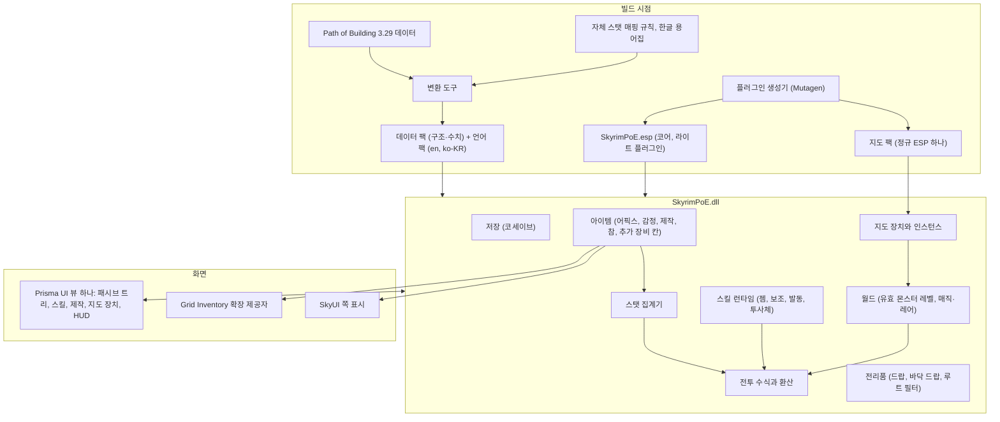

# Skyrim PoE — 통합 설계서 v3.2

작성: 2026-11-12 (v3.1: 같은 날 Codex 교차 검토의 지적을 반영. 사실 오류와 지나친 단정을 고치고 17장을 추가. v3.2: 같은 날 프로토타입 1·2의 결과로 사이클론 모션의 방식을 OAR로 확정하고(결정 48), 2.2·6.7·14장·부록을 맞춤. 그 뒤 6.7에 결정 49(최소 한 바퀴, 잠정)와 결정 50(회전과 타격은 DLL)을, 6.4에 결정 51(치명타의 출처)과 결정 52(스킬 주문은 우리 레코드, 아군과 자신 제외)를 반영. 프로토타입 2의 7차 시험 결과로 6.4의 빼는 방법 항목을 맞추고, 6.4와 7.3에 결정 53(스킬 피해는 난이도 배율을 그대로 받음)을 반영)

스카이림 SE/AE에서 Path of Exile의 빌드·파밍·엔드게임을 구현하는 SKSE 모드의 현재 설계입니다.
Carbon이 쓴 설계서 6개 판(v0.1~v2.2)의 내용에, 2026-11-12에 검증한 사실과 사용자가 정한 결정을 반영해 하나로 합쳤습니다.

## 0. 이 문서를 읽는 법

- 결정이 내려진 경위와 조사 근거는 `docs/설계-현황.md`에 있습니다. 이 문서는 "지금 설계가 무엇인가"만 담습니다.
- 항목 끝의 표시는 다음을 뜻합니다.

| 표시 | 뜻 |
| --- | --- |
| [확정] | 사용자가 직접 정함. 괄호 안 번호는 설계-현황 2장의 결정 번호 |
| [잠정] | Claude가 제안했고 사용자가 반대하지 않음. 바꾸기 전에 확인 |
| [제안] | Claude가 이 문서를 쓰면서 새로 넣은 안. 사용자가 아직 보지 않음 |
| [원안] | Carbon 설계서의 내용을 그대로 둔 것. 사용자가 따로 확인한 적 없음 |
| [미정] | 아직 정하지 않음 |
| [미검증] | 실행으로 확인되지 않은 기술적 전제 |

- 이 문서 전체가 아직 코드로 검증되지 않았습니다. Carbon 원문의 "검수 통과"는 문서상 점검이었고, 여기서는 그 표현을 쓰지 않습니다.
- 내부 이름은 `SkyrimPoE`입니다. 공개 제목은 미정입니다.

## 1. 무엇을 만드는가

스카이림의 1·3인칭 액션 전투를 그대로 두고, 그 위에 PoE의 성장·스킬·아이템·엔드게임을 얹습니다.

포함하는 것 [확정 1]:
- 스킬 젬과 보조 젬
- 접두·접미 어픽스가 붙는 장비와 오브 제작
- 패시브 트리, 키스톤, 전직
- PoE식 전투 수식(속성 피해, 방어 계층, 상태이상)
- 지도 장치 기반의 반복 엔드게임
- 사이클론, 블레이드 볼텍스 같은 PoE의 스킬

### 1.1 설계 원칙

1. **바닐라 위에 얹는다.** 바닐라와 다른 모드의 퍽, 마법부여, 연금술, 레벨드 리스트, 원본 던전을 수정하지 않습니다. 이유는 호환입니다. [확정 5]
2. **스카이림 조작이 기준이다.** PoE 요소는 스카이림의 조작과 체계에 녹이고, 녹이는 과정에서 불필요한 것은 쳐냅니다. [확정 36]
3. **특정 환경을 전제로 삼지 않는다.** 넥서스 공개 배포가 목표이므로, 개발에 쓰는 모드팩의 특징을 설계의 전제로 두지 않습니다. [확정 40]
4. **내용은 PoE1, 구조는 맞는 쪽에서.** 스킬·보조 젬·패시브 트리·전직·고유 아이템의 내용과 데이터는 PoE1 3.29를 따릅니다. 스카이림에 맞추기 쉬운 구조(젬의 보조 소켓, 지속 버프 자원, 참)는 PoE2에서 빌립니다. [잠정 41]
5. **Calamity와 독립.** 코드, 플러그인, 저장 데이터를 공유하지 않습니다. [확정 4]
6. **사실은 대조한 뒤에 쓴다.** 모드 버전, API 함수, 수치는 실제 파일이나 공식 문서로 확인한 것만 확정으로 취급합니다.

### 1.2 초기 범위에서 빼는 것

- 토템, 덫, 지뢰, 소환수 관련 스킬과 보조 젬. 설치물이나 소환 개체가 따로 필요해 부담이 큽니다. [잠정]
- 장비의 젬 소켓·링크·색과 그에 딸린 오브(쥬얼러, 퓨징, 크로마틱). [확정 42]
- 키를 눌러 쓰는 플라스크. [확정 37]
- 자체 스킬 핫바. [확정 47]
- 전직용 미궁. 규모가 커서 보스 이정표 방식으로 대체합니다. [확정 10]
- 탑다운 시점과 클릭 이동. [확정 2]

## 2. 배포와 환경

### 2.1 배포 방침

| 항목 | 내용 | 상태 |
| --- | --- | --- |
| 배포 | 넥서스 공개 배포가 목표 | [확정 19] |
| 지원 런타임 | SE 1.5.97과 AE 1.6.x | [확정 19] |
| 라이선스 | GPL-3.0. 같은 라이선스의 모드 코드를 가져다 쓸 수 있음 | [확정 30] |
| 라이선스 경계 | Prisma UI는 GPL이 아닌 자체 라이선스이고 스카이림 자체도 비공개 프로그램임. GPL 모드가 이들과 함께 동작하려면 Grid Inventory처럼 모딩·링크 예외 조항을 붙이는 것이 통례. 가져오는 코드·헤더·에셋별 출처와 조건 표도 필요 | [미정] |
| PoE 이름과 트리 | 그대로 쓰고 배포물에 포함. 다만 젬·어픽스·고유 아이템 데이터의 원천인 PoB의 `Data`는 게임 파일에서 추출된 것이고(파일 머리말에 GGG 저작권 표기), 비수익과 비제휴 표기는 위험을 줄일 뿐 권한의 증명은 아님. 사용자는 이 점을 알고 정했음 | [확정 27] |
| 수익화 | 하지 않음. 넥서스 기부 포인트도 받지 않음 | [확정 28], [잠정 33] |
| 제목 | 자체 제목에 PoE를 함께 표기. 설명에 GGG와 제휴·승인 관계가 아님을 적음 | [확정 29], [잠정 33] |
| 이미지·음향 | PoE의 이미지와 음향은 넣지 않음. 아이콘은 자체 제작 | [확정 19] |
| 설명 글·수치 | PoB 원문을 복사하지 않고 우리 스탯 매핑에서 생성. 수치는 스카이림에 맞춰 조정 | [잠정 31] |

### 2.2 선행 모드

선행 모드는 개발에 쓰는 모드팩에 무엇이 깔려 있는지가 아니라, 넥서스와 커뮤니티에서 가장 나은 것을 기준으로 고릅니다. [확정 14]

| 구분 | 모드 | 쓰임 | 상태 |
| --- | --- | --- | --- |
| 필수 | SKSE64, Address Library | 기반 | [확정] |
| 필수 | Prisma UI 1.5.1 이상, Media Keys Fix SKSE | 모든 자체 화면. 사용자는 "Prisma UI에 얽매이지 말고 가장 좋은 것을 고르라"고 했고(확정 7), Carbon의 비교와 Claude의 문서 확인을 거쳐 Prisma UI로 둠 | [잠정]. Media Keys Fix가 Prisma UI의 필수 요구인 것은 확인됨 |
| 필수 | Open Animation Replacer | 사이클론의 회전 모션. 채널링 중에 무기를 든 이동 클립을 회전 모션으로 바꿈. Animation Injector는 사이클론에 쓰지 않음 | [확정 48]. 첫 스킬인 사이클론의 모션이 여기에 기대므로 "조건부"에서 "필수"로 옮김(분류는 Claude의 판단). AE 1.6.1170 + MCO에서 실행 확인, 바닐라·BFCO 환경과 SE 1.5.97은 [미검증] |
| 권장 | Grid Inventory | 최상의 아이템 화면(카드 안 어픽스, 소켓 배지, 끌어다 놓기) | [확정 26] |
| 선택 | TrueHUD | 적 에너지 실드를 특수 바에 표시(비어 있을 때만) | [확정 23] |
| 선택 | Light Placer | 전리품 빛기둥에 실제 조명 | [원안] |
| 선택 | Inventory Interface Information Injector | SkyUI에서 전용 아이콘 | [원안] |
| 선택 | Death Drop Overhaul | 바닥 드랍의 물리 연출과 회수 | [미정] |
| 선택 | Precision | 사이클론 중 적 통과 | [원안], [미검증] |
| 선택 | Sound Record Distributor(넥서스 77815) | 드랍 효과음 분배 | [원안] |
| 호환 | Spell Hotbar NG | 주문 스킬이 실제 주문이라 그대로 쓸 수 있음 | [확정 47], [미검증] |

원문에서 필수로 꼽았던 Animation Motion Revolution과 powerofthree's Tweaks는 실제로 필요한지 다시 따져야 합니다. [미정]

선택 모드가 없어도 모드는 동작해야 합니다. 외부 DLL의 기능은 정적 링크하지 않고, 로드 시점에 버전을 확인해 얻으며, 없거나 버전이 다르면 내장 방식으로 돌립니다. [확정 19], [원안]

### 2.3 다른 모드와의 관계

- 아이템에 어픽스나 소켓을 붙이는 모드(Calamity, DiabloRim, Socketing 등)와는 함께 쓰지 않는 것을 전제로 합니다. 감지되면 시작할 때 한 번 경고하고 동작은 막지 않습니다. [확정 38]
- 적의 레코드와 능력치를 건드리지 않으므로 적 오버홀, 조우 지역 모드, 난이도 모드와 레코드 충돌은 없습니다(7.3 참고). [확정 45] 그러나 이것이 실행 중의 호환까지 보장하지는 않습니다. 피해 훅, 무적 시간, 방어 계산, 처치 판정은 레코드와 무관하게 다른 모드와 겹칠 수 있어 따로 검증해야 합니다. [미검증]
- 전설 적처럼 다른 모드가 만든 정예 개체에 우리의 매직·레어 승격이 겹치는 경우의 규칙은 미정입니다. [미정]

## 3. 전체 구조

- DLL은 CommonLibSSE-NG로 SE와 AE를 한 바이너리로 지원합니다. 버전 분기는 컴파일 시점이 아니라 실행 시점에 합니다. [원안]
- 코어 플러그인은 폼 수가 적어 라이트 플러그인으로 둡니다. 지도 팩은 정규 ESP 하나입니다. [확정 20]
- 스킬, 어픽스, 패시브의 효과는 주문이나 퍽 레코드를 액터에 붙이지 않고 DLL 안에서 계산합니다. 수백 개의 능력을 붙이면 엔진의 조건 평가가 느려지기 때문입니다. 엔진에 꼭 반영해야 하는 값(이동 속도, 최대 생명력 등)만 한 곳에서 더하고 제거 시 되돌립니다. [원안]

## 4. 데이터

### 4.1 출처

- 기준 데이터는 Path of Building Community 2.67.2의 PoE 3.29 데이터입니다. 로컬 경로는 `G:\poe\PathOfBuilding-2.67.2\`. [확정 34, 39]
- 위키는 스킬과 메커니즘이 어떻게 동작하는지 읽는 참고 자료로만 씁니다. [확정 34]
- 3.29 실측: 패시브 노드 3,396, 키스톤 57, 주요 패시브 1,003, 마스터리 353, 주얼 소켓 60, 전직 이름 37종, 젬 항목 821(액티브 558, 보조 263, 보조는 각성판을 합쳐 226종).

### 4.2 변환 도구

- PoB의 데이터 파일은 형식이 한 가지가 아닙니다. `Gems.lua`는 `return { … }` 형태의 표라서 그대로 불러올 수 있지만, `Data/Skills/*.lua`는 PoB가 넘겨주는 `skills, mod, flag, skill` 인자와 전역 열거형(`SkillType`, `ModFlag`), `bit.bor`에 의존하고 함수(예: Blade Vortex의 `preDamageFunc`)도 들어 있습니다. 따라서 PoB의 로더를 흉내 낸 제한된 실행 환경을 만들어 불러와야 하고, 함수로 표현된 동작은 표로 옮겨지지 않으므로 스킬별로 직접 구현합니다.
- PoB 버전마다 파일 배치가 다릅니다(3.29에서 어픽스 파일이 여러 개로 나뉨). 버전을 설정으로 받고 배치 차이는 버전별 어댑터에서 흡수합니다.
- 트리는 빌드 시점에 노드의 최종 좌표, 연결선의 호 정보, 아이콘 좌표를 미리 계산합니다. [원안]
- 트리에는 리그 전용 전직과 프록시 노드가 섞여 있습니다. 기본 전직 19종만 쓰려면 변환 단계에서 걸러야 합니다.
- 세이브는 표시 이름이 아니라 바뀌지 않는 내부 ID로 노드와 전직을 기록합니다. 예: 레인저 전직의 내부 ID는 `Raider`, 표시 이름은 `Warden`. [원안]

### 4.3 데이터 팩과 언어 팩

- 이름, 설명 글, 수치를 코드와 분리해 데이터 팩으로 둡니다. 방침이 바뀌어도 팩만 교체하면 됩니다. [잠정 32]
- 언어는 팩으로 분리합니다. 영어만으로 동작하고 `ko-KR`은 선택입니다. [확정 35]
- 스탯 매핑: PoE의 효과를 우리 스탯 엔진의 항목으로 옮기는 규칙입니다. 이 규칙이 설명 글 생성의 원천이기도 합니다. [원안]
  - 입력이 한 종류가 아닙니다. 패시브 노드의 효과는 사람이 읽는 문장으로 들어 있고(예: Blood Magic은 네 가지 효과가 한 문자열), 스킬은 스탯 ID와 조건과 함수로 들어 있습니다. 그래서 "스탯 하나 → 항목 하나"의 단순한 표가 아니라, 문장을 해석하는 파서와 조건·범위·무기 한정 같은 의미를 담는 중간 표현이 필요합니다.
  - 모든 노드·젬·어픽스를 "지원", "재설계", "제외" 가운데 하나로 분류한 목록을 둡니다. 변환 도구는 분류되지 않은 것이 있으면 빌드를 실패시킵니다. 제외로 분류한 것은 화면에 비활성으로 표시합니다. 이렇게 해야 "빈 껍데기 금지"와 "일부 노드는 비워 둔다"가 서로 부딪치지 않습니다.

### 4.4 한글화

- 남의 번역 묶음을 쓰지 않고 직접 합니다. [확정 35]
- 이름은 공개된 자료에서 공식 한글 명칭을 확인해 맞춥니다.
- 설명 글은 스탯 매핑에서 한글과 영어로 직접 생성합니다.
- 기본 용어(생명력, 에너지 보호막, 치명타 확률 등)는 공식 한글판 표기를 따르는 용어집을 먼저 만듭니다.
- 구현하는 콘텐츠 범위만큼만 채워 갑니다.

## 5. 캐릭터 성장

### 5.1 유배자 레벨 [확정 17]

- 스카이림 레벨과 분리된 1~100 레벨입니다. 적을 처치해 얻는 경험치로만 오릅니다.
- 패시브 포인트는 레벨로 99점, 보스 업적으로 24점, 합쳐 최대 123점입니다. 3.29 트리 파일의 `totalPoints`와 같습니다.
- 스카이림 쪽 레벨링 모드(경험치 방식 변경, 레벨 상한 해제, 스킬 책 등)와 경험치 변수를 공유하지 않습니다. 다만 다른 모드가 적의 수, 레벨, 처치 속도를 바꾸면 처치 기반인 유배자 경험치의 진행 속도는 달라집니다.
- 장착한 스킬 젬도 같은 처치 경험치로 성장합니다. [원안]
- 고레벨에서 사망 시 현재 레벨 안의 경험치 일부를 잃는 벌칙, 진행 중인 세이브에 처음 설치했을 때의 초기 레벨 보정은 원안에 있으나 확정되지 않았습니다. [원안]

### 5.2 클래스와 능력치

- 시작 클래스는 PoE1의 7종이고 플레이어가 직접 고릅니다. 새 게임 시작 때 강제로 묻지 않고, 패시브 트리를 처음 열 때 고릅니다. 그 전까지 포인트는 쌓입니다. [확정 8], [원안]
- 클래스별 기본 힘·민첩·지능은 PoE1의 값을 따릅니다(예: 마로더 32/14/14, 사이온 20/20/20). [원안]
- 할당한 노드를 모두 회수하면 클래스를 다시 고를 수 있습니다. [원안]
- 능력치가 모자라 젬이나 아이템의 요구치를 못 채우면, 장비를 벗기지 않고 그 아이템의 PoE 효과만 끕니다. 스카이림의 장비 해제를 강제로 부르면 의상 모드에서 사고가 납니다. [원안]

### 5.3 패시브 트리

- PoE1 3.29의 트리를 원본 규모로 씁니다. [확정 6, 27]
- 노드 회수 시 연결성 검사는 현재 클래스의 시작점뿐 아니라, 사이온 전직이 열어 주는 다른 클래스의 시작점까지 출발점으로 삼습니다. [원안]
- 마스터리는 주변의 주요 패시브를 찍으면 열리고, 효과 목록에서 하나를 고릅니다. [원안]
- 주얼 소켓은 트리에 주얼을 끼우는 자리입니다. 장비의 젬 소켓과는 별개라서 그대로 둡니다. 군단·시간 초월 주얼 같은 복잡한 종류는 초기 범위 밖입니다. [제안]
- 플라스크, 토템, 덫, 지뢰, 소환수, 장비 소켓을 전제로 한 노드와 키스톤은 "재설계" 또는 "제외"로 분류합니다(4.3). 마나 점유를 별도 자원으로 바꾼 영향은 이보다 넓습니다. Blood Magic처럼 마나 제거·비용의 생명력 전환·점유를 함께 다루는 키스톤, 점유 효율, 비점유 마나, 마나 기반 피해를 쓰는 노드와 고유 아이템까지 훑어야 합니다. 제외한 노드를 지나가야만 닿는 노드가 있을 때 포인트를 쓰게 할지도 정해야 합니다. [미정]

### 5.4 전직 [확정 10, 18]

- 전직 포인트는 8점이고 2점씩 네 번 얻습니다.
- 1~3차는 보스 처치 이정표로 풉니다. 원안의 조건은 다음과 같고 수치는 확정되지 않았습니다. [원안]

| 차수 | 조건(원안) |
| --- | --- |
| 1차 | 첫 드래곤 처치 또는 던전 보스 5회 처치 |
| 2차 | 이름 있는 드래곤 프리스트나 대형 퀘스트의 중간 보스 처치 또는 던전 보스 15회 처치 |
| 3차 | 고위 보스 처치 또는 지도 장치의 낮은 티어 보스 첫 처치 |
| 4차 | 공물 아이템으로 입장하는 전용 결투장에서 부활 없이 3페이즈 보스 처치 |

- 보스 판정은 특정 FormID가 아니라 종류와 위치 표식(드래곤, 보스 위치 참조, 고유 액터 여부 등)으로 합니다. 모드가 추가한 보스도 포함되게 하려는 것입니다. [원안], [미검증]
- 기본 전직은 PoE1의 19종입니다. 리그 전용 전직은 쓰지 않습니다. [제안]

## 6. 스킬

### 6.1 젬의 구조 [확정 42]

- 스킬 젬이 보조 소켓을 직접 가집니다. 장비에는 젬 소켓이 없습니다.
- 보조 젬은 스킬 젬에 끼웁니다. 호환 여부는 화면에 보이는 태그가 아니라 PoE1 데이터의 스킬 유형 규칙으로 판정합니다. 보조 젬마다 요구 유형(`requireSkillTypes`, 논리 연산 포함), 제외 유형(`excludeSkillTypes`), 스킬에 더하는 유형(`addSkillTypes`)이 있습니다. 예: Spell Echo는 발동된 스킬·즉발·토템 등을 제외합니다. 보조가 유형을 더하므로 평가 순서도 정해야 합니다.
- 젬 하나의 보조 소켓 수와 늘리는 방법은 미정입니다. PoE1의 6링크가 보조 5개에 해당하므로 최대 5개가 기준선입니다. [미정]
- 같은 종류의 보조 젬을 한 스킬에 중복해 끼울 수 있는지는 미정입니다. [미정]
- 젬마다 고유 ID를 주고, 끼워진 보조 젬과 레벨·경험치를 젬 단위로 저장합니다.

### 6.2 스킬 화면과 발동 방식 [확정 47]

스킬 화면의 칸마다 스킬 젬을 넣고 "어느 입력에 얹을지"를 고릅니다. 새 키를 만들지 않고 스카이림이 이미 가진 입력을 씁니다.

| 스킬 종류 | 얹는 입력 | 예 |
| --- | --- | --- |
| 공격 스킬 | 일반 공격, 강공격, 질주 중 공격 가운데 하나 | 번개 타격, 대지 강타 |
| 채널링 | 강공격 버튼을 누르고 있는 동안 | 사이클론 |
| 이동기 | 질주 중 공격 | 도약 강타, 방패 돌진 |
| 주문 스킬 | 실제 주문으로 등록되어 손에 장착 | 화염구, 얼음 폭발 |
| 즉발 스킬 | 파워로 등록되어 포효 키로 사용 | 가드 스킬, 함성 |
| 지속 버프 | 입력 없음. 켜 둠 | 오라, 전령 |
| 발동 젬 | 입력 없음. 조건이 되면 자동 | 치명타 시 시전 |

- 공격 스킬은 무기 종류 조건을 가집니다. 조건에 맞지 않는 무기를 들면 그 입력은 원래 공격으로 돌아갑니다.
- 대부분의 공격 스킬은 지금 쓰는 공격 모션을 그대로 쓰고, 타격이나 발사 시점에 효과를 얹습니다. 새 모션이 꼭 필요한 것은 채널링 정도입니다.
- 주문 스킬을 실제 주문 폼으로 두는 것은 즐겨찾기, Wheeler, Spell Hotbar NG, Grid Inventory의 퀵 휠에서 쓸 수 있게 하려는 것입니다. 다만 외부 도구는 자체 시전 시간과 쿨다운을 갖고 손 시전을 거치지 않고 직접 시전하기도 합니다. 손 시전만 가로채면 젬의 비용·요구치·쿨다운을 우회할 수 있으므로, 어느 경로로 시전하든 통과하는 공통 검증·비용 확정 지점이 필요합니다. [미검증]
- 같은 스킬 젬을 둘 가지고 서로 다른 보조를 끼울 수 있으므로, 젬 인스턴스와 주문 폼을 어떻게 대응시킬지 정해야 합니다. 스킬 칸마다 고정된 대리 주문을 두는 방식과 젬마다 폼을 만드는 방식이 후보입니다. [미정]
- 강공격과 질주 공격에 자체 모션을 넣는 무브셋(MCO, BFCO)을 그대로 두고 싶은 사람을 위해 "스킬 키" 1~2개를 선택 사항으로 둡니다.
- 스킬 칸의 수는 미정입니다. PoE2는 9칸입니다. [미정]
- 공격 입력을 가로채 스킬로 바꾸는 부분이 여러 전투 모드와 함께 안정적으로 도는지, 주문의 시전 시간과 비용을 우리 쪽에서 통제하는 방법은 프로토타입으로 확인합니다. [미검증]

### 6.3 지속 버프의 자원 [확정 43]

- 오라와 전령 같은 지속 버프는 매지카를 점유하지 않고 전용 자원을 씁니다(PoE2의 Spirit에 해당).
- 매지카는 주문 시전용으로 그대로 둡니다.
- 자원의 이름, 총량을 얻는 방법, PoE1 오라의 점유 비율을 이 자원의 비용으로 옮기는 기준은 미정입니다. [미정]

### 6.4 발동 젬 [확정 47]

- 소켓이 젬 쪽에 있으므로, 발동 젬은 주문 젬을 담는 젬입니다(구조는 PoE2의 메타 젬).
- 발동 조건은 PoE1식입니다. 예: "치명타 시 시전"은 공격이 치명타로 적중하면 담긴 주문을 시전하고, 쿨다운은 0.15초입니다.
- 발동으로 나간 피해가 다시 발동 조건을 일으켜 끝없이 이어지지 않도록, 피해마다 출처 표시를 달아 2차 발동을 막습니다. [원안]
- 치명타 확률과 배율은 우리 스탯으로 계산합니다(무기의 기본 확률에 패시브·젬·아이템을 반영). 스카이림의 치명타 확률(액터 값 `CriticalChance`와 퍽의 진입점)은 버리지 않고 우리 확률에 더합니다. 스카이림의 치명타는 기본 확률이 0이고 퍽으로만 생기는 체계라 그것만으로는 PoE의 치명타가 되지 않고, 더해 주면 다른 모드의 치명타 퍽이 쓸모를 잃지 않습니다. [확정 51]
- 스카이림의 값을 더하는 자리(최종 확률에 퍼센트포인트로 더할지, 기본 확률에 더할지), 엔진이 근접 타격마다 따로 굴리는 치명타를 끄는 방법, 대상의 퍽이 치명타 확률을 깎는 경우의 처리는 남아 있습니다(설계-현황 5장 31번). 프로토타입 2는 INI의 임시 기본 확률에 스카이림의 값을 퍼센트포인트로 더합니다. [미정]
- 젬의 스킬 주문은 바닐라 주문을 빌려 쓰지 않고 우리 레코드로 만들며, 플레이어 자신과 아군(동료, 소환수)에게는 닿지 않게 합니다. 바닐라 화염구를 발동 주문으로 쓴 프로토타입 2의 5차 시험에서 본체와 폭발이 동료와 플레이어 자신에게 적중 이벤트를 냈습니다. [확정 52]
- 빼는 방법은 정하지 않았습니다. 주문 효과의 조건, 폭발·투사체 레코드의 설정, DLL이 적대 대상에게 피해를 직접 적용하는 방식이 후보입니다(설계-현황 5장 32번). 첫째와 둘째는 실행으로 확인하지 않았습니다. 셋째 방식은 프로토타입 2의 6·7차 시험에서 확인했습니다. 체력이 깎이고, 그 피해로 죽이면 플레이어의 처치로 남으며, 발동 주문이나 폭발이 수단인 적중이 아군과 자신에게 남지 않았습니다. 대상이 여럿일 때 동료가 빠지는지는 아직 보지 못했습니다. 이 경로로 준 피해에는 스카이림의 난이도 배율이 곱해집니다(다음 항목). 바닐라 주문이나 다른 모드의 주문을 젬에 담는 기능은 만들지 않습니다. [잠정]
- 스킬 피해는 스카이림의 난이도 배율을 그대로 받습니다. 무기 타격이 배율을 받으므로 스킬만 빼면 둘이 어긋나고, 플레이어가 고른 난이도가 스킬에도 통해야 하기 때문입니다. 난이도 배율을 바꾸는 모드(이 모드팩의 Combat Difficulty Customizer)가 정한 값도 그대로 따릅니다. [확정 53] 적이 플레이어에게 주는 피해 쪽 배율도 같은 원칙으로 받습니다. [잠정]

### 6.5 보조 젬의 구현 방식

226종을 하나씩 만들지 않고 "동작 방식"을 만든 뒤 젬을 그 설정값으로 둡니다. [잠정]

| 방식 | 대표 젬 | 구현 | 난이도 |
| --- | --- | --- | --- |
| 수치 변경 | 피해, 속도, 치명타, 관통, 전환 계열. Pulverise도 여기에 속함(근접 범위 피해 증폭, 범위 증가, 공격 속도 감소) | 스탯 계산에 반영 | 쉬움 |
| 추가 투사체 | Lesser/Greater Multiple Projectiles, Volley | 각도를 나눠 여러 발 발사 | 쉬움 |
| 관통·연쇄·분기·귀환 | Pierce, Chain, Fork, Returning Projectiles | 적중 지점에서 새 투사체를 다시 발사 | 중간 |
| 근접 범위 | Melee Splash | 맞은 대상 주변에 범위 피해 | 쉬움~중간 |
| 근접 추가 타격 | Ancestral Call | 주변 적에게 추가 타격 적용 | 중간 |
| 근접 반복 | Multistrike | 자동 연속 공격 또는 추가 타격을 계산으로 처리 | 중간~어려움 |
| 주문 반복 | Spell Echo, Unleash | 시전을 한 번 더 하거나 모았다가 함. 투사체가 없는 주문도 대상이라 "다시 발사"가 아니라 "시전 반복"으로 구현 | 쉬움~중간 |
| 범위 조절 | Increased Area of Effect, Concentrated Effect, Spell Cascade | 폭발 반경과 반복 위치 조절 | 쉬움~중간 |
| 발동 | Cast On Critical Strike 등 | 조건 감지 후 자동 시전 | 중간 |

### 6.6 투사체

- 엔진에 투사체를 직접 쏘는 진입점이 있습니다(`Projectile::Launch`와 `LaunchData`: 발사 원점, 각도, 표적, 주문, 크기, 위력). 충돌 정보에서 맞은 대상도 얻을 수 있습니다.
- 처리 순서는 PoE1을 따릅니다: 관통, 분기, 연쇄, 귀환. [원안]
- 동시에 떠 있는 투사체 수에 상한을 둡니다. 원안의 값은 64입니다. [원안]
- 화살과 날아가는 주문은 같은 방식으로 다룰 수 있고, 광선형과 원뿔형 주문은 엔진에서 다른 종류라 따로 다룹니다. [미검증]
- 범위 효과와 연쇄의 표적 탐색은 양쪽 모두 적대 관계인 대상으로 한정합니다. 동료나 주민을 맞혀 현상금이 붙는 일을 막습니다. [원안] 플레이어 자신과 아군을 빼는 것은 확정입니다(6.4, 결정 52). 주민 같은 중립 대상까지 항상 빼는지는 원안 그대로이며 따로 확정하지 않았습니다.

### 6.7 먼저 만들 스킬

- 사이클론이 최우선입니다. [확정 9]
  - 강공격 버튼을 누르는 동안 회전하며 자유롭게 이동합니다. 타격 주기는 무기 공격 속도의 300%입니다.
  - 지형과 벽 충돌은 유지하고 적과의 몸 충돌만 무시합니다. Precision의 충돌 필터 콜백이 후보이고, 없을 때의 내장 방식이 필요합니다. [원안], [미검증]
  - 회전 모션은 네메시스나 판도라 패치를 요구하지 않습니다. [확정 22] 방식은 OAR 이동 클립 교체입니다. 우리 DLL이 "채널링 중" 조건을 켜면 OAR이 무기를 든 걷기·달리기·대기 클립을 사이클론 자세로 바꾸고, 끄면 되돌립니다. 이동은 평소의 이동 그대로라서 이동 속도 변화가 회전 중에도 반영됩니다. [확정 48]
  - 회전과 타격은 DLL이 맡습니다. [확정 50]
    - 교체되는 클립은 무기를 뻗은 정지 자세만 담습니다. 몸의 회전은 DLL이 스켈레톤의 `NPC` 노드(애니메이션이 쓰지 않는 상위 노드)를 매 프레임 돌려 만듭니다. 액터의 방향·이동·충돌은 그대로이고 보이는 몸만 돕니다. 회전을 클립에 구워 넣으면 이동 중에 섞이는 이동 클립 여러 벌의 시점이 어긋나 모션이 끊겼습니다(프로토타입 3).
    - 타격은 무기 충돌이 아니라 범위 타격입니다. DLL이 일정 주기로 주변의 적에게 근접 타격을 적용합니다. 주기는 무기 속도에 비례하고(무기 속도 1.0에서 초당 3회), 회전 속도는 타격 주기에 비례합니다.
    - 이 방식은 프로토타입 2의 4차 시험에서 실행으로 확인했습니다(AE 1.6.1170, MCO, XPMSSE 기반 스켈레톤). 이동 중에도 회전이 끊기지 않고 타격이 들어갑니다. 바닐라 스켈레톤과 SE 1.5.97은 [미검증]
    - 프로토타입은 엔진의 근접 타격 함수를 그대로 부르고 피해 배율만 낮춥니다. 피해를 우리 수식으로 계산하는 것은 7장의 과제입니다. 반경, 피해 배율, 벽 너머 판정, 막혔을 때의 튕김, 타격 소리와 이펙트는 정하지 않았습니다. [미정]
    - 프로토타입 1·2에서 Animation Injector 방식과 비교했습니다. 두 방식 모두 회전과 타격이 됐고, 평소 이동을 쓰는 점과 의존이 가벼운 점으로 OAR을 골랐습니다.
    - 시작은 입력을 가로채지 않고, 게임이 강공격을 시작하려고 보내는 애니메이션 이벤트를 받아 채널링으로 바꾸는 방식입니다. AE 1.6.1170 + MCO에서 실행으로 확인했습니다. 바닐라·BFCO 환경은 [미검증]
    - 조건을 OAR에 전하는 방법은 프로토타입에서는 액터 값(`Variable09`)이었습니다. 이 값은 세이브에 남으므로 제품에서는 OAR의 플러그인 조건 API로 바꾸는 것이 후보입니다. [제안]
    - 강공격 입력을 짧게 눌렀다 떼어도 최소 한 바퀴는 돕니다. 그 사이에 다시 누르면 이어집니다. [잠정 49]
    - 강공격을 내는 입력이 여러 가지인 환경이 있습니다(시험한 모드팩은 우클릭과 좌클릭 길게 누르기). 강공격 시작 이벤트를 받는 방식이라 둘 다 같은 처리로 받고, 채널링은 그때 누르고 있던 버튼에 묶입니다.
    - 채널링 중에 적에게 맞아 경직되면 지금은 회전이 끊깁니다. PoE의 사이클론은 채널링 중 밀려나지 않습니다. 경직을 막을지는 정하지 않았습니다. [미정]
    - 회전 모션 자체는 자체 제작하거나 사용 허락을 받은 것이어야 합니다. 프로토타입 1·2는 다른 모드의 클립을 빌려 이 컴퓨터에서만 시험했습니다. 직접 만드는 방식(프로토타입 3, 스크립트로 자세를 계산해 HKX로 변환)의 초안이 게임에서 재생됐고 사용자 평가는 "쓸 만함"입니다. 회전 모션은 직접 만드는 쪽으로 갑니다. 한손 무기용 자세와 시작·마무리 동작, 세부 다듬기가 남았고, 바탕 자세가 바닐라 애니메이션의 한 프레임이라는 점은 배포 전에 확인이 필요합니다. [미정]
  - 1인칭에서는 시점을 강제로 돌리지 않고 무기 잔상과 주변 효과로 표현합니다. [원안]
- 블레이드 볼텍스: 시전마다 공전하는 칼날을 쌓고(최대 10), 칼날 수에 따라 적중 빈도와 피해가 커집니다. PoB 3.29 데이터로 확인한 수치는 칼날당 적중 빈도 +30%, 칼날당 피해 30% 증폭, 기본 반경 15이고, 반경은 칼날 수와 연동되지 않습니다(원안의 "범위도 커진다"는 틀림).
- 사이클론 + 치명타 시 시전 + 범위 주문의 조합이 첫 목표 빌드입니다.

## 7. 전투 수식

### 7.1 구성 [원안, 4번 원칙에 따라 PoE1 기준]

- 속성: 물리, 화염, 냉기, 번개, 카오스. 피해 전환은 한 방향입니다.
- 방어: 방어도, 회피, 에너지 실드, 주문 억제, 원소 저항과 상한.
- 충전: 인내, 격분, 권능. 그리고 격노.
- 상태이상: 점화, 냉각, 동결, 감전, 출혈, 중독, 꿰뚫기.
- 스탯 합산은 PoE의 방식(더하기, 증가, 증폭, 전환)을 따르고, 장비·패시브·버프가 바뀔 때만 다시 계산합니다.

각 항목을 스카이림에서 어떻게 표현할지(예: 동결과 스카이림의 마비, 기절과 비틀거림)는 구현 단계에서 하나씩 정합니다. [미정]

### 7.2 바닐라와의 경계

- 엔진의 방어 계산을 거꾸로 풀지 않습니다. 방어 공식을 바꾸는 모드가 있으면 어긋나기 때문입니다. 엔진이 계산한 뒤의 피해에 PoE의 방어 계층을 덧붙입니다. [원안]
- 바닐라 마법부여와 PoE 어픽스는 같은 아이템에 함께 있을 수 있습니다. 둘이 겹쳤을 때의 균형은 따로 봐야 합니다. [원안], [미정]
- 우리가 계산해 입히는 피해가 다시 우리 훅으로 들어와 재귀하지 않도록 보호 장치를 둡니다. [원안]
- 지속 효과는 메뉴나 일시정지 중에 멈추는 시간 기준으로 갱신합니다. 작업 큐에 스스로를 다시 넣는 방식은 쓰지 않습니다. [원안]

### 7.3 월드와의 균형: 환산 [확정 45]

PoE의 수치는 몬스터 생명력이 레벨에 따라 지수적으로 커지는 세계를 전제로 합니다. 스카이림의 적은 그렇지 않으므로, 적을 바꾸는 대신 피해를 환산합니다.

- 적의 레코드와 능력치는 건드리지 않습니다.
- 플레이어가 주는 피해는 "그 유배자 레벨에서 기대되는 화력"에 대해 환산합니다. 빌드의 화력이 기대치와 같으면 바닐라와 비슷한 속도로 적을 잡고, 기대치의 세 배면 세 배 빨리 잡습니다.
- 받는 피해도 "기대되는 방어"에 대해 같은 식으로 환산합니다.
- 기준은 실제 빌드가 아니라 유배자 레벨의 기대 곡선입니다. 잘 짠 빌드는 그만큼 앞서고 못 짠 빌드는 뒤처집니다.
- 조절값은 "얼마나 되돌릴지"입니다. 0%면 레벨이 오를수록 월드가 금방 쉬워지고, 100%면 늘 비슷합니다. 설정으로 노출하고 주는 피해와 받는 피해를 따로 둘 수 있게 합니다. 시작값은 오픈월드 50%이고 플레이 시험으로 정합니다. [잠정 46]
- 오픈월드는 일부만 되돌려 성장할수록 쉬워지게 하고(PoE의 캠페인처럼), 본격 난이도는 지도 장치가 맡습니다.
- 스카이림의 난이도 배율은 환산과 별개로 그 위에 그대로 곱해집니다. [확정 53] 기대 곡선은 난이도 배율을 곱하기 전의 값을 기준으로 합니다. [잠정]

남은 과제 [미정]:
- 기대 화력·기대 방어 곡선을 만드는 방법. 레벨별 기준 빌드로 뼈대를 잡고, 개발용 화면에 "기대 대비 내 화력·방어 %"를 띄워 보정하는 안.
- 적마다의 유효 몬스터 레벨. 경험치와 드랍 등급 계산에 필요합니다.
- 다른 모드가 주는 피해(바닐라 마법, 동료, 소환수)와 우리 환산의 관계.

환산 방식이 가진 성질과 빈틈(Codex 검토에서 지적, 사실로 확인):
- 레벨이 오르면 기대치가 커지므로, 장비와 젬이 그대로면 같은 적에게 주는 피해가 줄어듭니다. 포인트를 아직 찍지 않았거나 클래스를 고르지 않은 채 경험치만 쌓인 캐릭터는 더 불리합니다. 이를 얼마나 허용할지, 미배분 포인트가 있을 때 어떻게 할지 정해야 합니다. [미정]
- 지도의 난이도가 어디서 나오는지가 비어 있었습니다. 적의 능력치를 바꾸지 않는다면, 지도 안에서는 기대 곡선의 기준을 유배자 레벨이 아니라 그 지도의 몬스터 레벨로 바꿔 환산하는 방식이 원칙과 맞습니다. 티어가 높을수록 같은 빌드가 덜 아프게 때리고 더 아프게 맞습니다. [제안]
- 엔진의 피해 처리 함수는 공격자와 피해량만 넘겨받습니다(`HandleHealthDamage(Actor*, float)`). 속성, 공격·주문 구분, 치명타 여부는 그 지점에서 알 수 없으므로 앞 단계에서 모아 넘겨야 합니다. 어느 경로에서 정보를 모으고 어디서 최종 체력을 깎는지 정해야 합니다. [미정]
- 방어는 하나의 수치로 줄일 수 없습니다. 큰 한 방, 잦은 작은 타격, 지속 피해에서 같은 빌드의 유효 방어가 다릅니다. 기대 방어는 피해 종류별 기준 상황으로 정의해야 합니다. [미정]

## 8. 아이템

### 8.1 어픽스와 희귀도

- 바닐라와 모드의 모든 장비가 베이스가 됩니다. [원안]
- 희귀 장비는 접두 3개, 접미 3개까지 가집니다. [원안, PoE1·2 공통]
- 방어구의 종류에 따른 방어 유형 매핑은 원안이 경갑은 회피, 중갑은 방어도, 의복과 로브는 에너지 실드입니다. [원안]
- 장비에는 젬 소켓이 없습니다. [확정 42]
- 어픽스 정보는 아이템의 고유 ID에 묶어 저장합니다.

### 8.2 감정과 제작

- 전리품은 "미감정 희귀 한손검" 같은 봉인 토큰으로 얻습니다. 토큰은 고유 데이터가 없는 일반 잡화 아이템이라 겹쳐 쌓이고, 줍지 않은 토큰에 대해서는 우리 코세이브에 아무것도 저장하지 않습니다. [확정 16] 엔진의 세이브에는 시체 인벤토리 변경이나 바닥에 놓인 레퍼런스가 기록될 수 있습니다.
- 토큰이 무상태이면 어디서 얻었는지(적의 레벨, 지도 티어)를 담지 못합니다. 감정할 때의 레벨로 결과를 정하면 낮은 곳에서 모은 토큰을 나중에 좋은 장비로 바꾸는 길이 생깁니다. 출처를 포기할지, 등급별로 토큰 종류를 나눌지 정해야 합니다. [미정]
- 감정하거나, 가진 장비에 오브를 쓰는 순간에만 고유 ID가 발급되고 저장 대상이 됩니다. [확정 16]
- 오브 제작은 PoE1의 핵심 오브를 따르되 소켓 관련 오브는 없습니다. 어떤 오브를 넣을지의 목록은 미정입니다. [확정 42], [미정]
- 아이템의 동일성은 조건 없이 보장할 수 없습니다. 엔진의 고유 ID는 16비트 번호와 베이스 ID의 쌍이고 컨테이너 이동 때 바뀔 수 있습니다. 다른 모드가 아이템을 지우고 새로 만들면서 대응 정보를 주지 않으면 원래 개체를 가려낼 방법이 없습니다. 따라서 "어떤 경우에도 어픽스가 따라간다"가 아니라, 어픽스가 보존되는 이동·변환 경로의 목록과 보존하지 못했을 때의 복구 방침을 정합니다. [미정]
- 모든 장비를 베이스로 삼으면 망토, 장신구, 보조 의상처럼 바디슬롯을 많이 쓰는 구성이 그만큼 어픽스를 더 받습니다. 겉모습으로 입는 것과 PoE 효과를 받는 칸을 나누고, 효과를 받는 칸의 수를 정해야 합니다. [미정]

### 8.3 추가 장비 칸 [확정 11]

- 2번째 반지와 벨트를 둡니다. 어떤 바디슬롯도 차지하지 않습니다.
- My Precious...es의 방식이 본보기입니다: 엔진의 반지 슬롯은 그대로 두고, 추가 장착은 플러그인 상태로만 추적하며, 장착 판정 함수와 메뉴 입력과 3D 부착을 각각 다룹니다. GPL-3.0이라 코드를 참고하거나 가져올 수 있습니다. [확정 30]
- 벨트는 3D가 필요 없어 반지보다 단순합니다.
- Grid Inventory는 반지 2개를 자체 지원하므로 그 환경에서는 그쪽에 맡깁니다. 다른 다중 반지 모드가 있을 때는 PoE 효과가 적용되는 반지를 2개로 제한합니다. [확정 26], [원안]
- 두 방식은 동작이 다릅니다. My Precious...es는 추가 반지를 엔진에 장착하지 않고 가상으로 다루지만, Grid Inventory는 반지의 베이스 폼에서 반지 슬롯 비트를 실행 중에 지웠다 되돌리며 엔진의 일반 장착을 씁니다(소스 `DualRing.cpp`). 환경에 따라 바닐라 마법부여·스크립트·3D의 동작이 달라지고, 여러 반지 중 어느 둘에 PoE 효과를 줄지도 정해야 합니다. [미정]
- 두 인벤토리 UI에서 벨트 칸을 각각 어떻게 보여 줄지는 미정입니다. [미정]

### 8.4 참 [확정 44]

- 플라스크 대신 참을 씁니다. 벨트에 따라 1~3칸입니다.
- 조건(상태이상에 걸림, 특정 종류의 피해를 받음 등)이 되면 자동으로 발동하고, 적을 처치하면 충전됩니다. 누르는 키는 없습니다.
- 생명력과 매지카 회복은 스카이림의 물약 체계에 맡깁니다.
- 참의 종류, 발동 조건 목록, 충전량은 미정입니다. [미정]

### 8.5 고유 아이템

- PoE1의 고유 아이템을 이름 그대로 씁니다. [확정 27]
- 장비 소켓이나 플라스크가 전제인 것(Tabula Rasa, Mageblood 등)은 효과를 다시 정의하거나 뺍니다. [미정]

## 9. 전리품

- 드랍은 플레이어 쪽이 적을 처치했을 때만 판정하고, 시체 인벤토리에 봉인 토큰으로 넣습니다. 레벨드 리스트와 컨테이너는 건드리지 않습니다. [확정 16], [원안]
- 설정한 등급 이상의 전리품은 개수 상한 안에서 바닥에 물리 아이템으로 나옵니다. 줍지 않으면 시간이 지나 시체로 회수됩니다. 등급 기준과 상한은 설정에서 조절합니다. [확정 16]
- 바닥으로 낼 때는 인벤토리에서 빼서 월드로 옮깁니다. 복제하지 않습니다.
- 추적과 회수를 자체로 할지 Death Drop Overhaul의 API에 맡길지는 미정입니다. 그 모드의 `DropItemFromActor`는 물건을 떨어뜨리는 동시에 자체 추적에 등록하므로 "물리 연출만 맡기는" 호출은 없습니다. 두 관리자가 같은 물건을 회수·삭제하지 않도록 생성부터 삭제까지의 책임자는 하나여야 합니다. 공개 배포이므로 자체 추적이 기본이고, 그 모드가 있을 때 전체를 맡길지는 따로 정합니다. [미정]
- 가치 있는 전리품은 빛기둥과 소리로 알립니다. 빛기둥은 저장되지 않는 임시 표시로 만듭니다. Light Placer가 있으면 실제 조명을 더합니다. [원안]
- 바닥 아이템의 이름표와 루트 필터는 ARPG POV에 선례가 있습니다. 넣을지는 미정입니다. [미정]

## 10. 월드의 몬스터

- 능력치 보정은 하지 않습니다. 균형은 7.3의 환산이 맡습니다. [확정 45]
- 일부 적을 매직(무리)이나 레어(속성 1~3개를 가진 우두머리)로 승격해 강한 개체를 섞습니다. 원안의 확률은 매직 12%, 레어 4%입니다. [확정 13], [원안]
- 비살상 전투와 필수 NPC는 승격에서 제외합니다. [원안]
- 승격한 개체는 더 좋은 전리품과 첫 지도를 줍니다. [원안]

## 11. 엔드게임

### 11.1 지도 장치 [확정 12]

- 은신처에 지도 장치를 둡니다. 지도 아이템을 넣으면 포털 6개가 열립니다. [원안]
- 지도에는 티어(1~16)와 속성(무리 크기 증가, 추가 투사체, 플레이어 최대 저항 감소, 전리품 수량 증가 등)이 있고 오브로 가공합니다. [원안]
- 지도 안에서는 몬스터 레벨을 우리가 직접 정합니다. 본격 난이도가 여기서 나옵니다. [확정 45]
- 지도 안에서 죽으면 포털 하나를 잃고 은신처로 돌아옵니다. 사망 가로채기는 지도 인스턴스 안에서만 동작하고 일반 월드의 사망은 건드리지 않습니다. [원안], [미검증]
- 치명적인 피해를 죽기 직전에 막는 것만으로는 다른 사망 대체 모드를 배제할 수 없습니다. 엔진에는 피해 처리와 별개인 사망 진입점(`KillImpl`)이 있고, 다른 모드가 더 앞에서 패배를 판정하거나 처형 동작으로 직접 죽일 수 있으며 훅 순서도 보장되지 않습니다. 지원할 사망 경로, 다른 사망 모드가 있을 때의 방침, 훅이 실패했을 때의 처리를 정하고 프로토타입으로 확인합니다. [미정]
- 포털의 규칙도 정해야 합니다. 정상 출입이 포털을 쓰는지, 연속 피해나 로드 중 재처리로 두 번 깎이지 않게 하는 방법, 마지막 포털을 쓴 뒤 지도 안에서 저장했을 때, 동료와 소환수의 동행. [미정]
- 은신처가 어디에 있고 어떻게 들어가는지는 미정입니다. [미정]

### 11.2 복제 던전

- 원본 던전을 직접 초기화하며 반복하면 퀘스트와 다른 모드의 배치가 깨집니다. 그래서 빌드 시점에 Mutagen으로 바닐라 던전의 지형, 조명, 룸바운드, 내비메쉬만 새 셀로 복제합니다. 원본 퀘스트 NPC, 퍼즐 잠금, 외부로 나가는 문은 뺍니다. [확정 12], [원안], [미검증]
- 지도 팩은 정규 ESP 하나입니다. 던전 하나가 1,400~3,800 레코드입니다. 라이트 플러그인의 한도는 1.6.1130 이후 형식에서 4,096개라 한두 개가 들어가고, SE 1.5.97이 쓰는 예전 형식에서는 2,048개라 큰 던전은 하나도 들어가지 않습니다. [확정 20]
- 복제의 핵심은 레코드 복사가 아니라 참조의 재연결입니다. 내비메쉬는 부모 셀, 바깥 경계, 문 삼각형을 가리키고, 내비메쉬 정보 맵(NAVI)과 룸 포털도 각자 참조를 가집니다. 새 ID로 복사만 하면 원본을 가리키거나 끊어진 참조가 남습니다. 복제 대상 집합, ID 재매핑, NAVI 처리, 바깥 참조 허용 목록을 정합니다. [미정]
- "퍼즐을 뺀다"가 지나갈 수 있는 던전을 보장하지 않습니다. 퍼즐로 내려오는 다리나 열리는 철문을 빼면 길이 끊깁니다. 자동 복제가 되는 유형과 손으로 고쳐야 하는 유형을 나누고, 시작점에서 보스와 출구까지 지나갈 수 있는지 검사합니다. [미정]
- 빌드 때 만든 셀과 매번의 지도 실행 사이가 비어 있습니다. 같은 셀을 다시 쓰면 이전 몬스터, 시체, 전리품, 문 상태가 남습니다. 실행마다 번호를 붙이고 셀의 예약·생성·진행·종료·정리 상태와, 한 번에 지도 하나만 여는지를 정합니다. [미정]
- 코어 플러그인을 라이트로 둘 수 있는지는 실제 폼 목록(젬 아이템, 대리 주문, 효과, 토큰)으로 다시 셉니다. SE 1.5.97까지 지원하려면 예전 형식의 한도 2,048개 안이어야 합니다. [미검증]
- 유형이 다른 3~5종(노드 고분, 동굴, 드웨머 유적 등)으로 시작해 복제 과정을 검증한 뒤 늘립니다. 어느 던전인지는 미정입니다. [확정 21], [미정]
- 몬스터 무리와 보스를 놓을 위치는 내비메쉬를 따라 자동으로 잡는 것이 원안입니다. [원안], [미검증]

### 11.3 4차 전직 결투장 [확정 18]

- 공물 아이템을 지도 장치에 넣어 입장하는 전용 셀 한 칸입니다.
- 부활 없이 3페이즈 보스를 잡으면 마지막 전직 포인트 2점을 얻습니다.
- 보스의 구성은 미정입니다. [미정]

## 12. 화면

### 12.1 자체 화면

- Prisma UI 뷰는 플러그인당 하나를 쓰라는 것이 공식 권장입니다. 패시브 트리, 스킬, 제작, 지도 장치, HUD를 한 뷰 안에서 전환합니다. HUD와 전체 화면 패널이 같은 뷰에 있으므로 포커스 전환을 따로 설계해야 합니다. [잠정], [미검증]
- Prisma UI의 제약: CPU 렌더링, UI 갱신 60 FPS 상한, WebGL·비디오·오디오 미지원. Canvas 2D와 OffscreenCanvas는 지원 목록에 있습니다. 그림자·필터·흐림 같은 무거운 CSS는 피합니다.
- 패널 기본 키는 `K`이고 게임 안에서 바꿀 수 있습니다. [잠정 24]
- 설정은 패널 안의 탭에서 재시작 없이 바꿉니다. [원안]

### 12.2 패시브 트리 화면

- 3단 구성입니다. 바닥층은 변하지 않는 배경과 비활성 노드를 큰 타일로 미리 그려 둔 것, 가운데층은 화면에 보이는 범위의 활성 경로와 강조 표시, 위층은 HTML로 그리는 툴팁과 검색창입니다. [원안]
- 목표는 60 FPS입니다. [잠정 25]
- 한글 검색은 Prisma UI의 IME가 "부분 지원"이라 실제 동작을 확인해야 합니다. [미검증]
- 캔버스 사이의 복사 성능, 한글 글꼴 렌더링 품질, 3,396노드를 CPU 렌더링으로 그릴 수 있는지는 프로토타입으로 확인합니다. [미검증]

### 12.3 아이템 화면 [확정 26]

어픽스와 소켓을 설명하는 줄은 DLL 한 곳에서 만들고, 출력만 두 갈래로 내보냅니다.

| | Grid Inventory (권장) | SkyUI (기능 보장) |
| --- | --- | --- |
| 어픽스 | 아이템 카드 안의 줄(최대 16줄) | 글 상자 또는 자체 패널 |
| 보조 소켓 | 스킬 젬 타일의 배지 칸(최대 8개) | 자체 패널 |
| 젬 장착, 오브 사용 | 끌어다 놓기 | 자체 패널 |
| 아이콘 | 지정 폴더의 PNG | Inventory Interface Information Injector |

- Grid Inventory에는 확장 제공자로 등록합니다. 제공자가 동시에 하나만 등록되는 제한이 있어, 다른 제공자 모드와 함께 쓰면 한쪽이 꺼집니다. 제작자에게 다중 등록을 요청하는 것이 과제입니다. [미정]
- 제공자 API로는 타일의 배경색을 바꿀 수 없습니다. 희귀도 색은 배지 색으로 대신하거나 상류에 요청합니다. [미정]
- SkyUI 쪽을 LoreBox와 Dynamic Translation Framework로 할지, 자체 패널로 통일할지는 미정입니다. 그 프레임워크는 어느 아이템에 대한 요청인지 알려 주지 않아 비용이 예상보다 큽니다. [미정]
- 어떤 인벤토리 환경에서도 자체 패널(Prisma UI)에서 어픽스 확인, 젬 장착, 오브 사용을 할 수 있어야 합니다. Grid Inventory가 기본 인벤토리를 대체한 상태에서 제공자 등록에 실패하면 SkyUI 쪽 경로는 쓸 수 없기 때문입니다. 등록 성공 여부를 확인해 실패하면 알리고 자체 패널로 안내합니다. [제안]
- Grid Inventory의 카드는 16줄, 줄당 127바이트라 한글은 더 빨리 찹니다. 카드에는 요약만 넣고 전체 설명은 자체 패널에서 엽니다. 글자 중간에서 잘리지 않게 자릅니다. [제안]
- Grid Inventory의 놓기 판정(`OfferDrop`)은 렌더 스레드에서 불리고 "수락"은 작업이 이루어졌다는 뜻입니다. 그 자리에서 인벤토리를 고치면 스레드 문제가 생기고, 예약만 하고 수락을 돌려주면 실행 시점에 대상이 사라졌을 수 있습니다. 우리 쪽 고정 ID로 예약하고 다시 확인하는 방식과, 실패를 화면에 반영하는 방법을 프로토타입으로 확인합니다. [미검증]

### 12.4 HUD

- 유배자 경험치, 에너지 실드, 충전, 참의 충전 상태를 보여 줍니다. 위치는 끌어서 바꿀 수 있습니다. [원안]
- 적의 에너지 실드는 자체 표시가 기본이고, TrueHUD의 특수 바는 비어 있을 때만 쓰는 선택 연동입니다. [확정 23]

## 13. 저장

- SKSE 코세이브에 저장합니다. 저장 대상은 유배자 레벨과 경험치, 클래스와 전직, 할당한 노드와 마스터리 선택, 스킬 칸 구성, 젬 인스턴스(레벨, 경험치, 끼운 보조 젬), 감정된 아이템의 어픽스, 추가 장비 칸, 참, 지도 진행입니다.
- 로드 콜백에서는 데이터만 읽어 두고, 인벤토리나 화면을 건드리는 적용은 게임 로드가 끝난 뒤 메인 스레드에서 합니다. 코세이브를 병렬로 읽는 가속 모드가 있는 환경에서 충돌을 피하기 위한 규칙입니다. [원안], [미검증]
- 아이템의 고유 ID는 컨테이너를 옮길 때 바뀔 수 있으므로, 우리 쪽 식별자와의 대응을 따로 관리합니다.
- 장비가 팔리거나 버려지거나 다른 컨테이너로 가면 장착 상태와 효과를 즉시 정리합니다. [원안]
- 제거: DLL을 먼저 지우면 되돌리는 코드가 실행되지 않으므로 "지우면 흔적이 남지 않는다"는 보장은 할 수 없습니다. 모드가 설치된 상태에서 실행하는 정리 절차(엔진에 반영한 값 되돌리기, 추가 장비 칸 해제, 지도에서 나오기)를 제공하고, 그 뒤 저장한 다음 지우도록 안내합니다. 되돌릴 수 없는 범위(우리 아이템과 주문 폼, 지도 셀에 있던 플레이어 위치)를 문서에 적습니다. 엔진에 반영한 값은 한 곳에서 관리합니다.
- 복원의 완료 조건: 같은 실행 중에 세이브 A를 불렀다가 B를 부르면 A의 예약 작업이 B에 적용될 수 있습니다. 로드마다 세대 번호를 붙여 이전 작업을 무효로 하고, 적용은 여러 번 실행해도 결과가 같게 만듭니다. 새 게임, 코세이브가 없는 세이브, 실패한 로드의 경로도 정합니다. [미정]
- 저장 형식에 스키마 버전과 데이터 팩 버전을 넣습니다. 트리가 바뀌거나 젬을 다시 설계했을 때의 환불, 폼 번호가 바뀌었을 때의 재해석, 손상된 데이터의 검사를 정합니다. 데이터 팩만 바꾸면 된다는 말은 세이브에는 해당하지 않습니다. [미정]

## 14. 위험과 검증 계획

설계의 전제 중 실행으로 확인되지 않은 것이 많습니다. 본 구현 전에 작은 프로토타입으로 확인합니다.

| # | 프로토타입 | 확인할 것 |
| --- | --- | --- |
| 1 | 사이클론 모션 | Animation Injector 방식과 OAR 클립 교체 방식 비교. 회전 중 자유 이동, 버튼을 떼면 즉시 정지, 1·3인칭, SE 1.5.97 동작. **2026-11-12: 비교를 마치고 OAR 방식으로 확정(결정 48).** 회전·이동·타격은 확인, 즉시 정지의 모습·1인칭·SE 1.5.97은 남음 |
| 2 | 입력에 스킬 얹기 | 일반 공격·강공격·질주 공격을 가로채 스킬로 바꾸기. 바닐라, MCO, BFCO 환경에서 각각. **2026-11-12: MCO 환경의 강공격은 확인**(입력은 그대로 두고 강공격 시작 이벤트를 받아 바꿈). 일반 공격·질주 공격, 바닐라·BFCO 환경, 짧게 눌렀을 때의 처리는 남음 |
| 3 | 투사체 | 여러 발 발사, 적중 지점에서 다시 발사(관통·연쇄·분기), 동시 개수와 성능, 피해가 우리 수식을 거치는지 |
| 4 | 주문 등록 | 스킬 젬을 실제 주문으로 내보내 손에 장착해 쓰기. 시전 시간과 비용 통제, Spell Hotbar NG에서의 동작 |
| 5 | 환산 | 기대 곡선의 뼈대와 "기대 대비 %" 표시. 서로 다른 난이도 구성에서 체감 확인 |
| 6 | 패시브 트리 렌더 | Prisma UI에서 Canvas 2D로 3,396노드, 60 FPS, 한글 검색 |
| 7 | Grid Inventory 제공자 | 툴팁 줄과 배지, 끌어다 놓기. 같은 줄을 SkyUI 쪽으로도 내보내기 |
| 8 | 던전 복제 | Mutagen으로 던전 하나를 정규 ESP에 복제. 룸바운드와 내비메쉬가 살아 있는지 |
| 9 | 바닥 드랍 | 토큰을 바닥에 내고 회수. 저장하고 다시 불러온 뒤의 상태 |
| 10 | 추가 장비 칸 | 벨트 한 칸을 먼저. 장착 판정과 판매·이동 시 정리 |
| 11 | 저장 왕복 | 최소한의 상태를 저장하고 불러오기. 세이브 A에서 B로 넘어가기, 새 게임, 코세이브가 없는 세이브 |
| 12 | 아이템과 젬의 동일성 | 같은 베이스 아이템 둘과 같은 스킬 젬 둘을 나누고 합치고 옮기고 팔았을 때 어픽스와 보조 구성이 제 개체를 따라가는지. 같은 젬 둘이 각자의 주문으로 연결되는지 |
| 13 | 지도의 사망과 복귀 | 지도 안에서 죽었을 때 포털이 한 번만 깎이고 은신처로 돌아오는지. 다른 사망 대체 모드가 있을 때 |
| 14 | 화면의 확정 작업 | 끌어다 놓기로 젬 장착과 오브 사용. 중복 입력, 대상이 그사이 옮겨진 경우, 저장과 겹친 경우에 자원이 사라지거나 복제되지 않는지 |

각 프로토타입은 "되는 것 같다"가 아니라 통과 기준을 먼저 적고 시작합니다. 기능 하나씩은 되더라도 사이클론 → 발동 주문 → 범위 피해 → 처치 → 드랍이 한꺼번에 돌 때의 프레임과 이벤트 수는 따로 잽니다. 피해가 한 번만 적용되는지, 아이템 수량이 보존되는지, 저장 왕복, 선택 모드가 없을 때의 동작을 되풀이해 확인하는 기준으로 삼습니다.

그 밖의 위험:
- 범위가 큽니다. 원본 규모 트리, 젬 수백 종, 아이템, 지도 장치를 한꺼번에 만들 수 없습니다. 15장의 순서대로 작은 조각부터 끝까지 완성합니다.
- 기준으로 삼은 외부 모드가 새것입니다. Animation Injector는 2026-11-04에 공개됐고 Grid Inventory의 확장 API는 v1입니다. 바뀔 수 있습니다.
- PoE2 1.0이 2026-12-11에 나옵니다. PoE2에서 빌린 것은 구조뿐이라 수치 변경의 영향은 없지만, 참의 조건 목록 같은 참고 내용은 그 뒤에 다시 봅니다.

## 15. 작업 순서 [제안]

통합 설계서를 완성한 뒤에 구현에 들어갑니다. [확정 3] 순서는 Carbon 원안의 5단계를 오늘의 결정에 맞춰 다시 짠 것입니다.

1. **프로토타입**: 14장의 1~5번으로 스킬의 핵심 전제를 확인하고, 11~12번(저장 왕복, 아이템과 젬의 동일성)을 함께 합니다. 저장 모델과 식별 방식은 스킬·아이템·드랍 모두의 바탕이라 나중에 바뀌면 다시 써야 하기 때문입니다. 13~14번은 해당 기능(지도, 아이템 화면)을 만들기 직전에 합니다.
2. **뼈대와 첫 조각**: 빌드 환경, 변환 도구(트리와 젬 일부), 스탯 집계기, 피해 수식과 환산, 유배자 레벨, 스킬 화면의 최소판, 사이클론과 보조 젬 몇 개, 치명타 시 시전. 이 단계가 끝나면 "사이클론으로 적을 잡으며 레벨이 오르는" 상태가 됩니다.
3. **패시브 트리**: 트리 화면, 클래스 선택, 노드 할당과 회수, 마스터리, 스탯 매핑 확대.
4. **아이템**: 어픽스, 봉인 토큰과 감정, 오브 제작, 드랍과 바닥 드랍, 루트 표시, 인벤토리 연동.
5. **스킬 확장**: 투사체·주문·근접 보조 방식 전체, 지속 버프와 자원, 참, 추가 장비 칸, 매직·레어 몬스터.
6. **엔드게임**: 은신처, 지도 장치, 복제 던전, 지도 속성, 전직 시련과 결투장.

## 16. 정해지지 않은 것

자세한 목록과 메모는 `docs/설계-현황.md` 5장에 있습니다. 설계에 영향이 큰 것만 모으면 다음과 같습니다.

- 스킬 칸의 수, 젬 하나의 보조 소켓 수와 늘리는 방법
- 지속 버프 자원의 이름과 획득 방법
- 참의 종류와 발동 조건
- 오브 목록
- 기대 화력·방어 곡선과 유효 몬스터 레벨의 정의
- 바닥 드랍의 추적 방식, 기본 등급 기준과 상한
- SkyUI 쪽 아이템 표시 방식
- Grid Inventory의 제공자 한 칸 제한과 희귀도 색
- 플라스크·소켓·토템 등이 전제인 패시브 노드와 고유 아이템의 처리
- 처음 복제할 던전, 은신처의 위치, 4차 결투장의 보스
- 사망 벌칙, 전직 조건의 수치 등 Carbon 원안의 세부
- 공개 제목

## 17. 구현 전에 정해야 할 계약

Codex 교차 검토(2026-11-12, 원문은 `docs/검토/codex-2026-11-12-통합설계서-v3.0.md`)가 짚은 것 가운데, 설계 방향은 맞지만 구현자가 같은 결과를 내려면 먼저 글로 정해야 하는 것들입니다. 앞 장들에 반영한 것은 빼고 모았습니다. 해당 기능의 프로토타입을 시작하기 전에 정합니다.

**피해와 환산**
- 환산의 단위와 식: 기대치가 초당 피해인지 타격당 피해인지, 스카이림 피해로 되돌리는 기준값, "50%"가 선형 보간인지 지수 보간인지, 적용 순서와 상·하한.
- 피해원별 적용 표: 플레이어의 PoE 스킬, 바닐라 무기와 주문, 무기 마법부여, 동료, 소환수, 반사와 지속 피해 각각에 환산을 적용하는지. 어느 쪽으로 정해도 우회로(예: 환산을 안 받는 바닐라 주문)가 생기지 않는지 확인.
- 기대 곡선의 고정 조건: 기준 빌드가 쓰는 장비, 상대할 적, 전투 시간, 자원 조건을 먼저 못 박고, 계산기와 별개인 정답 사례를 둠. 곡선과 젬 수치를 서로에게 맞추며 도는 것을 막기 위함.
- 적의 에너지 실드와 레어 속성을 어디에 적용하는지(적의 능력치를 바꾸지 않는 원칙 아래에서).

**스킬의 입력과 비용**
- 한 입력에 스킬 둘을 배정했을 때의 규칙, 양손 입력·방패 강타·활 당기기·은신·변신·승마·메뉴 진입 때의 우선순위.
- 입력을 가로채는 스킬과 기존 타격에 효과만 얹는 스킬의 구분. 시작·유지·취소·복귀의 상태표.
- 공격 스킬과 채널링의 자원(스태미나인지 매지카인지), 사이클론의 타격당 비용, 자원이 떨어졌을 때의 동작. 비용과 쿨다운을 확정하는 시점(버튼, 시전 성공, 적중, 채널링 틱).
- 공격 속도 증가를 애니메이션 속도와 자체 타격 타이머에 이중으로 적용하지 않는 규칙.
- 사이클론의 통과 조건을 나눠 적기: 반복 재생, 회전 중 자유 이동, 버튼을 떼면 즉시 정지, 자원 소진 시 취소, 1·3인칭.
- Precision 충돌 콜백이 넘겨주는 것은 필터 정보 두 개뿐이라, 플레이어와 적의 쌍을 어떻게 가려내는지와 종료 때 복구하는 방법.

**젬, 발동, 투사체**
- 발동 젬의 연결: 어느 공격이 그 발동 젬을 일으키는지, 담긴 주문의 보조는 어느 소켓을 쓰는지, 여러 주문을 돌아가며 쓰는지 동시에 쓰는지, 쿨다운의 공유 단위. 모든 공격이 모든 발동 젬을 일으키면 PoE1의 링크 제약보다 훨씬 강해짐.
- 발동의 인과 규칙: 공격, 적중, 피해, 상태이상, 처치를 따로 다루고 허용하는 연결과 발동 깊이, 같은 사건의 중복 방지를 정함. "2차 발동 금지"만으로는 발동 주문의 점화나 처치 효과까지 막거나, 반대로 나중에 맞는 투사체의 순환을 놓침.
- 젬의 소유: 젬 하나는 정확히 한 곳에 있다는 규칙. 처음 장착할 때의 ID 발급, 담긴 보조 젬이 인벤토리에 남는지, 부모 젬을 팔거나 잃었을 때.
- 투사체 재발사가 지켜야 할 상태: 맞은 대상을 다시 맞히지 않기, 남은 거리와 수명, 관통 횟수, 이미 맞은 대상 목록, 화살의 무기·탄약·독·마법부여 출처.
- 투사체 상한의 범위(우리 것만인지), 상한에 걸렸을 때의 우선순위와 비용 반환. 상한이 빌드의 화력을 바꾸기 때문.
- 표적 선택과 최종 피해 허용 판정을 나눔. 적대 대상만 고르더라도 날아가는 길의 비적대 액터나 엔진의 폭발이 주민을 맞힐 수 있음. 선제공격 대상의 처리.

**성장과 진행**
- 요구 능력치의 순환: 아이템이 자기 요구치를 채워 주는 경우, 젬 레벨이 올라 요구치가 높아지는 경우의 평가 순서.
- 패시브의 규칙: 마스터리 효과 중복 금지, 근거 노드를 회수했을 때의 마스터리, 클래스를 바꿨을 때의 전직, 주얼의 반환, 회수 비용.
- 처치 보상의 중복 방지: "플레이어 쪽 처치"와 "첫 처치"의 정의. 재소환, 부활, 되살린 시체, 동료의 마지막 타격.
- 최소 진행 경로: 첫 젬 → 보조 소켓 확장 → 장비 제작 → 첫 지도 → 다음 티어로 이어지는 획득과 소비의 길, 보스 포인트 24점의 지급원. 최종 확률은 나중에 정하더라도 길이 끊기지 않는지는 먼저 확인.

**아이템**
- 감정·제작·장착을 하나의 거래로 다룸: 오브 소비, 결과 확정, 인벤토리 변경, 저장의 순서. 난수를 정하는 시점과 다시 불러왔을 때 다시 뽑히는지.

**실행 구조**
- 스탯 계산의 층: 장비·패시브로 정해지는 정적인 값, 현재 생명력·이동 여부·충전처럼 변하는 상태, 타격마다 따지는 조건. 각각 언제 다시 계산하는지.
- 스레드와 수명: 화면(렌더 스레드), 물리 콜백, 저장 콜백이 같은 상태를 읽고 씀. 권위 있는 변경을 한 스레드로 모으고 나머지에는 읽기용 사본을 주는 방식, 예약 작업에 원시 포인터를 담지 않는 규칙.

**화면**
- HUD 표시와 입력 소유권을 나눔. 패널을 닫을 때 뷰를 통째로 숨기면 HUD도 사라짐. 다른 메뉴, 다른 Prisma UI 모드, 로드, 창 전환, 사망 중에 포커스가 풀리지 않아 입력이 잠기는 경우.
- 트리 렌더의 기준: 대상 CPU, 1080p와 4K, 메모리 상한(4,096 정사각 타일 하나가 약 64MB), 게임 프레임에 주는 영향, 안 될 때의 대안.
- 게임패드로 트리 이동, 노드 선택, 젬 장착을 끝낼 수 있는지와 지원 수준. 색만으로 희귀도와 소켓 상태를 구별하지 않기, 글자 크기와 대비.
- Grid Inventory도 SkyUI도 없는 설치에서 보장하는 기능.

**배포와 검증**
- 지원하는 정확한 버전 목록(게임 런타임, Steam과 GOG, 각 선행 모드)과 API 버전 확인. 지원하지 않는 환경에서는 안전하게 꺼지게 함.
- 자체 에셋의 목록: 트리 아이콘(PoB의 아이콘 좌표는 우리 아이콘과 맞지 않음), 젬·오브·토큰 아이콘, 회전 모션, 칼날, 빛기둥. 제작 방식과 분량을 작업 계획에 넣음.
- 성능 예산의 측정 항목: 프레임 시간, 세이브 크기, 동시에 움직이는 액터 수, 상태이상 수, 추적하는 전리품 수.

## 부록: Carbon 원안에서 달라진 것

| 주제 | 원안 (v2.2) | 지금 |
| --- | --- | --- |
| 젬 소켓 | 장비에 6소켓 링크 | 스킬 젬이 보조 소켓을 가짐 |
| 스킬 조작 | 3채널, 자체 핫바(Q·E·R·F) | 스카이림의 기존 입력에 얹음 |
| 플라스크 | 5칸, 키 1~5 | 자동 발동하는 참 |
| 지속 버프 | 마나 점유 | 별도 자원 |
| 월드 균형 | 적의 능력치를 동적으로 올림 | 피해 환산 |
| 드랍 | 시체에만 | 시체 + 고가치는 바닥에 |
| 인벤토리 | SkyUI에 자체 표시 | Grid Inventory 권장, SkyUI는 기능 보장 |
| 플러그인 | 전부 라이트, 지도 팩은 ESL 3개 | 코어는 라이트, 지도 팩은 정규 ESP 하나 |
| 복제 던전 | 25종 | 3~5종으로 시작 |
| 사이클론 모션 | OAR 조건 API | OAR 이동 클립 교체(Animation Injector와 프로토타입으로 비교해 선택). 조건을 전하는 방법은 미정이며 OAR 조건 API가 후보 |
| 적 에너지 실드 | TrueHUD 특수 바 | 자체 표시 기본 |
| 데이터 | PoB 3.27, 한글 PoB의 번역 | PoB 3.29, 직접 한글화 |
| 트리 렌더 목표 | 144Hz | 60 FPS |
| 배포 | 미정(에셋 분리만 언급) | 공개, GPL-3.0, PoE 이름 사용, 비수익 |

원안의 사실 오류(없는 API 함수, 틀린 넥서스 ID, 슬롯 계산 등)는 `docs/설계-현황.md` 4.1절에 정리돼 있습니다.
